# Salonhub: Product and Engineering Documentation

| Document control | |
| --- | --- |
| **Product** | Salonhub (earlier documents use the name "Salon Hup") |
| **Document type** | Product, design and engineering specification |
| **Document version** | 2.5.0 |
| **Last updated** | 24 November 2026 |
| **Product status** | In production. Version 1.0.0 was released on 23 November 2026; version 1.1.0 (CliQ booking payments and booking rules) on 24 November 2026 |
| **Short summary** | A one-page product guide for sharing: [SalonHub Product Guide](https://claude.ai/artifact/DnqG7E1GN2GfY6o4eab6jC) (private until the owner shares it) |
| **Owner and author** | Ghaleb Shhab |
| **Source file** | `backend/documentation/Salon-Hup-Project-Documentation.md` |
| **Audience** | Engineers, reviewers, quality assurance, operations, stakeholders, and a company that evaluates the product for purchase |

## How to read this document

This document is the single maintained description of Salonhub. It follows the product through its life cycle, so each reader can go to the part that answers their question.

| Part | Chapters | Question it answers | Main reader |
| --- | --- | --- | --- |
| I. Product | 1 to 5 | What is Salonhub, who uses it, and what does it do today? | Stakeholders, buyers, product |
| II. Planning | 6 to 9 | What was required, what was delivered, what comes next, and what are the risks? | Product, project leads, buyers |
| III. Design | 10 to 14 | How is the system built, how does it behave, and how does it look? | Architects, engineers, designers |
| IV. Development | 15 to 26 | How does each workflow, contract and API work, and how is it secured, tested and deployed? | Engineers, QA, operations |
| V. Handover | 27 to 31 | What does a new owner receive, and how is this document kept correct? | Buyers, new team members |

### Conventions

- **Implemented** means that working source code exists in the repositories.
- **Partial** means that a foundation exists but production controls are not complete.
- **Planned** means an approved direction with no implementation. Planned behavior is never described as current behavior.
- Diagrams use Mermaid. GitHub and most Markdown viewers render them directly.
- Chapters 12 to 22 are reference chapters. Their text was reviewed for version 1.4.2 and is carried into this version without a new line-by-line review. Version 2.1.0 updated the booking, schedule, location and notification parts of these chapters. Version 2.4.0 updated the sign-in, plan, language, email and departure parts. Where a reference chapter and chapter 5 disagree about status, chapter 5 is newer.

## Contents

**Part I. Product**: [1. Executive summary](#1-executive-summary) · [2. Vision, goals and principles](#2-vision-goals-and-principles) · [3. Users, roles and stakeholders](#3-users-roles-and-stakeholders) · [4. Scope](#4-scope) · [5. Feature catalog and status](#5-feature-catalog-and-status)

**Part II. Planning**: [6. Requirements](#6-requirements) · [7. Delivery history](#7-delivery-history) · [8. Roadmap and next phases](#8-roadmap-and-next-phases) · [9. Risks](#9-risks)

**Part III. Design**: [10. System architecture](#10-system-architecture) · [11. Application behaviour and flows](#11-application-behaviour-and-flows) · [12. Domain model](#12-domain-model) · [13. Domain state model](#13-domain-state-model) · [14. Experience and visual design](#14-experience-and-visual-design)

**Part IV. Development**: [15. Technology stack](#15-technology-stack) · [16. Repositories and code structure](#16-repositories-and-code-structure) · [17. Business workflows](#17-business-workflows) · [18. Workflow data contracts](#18-workflow-data-contracts) · [19. API catalog](#19-api-catalog) · [20. API contract reference](#20-api-contract-reference) · [21. Security model](#21-security-model) · [22. Data protection and governance](#22-data-protection-and-governance) · [23. Environments and configuration](#23-environments-and-configuration) · [24. Deployment](#24-deployment) · [25. Testing and quality](#25-testing-and-quality) · [26. Operations and observability](#26-operations-and-observability)

**Part V. Handover**: [27. Asset inventory for a new owner](#27-asset-inventory-for-a-new-owner) · [28. Known gaps before production](#28-known-gaps-before-production) · [29. Glossary](#29-glossary) · [30. Documentation maintenance](#30-documentation-maintenance) · [31. Revision history](#31-revision-history)

---

# Part I. Product

## 1. Executive summary

Salonhub is a web platform for the beauty community in Jordan. It connects four groups in one product:

- **Customers** find approved salons, see services and prices, book appointments, and review completed visits.
- **Salon owners** run the salon: profile, services, team, schedules, bookings, hiring and performance.
- **Beauty professionals** keep one career profile, find jobs, apply, and manage their employment.
- **Platform administrators** approve salons, moderate content, and watch platform activity.

A community area (posts, comments, friends and salon follows) and an AI assistant named **Lamsa** connect these groups. Lamsa answers from live platform data: it finds pages, ranks salons by governorate, and suggests jobs and team members.

The product consists of three applications that share one API:

| Application | Technology | Purpose |
| --- | --- | --- |
| Web application | React 19, Vite, React Router 7 | Customer, owner, employee, career and community experience |
| Admin dashboard | Next.js 16, TypeScript, Tailwind CSS 4 | Platform administration, analytics and moderation |
| Backend API | Spring Boot 4.1, Java 17, JPA, MySQL | Identity, business rules, persistence and integrations |

**Bookings in real time.** A customer books in four guided steps and can let the salon assign the professional. After the owner confirms, the customer and the employee follow the same appointment live: the customer can share the trip to the salon with an arrival estimate, and the employee shows when the service starts and when it will end.

**The appointment life cycle runs by itself.** A request that the salon does not answer in 24 hours expires, so it never blocks a professional. Customers get a reminder one day and two hours before a confirmed visit. Owners can close the whole salon for holidays, and staff can record a no-show when a customer does not come.

**Payments, first step.** The customer chooses how to pay when booking. Cash works today: after the service, the employee or the owner records **Cash received**, and the customer gets a receipt. Each payment keeps a ledger of what happened and who did it. Owners see what they collected, what guests still owe, and set their payment rules. Card payment is designed but stays locked until a payment provider is chosen.

**Salon plans.** Salons choose Free, Pro or Business. A newly approved salon tries Pro for 30 days. Owners pay by CliQ transfer, and an administrator confirms the transfer. Each plan sets limits (team size, services, hiring posts, analytics period) and opens features (missed-visit rule, email reminders, CSV export, a salon manager, a plan badge and a search boost). Customers never pay a platform fee.

**Arabic and English.** The whole web application works in Arabic with a right-to-left layout. Claude translates owner-written service names, service descriptions and the salon story in the background, and the owner can correct the Arabic.

**Leave on time.** A customer can share where they will leave from. Salonhub uses road traffic times and the employee's real working pace to tell the customer when to leave, and tells them when the salon runs late.

**Email.** Important events (sign-up codes, sign-in alerts, booking changes, employment and hiring events, plan reminders) also go out as branded emails from the Salonhub Gmail account.

**Current state.** All core journeys are implemented and covered by automated tests (317 backend tests and 220 web tests at the last full run, 22 November 2026). Version 1 was pushed for the first production deploy on 22 November 2026. Sign-in now uses httpOnly cookies with stored, revocable sessions, Flyway manages the database schema, and all three repositories have continuous integration. The main open items are card payments (they need a provider), monitoring and alerts, and tested backups. Chapter 28 lists them.

## 2. Vision, goals and principles

### 2.1 Vision

One trusted place for the salon business in Jordan: a customer books with confidence, a professional builds a career, and an owner fills both the appointment book and the team.

### 2.2 Product goals

- Give each user a secure account and a clear role.
- Publish only salons that an administrator approved.
- Let customers book real, server-calculated appointment times.
- Let owners assign qualified, available employees and complete appointments.
- Show the customer and the employee the live state of each confirmed appointment.
- Keep employee time off out of the bookable calendar.
- Publish reviews only from completed visits.
- Help owners recruit, and help professionals find work that fits their profile.
- Keep employment history correct when an employee moves between salons.
- Give the community a safe place to share work, with reporting and moderation.
- Guide each user with an assistant that uses real platform data only.
- Build a base that is ready for payments, notifications and deployment.
- Give salons clear plans with fair limits, and keep the product free for customers.
- Serve Arabic and English speakers equally.
- Help customers arrive on time without calling the salon.

### 2.3 Product principles

- **Server-owned identity:** clients never choose the authenticated user, owner, or salon relationship for protected workflows.
- **Reversible administration:** moderation preserves recoverable business state unless an explicit deletion policy applies.
- **One user profile:** career information extends the registered profile instead of creating a second identity.
- **Transparent ranking:** hiring labels and scores come from documented, reproducible rules.
- **Permanent application history:** a user applies once to a hiring post and historical decisions remain traceable.
- **Qualified assignment:** an assigned employee must be active in the salon, qualified for every selected service, and available for the complete appointment interval.
- **Verified feedback:** salon ratings originate only from completed bookings owned by the reviewing customer.
- **Safe evolution:** implemented behavior, planned behavior, and known production gaps remain visibly separated.
- **Grounded assistance:** Lamsa states only what the database returns. The language model writes the sentence; it does not supply facts.
- **Safe community:** each post, comment, salon and member can be reported, and an administrator records the decision.
- **Location by consent:** the customer's position is shared only after the customer starts a trip, only with the assigned employee and the owner, and is deleted on arrival, completion or cancellation.
- **Honest times:** each time that the product shows (free slot, arrival estimate, service end) comes from the server and is labelled as an estimate where it is one.
- **No secrets in the page:** the browser never holds a sign-in token that a script can read. Sessions live in httpOnly cookies and on the server.
- **Owner text stays the owner's:** a machine translation is a draft. The owner can always correct it, and the correction stays until the owner changes the English text.

## 3. Users, roles and stakeholders

### 3.1 Personas

| Persona | Need | Main journeys |
| --- | --- | --- |
| Customer | Find a good salon nearby and book without phone calls | Discover, book in four steps, get directions, share the trip, follow the service live, review |
| Beauty professional | Find work and show skills | Career profile, job discovery, applications, employment, work gallery |
| Salon owner | Fill the calendar and the team, and see performance | Salon setup and map location, services, team, schedules, time off, assign-and-accept bookings, hiring, dashboard |
| Salon employee | Know the day's appointments and when each client arrives | Assigned bookings, customer arrival estimate, start, extend and complete a service, leave and transfer |
| Administrator | Keep the platform trustworthy | Salon approval, blocking, reports, analytics, activity |
| Guest | Understand the platform before sign-up | Home page, public salon pages, community reading rules, Lamsa in guide mode |

### 3.2 System roles

| Role | Purpose | Permissions |
| --- | --- | --- |
| `USER` | Default registered account | One profile, salon discovery, bookings, reviews, career mode, applications, community, reports |
| `OWNER` | User approved as owner of a salon | Everything a user can do, plus the owned salon, services, team, schedules, booking decisions, hiring, and the owner dashboard |
| `Employee` | User currently employed by a salon | Assigned bookings, work gallery, leave and transfer workflows. On a Business plan the owner can mark one or more employees as **salon manager** (`user.salon_manager`): a manager also handles the salon's bookings and team schedules, but never money, the plan, service edits, hiring or salon settings |
| `ADMIN` | Platform administrator | Admin dashboard: salon requests, user and salon blocking, analytics, activity and moderation reports |

Role names follow the source enum exactly: `USER`, `OWNER`, `ADMIN` and `Employee`. A later normalization of the casing needs a data migration.

### 3.3 Stakeholder responsibilities

| Stakeholder | Primary concern | Decision responsibility |
| --- | --- | --- |
| Product owner | Correct business behavior and release priority | Approves workflows, edge cases, and scope changes |
| Backend engineering | Reliable domain logic and API contracts | Implements reviewed behavior and technical controls |
| Frontend engineering | Clear user journeys and valid client integration | Uses documented DTOs, authentication, and route contracts |
| Quality assurance | Repeatable evidence and regression protection | Verifies acceptance criteria, authorization, and failure paths |
| Operations | Deployability, observability, recovery, and secrets | Owns environment configuration and production runbooks |

## 4. Scope

### 4.1 In scope

- Customer accounts, salon owners, salon employees and platform administrators.
- Salon onboarding with administrative approval and reversible blocking.
- Public salon discovery, service catalogs, appointment booking and verified reviews.
- Salon location on a map, with directions for customers.
- Employee time off, and live tracking of confirmed appointments.
- Career profiles, hiring posts, ranked applications and employment workflows.
- Community: posts, comments, likes, friends and salon follows.
- Content reports and administrative moderation.
- The Lamsa assistant and global search.
- Owner dashboard and platform admin dashboard with analytics.
- Salon plans (Free, Pro, Business) with a free trial, CliQ payments and admin review.
- Arabic and English interface, and Arabic versions of owner-written salon text.
- Email delivery of important events.
- Leave-on-time alerts with traffic-aware travel times.

### 4.2 Outside the current implementation

- Card payments, refunds, invoices and financial reconciliation with a provider. Cash payments, receipts and the payment ledger are implemented (section 5.12).
- Recurring appointments.
- Partial-day employee absences (time off covers whole days only).
- Turn-by-turn routing inside Salonhub. Directions open in Google Maps. Travel times come from the Google Routes API when a key is set, otherwise from distance.
- Real-time chat, and ratings for single employees or services.
- Native mobile applications and mobile push notifications.
- Automatic plan billing by card. Plan payments are CliQ transfers that an administrator confirms by hand.
- Languages other than Arabic and English.

## 5. Feature catalog and status

| Module | Status | What the user gets |
| --- | --- | --- |
| Identity and access | Implemented | Registration, email verification with resend cooldown, login, logout, password recovery and change, httpOnly cookie sessions with a 15-minute access token and a rotating 14-day refresh token, stored and revocable sessions, rate limits per IP, role checks, blocked-account enforcement, profile picture |
| Unified profile and career mode | Implemented | One profile for each person; career data extends it; completion score |
| Salon onboarding and governance | Implemented | Salon request, admin approval or rejection with reason, correction and resubmission, reversible blocking |
| Salon profile, location and media | Implemented | Salon page, map pin chosen in a Google Maps dialog and saved on its own, map and directions on the public page, cover image, employee work gallery through Cloudinary |
| Service catalog | Implemented | Owner-managed services with price and duration, each with an Arabic name and description; public list of active services |
| Team, capabilities and schedules | Implemented | Employee directory, service capabilities, weekly working periods |
| Employee time off | Implemented | Whole-day absences that the owner adds; the booking calendar skips them and the owner sees affected appointments |
| Appointment booking | Implemented | Four-step wizard, server-calculated 15-minute slots, "Let the salon assign" option, reason and next free day when a date is full, owner assign-and-accept, customer-approved reschedule, customer "I will come" confirmation, completion |
| Appointment life cycle automation | Implemented | Unanswered requests expire after 24 hours, reminders one day and two hours before a confirmed visit, no-show marking 15 minutes after the start, answer deadline shown to customer and owner |
| Salon holidays | Implemented | Whole-day closures of the full salon; the booking calendar skips them, guests see them on the salon page, and the owner sees the appointments inside them |
| Live appointment tracking | Implemented | Customer trip sharing with distance and arrival estimate, automatic arrival, service start, extension and completion, live progress for customer, employee and owner |
| Notification inbox | Implemented | Durable booking, reminder, expiry, live-tracking, departure, plan and friend events, unread count, read operations, polling |
| Email delivery | Implemented | Branded emails through the Brevo HTTPS API in production (Gmail SMTP locally): account codes, welcome, sign-in alert, password changed, booking events by priority, employment and hiring events, plan reminders. Sent in the background after the save commits, with retries; in SMTP mode the backend checks the SMTP sign-in at start |
| Verified reviews | Implemented | One review for each completed booking; public list and summary |
| Hiring | Implemented | Hiring posts, personalized discovery, ranked applications, owner decisions, post life cycle |
| Employment, leave and transfer | Implemented | Requests, invitations, leave, transfer between salons |
| Community | Implemented | Feed, posts with optional media, comments, likes, friends, salon follows, member profiles |
| Moderation | Implemented | Reports on posts, comments, salons and users; admin review with a recorded decision |
| Owner dashboard | Implemented | One owner-only view of salon, bookings, team, services and reviews; SQL-built period summary limited by the plan's analytics period; CSV export of a period's bookings (Business) |
| Admin dashboard | Implemented | Separate Next.js application: overview, analytics, activity, reports, salons, users, and plans (confirm or reject CliQ plan payments, grant or change a salon's plan) |
| Global search | Implemented | Command palette that finds pages and people |
| Lamsa AI assistant | Implemented | Chat page, floating chat on each page, salon rankings by governorate on the home page, job and team suggestions |
| Design system | Implemented | Plum and gold identity, light and dark themes, shared tokens, motion rules, accessible focus states |
| Interactive prototype | Implemented | `/prototype` shows the main journeys with sample data |
| Payments | Partial | Method choice when booking, cash received by staff, CliQ transfer marked as paid by the owner (1.1.0), receipts, payment ledger, unpaid list, owner money summary and payment settings, missed-visit rule (a customer who reaches the salon's no-show limit must pay in advance, and cannot book online while no card provider exists). Card methods are designed and locked until a provider is connected |
| Salon plans | Implemented | Free, Pro and Business; 30-day Pro trial; monthly or yearly CliQ payment confirmed by an administrator; 7-day grace period; hourly job that ends trials and unpaid plans; limits on team, services, hiring posts and analytics period; plan badge and search boost (section 5.13) |
| Arabic and English | Implemented | Full interface in both languages with right-to-left layout for Arabic; Claude translation of owner-written salon text with owner correction (section 5.14) |
| Leave on time | Implemented | Departure point shared by the customer, traffic-aware travel time, queue forecast from the employee's pace, "leave soon", "leave now" and "salon running late" alerts (section 5.15) |
| Loading, error and settings pages | Implemented | Page-shaped loading skeletons on every page, one branded error page for not found, no access, blocked salon or user, expired session and crashes, and a settings page for language, theme, alerts and location access |
| Production operations | Partial | Docker image and hosting, Flyway migrations, stored sessions, CI in all three repositories, health probes, graceful shutdown and a written deploy plan exist; monitoring, alerts and tested backups remain |

### 5.1 Community

Members share work and connect with salons and with each other.

| Capability | Rule |
| --- | --- |
| Posts | Text up to 5,000 characters, optional media URL. Only the owner of a salon can publish as that salon. An author can edit or delete an owned post. |
| Comments | Text up to 2,000 characters. |
| Likes | One like for each member and post; the list of members who liked a post is available. |
| Friends | A request is `PENDING` until the receiver accepts it (`ACCEPTED`). A member cannot send a request to their own account. Either side can remove the friendship. |
| Salon follows | A member can follow an active salon and list the followed salons. |
| Member search | Returns 1 to 30 members for each search. |
| Paging | Feed and comment pages hold up to 50 items (20 by default). |

Web routes: `/community`, `/community/discover`, `/community/requests`, `/community/following`, `/community/new`, `/community/people/:userId`.

### 5.2 Moderation

A signed-in member can report a `POST`, `COMMENT`, `SALON` or `USER` with one reason: `SPAM`, `HARASSMENT`, `INAPPROPRIATE_CONTENT`, `IMPERSONATION`, `SCAM` or `OTHER`. Details are optional and limited to 1,000 characters. A member can hold one open report for each item. An administrator reviews each report in the admin dashboard and sets it to `RESOLVED` or `DISMISSED`, with an optional note of up to 1,000 characters.

### 5.3 Lamsa, the AI assistant

"Lamsa" (لمسة) means "a touch" in Arabic. Lamsa is the assistant inside Salonhub, with its own mark, its own page and a small chat on each page.

| Topic | Design |
| --- | --- |
| What it does | Finds pages, ranks salons by governorate, lists salons with open team seats, suggests jobs to professionals and candidates to owners, and explains how Salonhub works |
| Where it appears | `/assistant` page, a floating launcher on each page except sign-in pages, and the "Lamsa's picks" section of the home page |
| How it stays correct | The backend detects the intent from keywords (English and Arabic), loads real records, and passes only those records to the language model. Without an API key, fixed sentence templates write the reply ("guide mode"). |
| Ranking | Salon ratings use a Bayesian-weighted average, so one 5-star review does not outrank many good reviews |
| Limits | 20 AI replies in 10 minutes for each member; guests always receive guide mode |
| Language model | Anthropic Claude through the official Java SDK; the model name is configuration (`ASSISTANT_MODEL`) |
| Privacy | The conversation is kept in the browser session only. The server does not store chat history. |

### 5.4 Global search

A command palette opens from the navigation bar. It searches a catalog of pages (filtered by the user's role) and community members.

### 5.5 Salon location and media

**Choosing the location.** On the salon edit page the owner selects **Select location on map**. A dialog opens with a Google Maps view. The owner searches for a place, drops the pin, or uses the current device position, and then saves. The pin is saved through its own endpoint (`PUT /api/salons/{salonId}/location`), so other profile fields, for example an old description that is shorter than the current rule, never block it. The owner can also remove the pin.

| Rule | Value |
| --- | --- |
| Coordinates | Latitude and longitude are required together, or both are null to remove the pin |
| Allowed area | Inside Jordan: latitude 29.0 to 33.5, longitude 34.8 to 39.4 |
| Precision | Rounded to 7 decimal places (about 1 cm) |
| Map link | Built by the server as `https://www.google.com/maps/search/?api=1&query=<lat>,<lng>`. The client never sends a link, so no foreign or unsafe URL can be stored |
| City | Optional. A supported Jordan city that the map detects replaces the profile city; any other value is ignored |
| Errors | Shown inside the dialog, because a toast message is hidden below an open modal dialog |

**Showing the location.** The public salon page shows a location card with an embedded map (no API key needed). A guest opens a larger map view in a dialog and selects **Directions**, which opens Google Maps with the route from the current position to the salon. When the browser does not share the position, Google Maps asks for the start point.

Salon creation and the full salon edit still accept an optional HTTPS Google Maps URL with latitude and longitude for backward compatibility. The backend requires the three values together, accepts Google Maps hosts only, and validates the coordinates against Jordan's geographic bounds.

Salon cover images and employee portfolio media use a backend `MediaStorageService` abstraction implemented with Cloudinary's authenticated upload API. Cloudinary credentials remain backend environment variables. React never receives the API secret. Device files are selected through native image/video inputs, previewed locally, validated again by the server, uploaded to Cloudinary, and persisted as HTTPS delivery URLs plus provider public IDs. Public image delivery adds automatic format, quality, crop, and size transformations. Replacing a salon cover removes the previous managed Cloudinary asset; deleting employee media requires that the authenticated employee owns the database record.

The public employee directory uses a dedicated public DTO. It may show name, specialty, career skills, experience, professional biography, and assigned public services. It does not return employee email, phone number, or private schedule data. Active employees may publish photos or supported videos only for their current accepted salon. Public gallery reads filter for current active employees in the requested salon before pagination, including the count query, and order by creation time then record ID descending. Departure, transfer, role changes, and account blocking therefore hide earlier work from public results without deleting the stored asset. Remaining media/privacy acceptance gaps are tracked in [the coordinated feature status](Salon-Public-Profile-Media-Status.md).

| Method | Endpoint | Authentication | Purpose |
| --- | --- | --- | --- |
| `POST` | `/api/media/salon-cover` | Authenticated salon owner/request owner | Upload and replace the owned salon cover from a multipart device file |
| `POST` | `/api/media/salon-cover/drive` | Authenticated salon owner/request owner | Import a publicly shared Google Drive media URL as the owned salon cover |
| `POST` | `/api/media/work` | Active employee | Publish a multipart work photo or video to the employee's current salon |
| `POST` | `/api/media/work/drive` | Active employee | Import publicly shared Drive work media into Cloudinary |
| `GET` | `/api/media/salons/{salonId}/work` | Public | Return the accepted salon's paginated public work gallery |
| `DELETE` | `/api/media/work/{mediaId}` | Publishing employee | Remove an owned gallery record and its managed Cloudinary asset |

### 5.6 Booking wizard

The customer opens a salon page and selects **Book**. The wizard at `/salons/:salonId/book` has four steps. A summary panel stays beside the steps on large screens and below them on small screens.

| Step | What the customer does | Rules |
| --- | --- | --- |
| 1. Service | Selects one to ten services | Only active services of the salon; total price and duration update at once |
| 2. Professional | Selects a professional, or **Let the salon assign** | Only active employees who can do every selected service. With **Let the salon assign** the owner picks the employee later |
| 3. Date and time | Selects a date chip, then a free time | Times are inside salon hours, on a 15-minute grid, at least 30 minutes ahead on the same day. Employees on time off or busy are removed |
| 4. Review | Checks the summary, adds a note and the start location, and sends | The server checks the time again before it saves the request |

When a date has no free time, the server returns the reason and the next free date within 14 days. The wizard shows a short message and a button that goes to that date.

| Reason code | Message to the customer |
| --- | --- |
| `TIME_OFF` | The selected professional is on time off that day |
| `NOT_WORKING` | The selected professional does not work that day |
| `FULLY_BOOKED` | All qualified professionals are booked that day |
| `NO_TIME_LEFT_TODAY` | No time is left today after the 30-minute notice |
| `NO_QUALIFIED_EMPLOYEE` | No professional can do all of the selected services |

After sending, the customer sees a confirmation and the booking in **My bookings** with the status `PENDING`. The owner and, when one was chosen, the employee receive a notification.

**Booking rules (version 1.1.0).** The API refuses two requests before it saves a booking:

| Rule | Message |
| --- | --- |
| A customer cannot hold two active bookings (`PENDING`, `ACCEPTED` or `IN_PROGRESS`) whose times overlap, at any salon and for any service. Bookings that only touch (one ends when the other starts) do not overlap | "You have another booking at this time" |
| A salon owner cannot book at their own salon | "You are the owner of this salon" |

### 5.7 Employee time off

The owner adds time off on the employee setup page (`/owner/employees/:employeeId/setup`). Time off covers whole days, and both dates are included.

| Rule | Value |
| --- | --- |
| Length | 1 to 90 days |
| Planning window | Must include today or a later day, and must start within one year |
| Overlap | Not allowed with another time off of the same employee |
| Reason | Optional, up to 255 characters, visible to the owner only |
| Effect on booking | The employee does not appear for those days, and the wizard shows `TIME_OFF` with the next free date |
| Existing appointments | The response counts the pending and confirmed appointments inside the new time off, so the owner can reassign them |

### 5.8 Owner assignment and confirmation

The owner opens a pending booking and selects **Assign and accept**. A dialog lists the employees who can do every service of the booking. Each employee shows **Available**, or the reason why not (`TIME_OFF`, `NOT_WORKING`, `BUSY`). The owner cannot accept without an employee. Acceptance repeats all availability checks inside a lock, so two owners or two tabs cannot give one employee two appointments at the same time.

On acceptance:

1. The booking becomes `ACCEPTED` with the assigned employee.
2. The customer receives `BOOKING_ACCEPTED`.
3. The employee receives `BOOKING_ASSIGNED`.

A pending request that names an employee holds that time. A second customer therefore cannot request the same time with the same employee.

### 5.9 Live appointment tracking

A confirmed appointment has one live view. Each person sees it in their own booking list: **My bookings** (customer), **My appointments** (employee) and **Salon bookings** (owner). The view refreshes every 15 seconds while the page is visible.

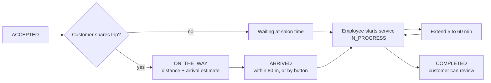

| Topic | Rule |
| --- | --- |
| Trip sharing window | From 3 hours before the appointment until its planned end |
| Position updates | The browser sends the position about every 12 seconds while moving, and at least every 45 seconds. The server ignores updates closer than 8 seconds |
| Arrival estimate | Straight-line distance × 1.35 road factor, at 28 km/h city speed, plus 2 minutes. Shown as an estimate |
| Arrival | Automatic within 80 m of the salon, or when the customer selects **I've arrived** |
| Privacy | Only the assigned employee and the owner see the customer's position, and only while `ON_THE_WAY`. The server deletes the coordinates on arrival, stop, completion or cancellation |
| Start | The assigned employee or the owner. Earliest 60 minutes before the appointment, on the same day. One employee can serve one client at a time |
| Extend | 5 to 60 minutes at a time, at most 120 minutes over the plan |
| Complete | From `ACCEPTED` or `IN_PROGRESS`. The customer can then write a review |
| Customer sees | Employee state: waiting for assignment, available, busy with another client (no details of that client), serving you, finished. Remaining time, progress and expected end |
| Employee sees | Whether the customer is on the way, distance, arrival estimate and expected arrival time, and a directions link to the customer's position |

| Event | Receiver |
| --- | --- |
| `BOOKING_CUSTOMER_ON_THE_WAY` | Assigned employee |
| `BOOKING_CUSTOMER_ARRIVED` | Assigned employee |
| `BOOKING_SERVICE_STARTED` | Customer |
| `BOOKING_COMPLETED` | Customer |

The arrival estimate sits behind a `TravelTimeEstimator` interface. A routing provider with traffic data can replace the distance estimate without a change to the API.

### 5.10 Appointment life cycle and salon holidays

Version 2.2.0 closes the gaps of the booking life cycle. A background job on the API checks every minute. Each booking is changed in its own transaction, and each notification has a unique event key, so a repeated run sends nothing twice.

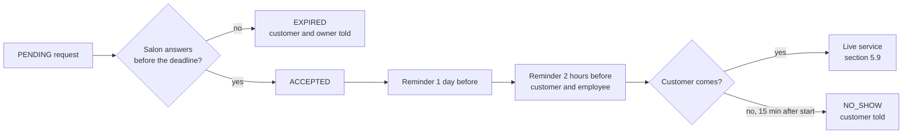

| Rule | Value |
| --- | --- |
| Answer deadline | 24 hours after the request, but never later than the appointment start |
| Expiry | At the deadline, a `PENDING` request becomes `EXPIRED`. Open reschedule proposals are cancelled. The held employee time becomes free |
| Late accept | The API rejects an accept after the deadline, also before the job runs |
| Deadline in the interface | The customer sees "The salon answers by …". The owner sees "Answer by … · time left"; under 3 hours it is marked urgent |
| Reminders | `DAY` from 24 hours before, to the customer. `SOON` from 2 hours before, to the customer and the assigned employee. A later reminder replaces an earlier one that was not sent |
| No-show | The assigned employee or the owner can mark a confirmed appointment `NO_SHOW` from 15 minutes after the start, when the customer is not checked in. It cannot be undone |
| Salon holiday length | 1 to 60 days, both dates included |
| Holiday planning window | Must include today or a later day, and must start within one year |
| Holiday overlap | Not allowed with another closure of the same salon |
| Holiday note | Optional, up to 255 characters, shown to guests |
| Effect on booking | No times on closed days; the wizard shows `SALON_CLOSED` with the next open date, and the owner cannot assign an employee for a closed day |
| Existing appointments | The response counts the pending and confirmed appointments inside the new closure, so the owner can move or cancel them |

The owner manages holidays on the salon edit page in the panel **Days the salon is closed**. The public salon page shows upcoming closures under the description; on a closed day it shows "Closed today".

| Event | Receiver |
| --- | --- |
| `BOOKING_EXPIRED` | Customer and owner |
| `BOOKING_REMINDER` | Customer (`DAY` and `SOON`) and assigned employee (`SOON`) |
| `BOOKING_NO_SHOW` | Customer |

### 5.11 Administration

The admin dashboard is a separate application so that administrative code and sessions stay apart from the public web application. It contains these pages: sign-in, overview, analytics, activity, reports, salons, salon detail, users, person detail and administrator profile.

The analytics endpoint returns totals for users (active, blocked, owners, employees, career profiles), salons by state, bookings by state, gross and completed booking value, and a monthly trend.

### 5.12 Payments

Version 2.3.0 delivers step A of payments: everything that works without a card provider. Steps B and C add card payment later, on the same data model.

| Step | Scope | State |
| --- | --- | --- |
| A. Cash and records | Method choice in the wizard, payment record and ledger, **Cash received**, receipts, unpaid list, owner summary, owner settings, commission field | Implemented |
| A+. CliQ transfer | The customer sends the money by CliQ to the salon's alias; the owner marks the booking as paid | Implemented (1.1.0) |
| B. Card after the service | Payment link after the service, provider webhook confirms the payment | Planned, needs a provider |
| C. Card now | Hold at booking, capture after the service, release on cancel, refunds, late-cancel and no-show fees | Planned, needs a provider |

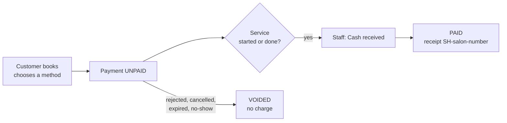

| Rule | Value |
| --- | --- |
| Money | Stored as whole fils (1 JOD = 1000 fils), never as floating point. The interface shows three decimals, for example `19.500 JOD` |
| Methods | `CASH`, `CLIQ` (bank transfer to the salon's CliQ alias, version 1.1.0), `CARD_POSTPAID` (card after the service), `CARD_PREPAID` (card now). Card methods need a connected provider; until then the API rejects them and the wizard shows them locked as "Coming soon" |
| Default | When the request has no method, the salon's first available method is used (cash) |
| Amount | Copied from the booking total when the booking is created. Later price changes do not change it |
| Who records cash | The assigned employee or the salon owner. Never the customer |
| When | Only while the service runs or after it is complete, and only for an unpaid payment that is not paid by card in advance |
| Repeat | Recording cash twice returns the same receipt and changes nothing |
| Method change | A guest who chose card after the service can still pay cash; the ledger keeps a `METHOD_CHANGED` entry |
| Receipt number | `SH-{salon id}-{payment id}`, for example `SH-1-000042` |
| Closing | Rejected, cancelled, expired and no-show bookings close their payment as `VOIDED` with a ledger entry. Nothing is charged |
| Free cancellation | 24 hours by default; the owner can set 0 to 168 hours |
| Fees | Late-cancel and no-show fee percents (0 to 100) are stored now and apply only to card-now bookings in step C. Cash guests never pay a fee |
| Commission | Stored on each payment as a rate and an amount. The rate is `0` and comes from configuration (`PAYMENT_COMMISSION_BPS`); a change applies only to new payments |
| Payouts | Each salon receives its own money (sub-merchant model in step B and C). Salonhub holds no money |
| Card data | Never on Salonhub servers; the provider's hosted page will collect it |
| CliQ settings | The owner turns CliQ on and saves a CliQ alias (or mobile number) and an optional account name. The booking keeps a copy of the alias the customer saw |
| CliQ method switch | The customer can switch an unpaid `PENDING` or `ACCEPTED` booking between cash and CliQ before the visit starts |
| CliQ paid | Only the salon owner marks an accepted CliQ booking as paid, with an optional bank reference. The payment becomes `PAID` with a `CLIQ_RECEIVED` ledger entry and a receipt. Employees cannot do this. Salonhub does not hold or check the transfer |

| Screen | Who | What it shows |
| --- | --- | --- |
| Booking wizard, step 4 | Customer | Payment cards (cash, CliQ transfer with the alias when the salon accepts it, card after, card now), the total, and the free-cancellation rule |
| My Bookings | Customer | Method, amount and payment state on each booking; the CliQ alias and a cash/CliQ switch on an unpaid CliQ booking; **Receipt** after payment |
| Salon Bookings and My appointments | Owner and employee | The same payment line, with **Cash received** when collecting is allowed, **Paid by CliQ** (owner only) with an optional transfer reference, and **Receipt** after payment |
| Payments (`/owner/payments`) | Owner | Collected, cash, CliQ, card, still unpaid and net for today, 7 days, this month or 30 days; finished-but-unpaid list; payment settings, including the CliQ switch, alias and account name |
| Receipt | All three | Salon, guest, appointment, method, lines and total. The owner also sees commission, net and the ledger |

| Event | Receiver |
| --- | --- |
| `PAYMENT_RECEIVED` | Customer |

**Missed-visit rule (version 2.4.0).** On Pro and Business the owner can set a no-show limit in the payment settings. When a customer reaches that number of `NO_SHOW` bookings at the salon, `NoShowDepositRule` asks for payment in advance by card. While no card provider is connected, the customer cannot book that salon online and is told to contact the salon.

### 5.13 Salon plans

Only salons pay. One enum, `SubscriptionPlan`, holds every price, limit, card fee and feature, so all checks (`PlanLimits`) read from one place. Money is in fils.

| Item | Free | Pro | Business |
| --- | --- | --- | --- |
| Monthly price | 0 | 15 JOD | 25 JOD |
| Yearly price | 0 | 150 JOD | 250 JOD |
| Team members (owner included) | 3 | 8 | No limit |
| Services | 15 | No limit | No limit |
| Open hiring posts | 1 | 3 | No limit |
| Longest analytics period | 7 days | 90 days | 366 days |
| Salonhub fee on card payments | — (cash only) | 3% | 2% |
| Card payments, cancellation fees, missed-visit rule, email reminders, advanced analytics, plan badge | — | Yes | Yes |
| CSV export, search boost, salon manager role | — | — | Yes |

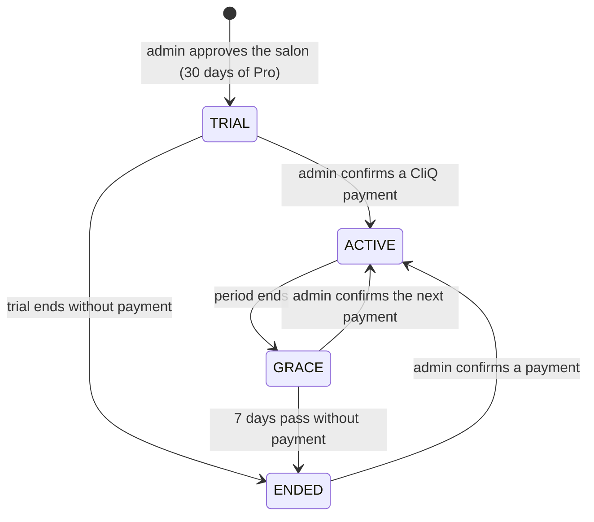

| Rule | Value |
| --- | --- |
| Trial | When an administrator approves a new salon, it gets 30 days of Pro (`TRIAL_PLAN`, `TRIAL_DAYS`) |
| Grace | After a paid period ends, the plan works for 7 more days (`GRACE_DAYS`) |
| Dates win | A trial or period whose end date has passed counts as Free at once, even before the job updates the status |
| Job | `SubscriptionLifecycleScheduler` runs every hour. It ends trials and unpaid plans and sends each reminder notice once (`last_notice_key`) |
| Paying | The owner chooses a plan and a monthly or yearly cycle on `/owner/plan`, sends a CliQ transfer to the Salonhub alias (`BILLING_CLIQ_ALIAS`) and enters the reference. This creates a `subscription_payment` request. The owner can cancel a request that is still open |
| Review | An administrator confirms or rejects each request on the dashboard Plans page. Confirming starts the period. Admins can also grant time or change a salon's plan |
| Limits | Adding a team member, a service or an open hiring post above the plan limit is refused with a clear message |
| Visibility | Business salons come first in salon lists (search boost). Pro and Business salons show a plan badge |

### 5.14 Languages

| Part | Behaviour |
| --- | --- |
| Interface | Every page uses `t()` and the message files in `src/shared/i18n/messages`. The chosen language is saved and sets `lang` and `dir` on the page; `rtl.css` mirrors the layout for Arabic. The language switch is in the header and on `/settings` |
| Owner-written text | `salon_service.name_ar`, `salon_service.description_ar` and `salon.description_ar` (migration V3). The web application shows them through `localized()` when the page is in Arabic and the Arabic is not blank |
| Translation | `ContentTranslationService` asks Claude for Arabic after a save commits, on one background thread (`translationExecutor`). At start it also translates older rows that have no Arabic. Without `ANTHROPIC_API_KEY`, nothing is translated and the English shows |
| Owner correction | The service and salon forms show the Arabic fields. `ArabicText.resolve` keeps a correction until the English changes; a blank field asks for a new translation |
| Bookings | A booked service shows its Arabic name only while the live service still has the same English name as the booking copy |

### 5.15 Leave on time

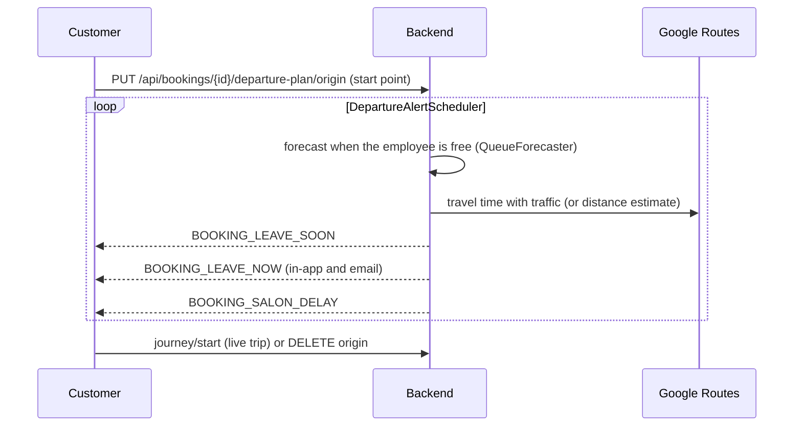

| Rule | Value |
| --- | --- |
| Consent | Only accepted bookings, and only after the customer shares a start point. The point is deleted when the live trip starts, on arrival, on completion, or when the customer turns the alerts off |
| Expected start | `QueueForecaster` walks the employee's accepted and running bookings of the day. It scales each duration by the employee's real pace from the last 20 timed services (between 0.85 and 1.4, with at least 3 samples) and adds a 5-minute allowance for an overrun |
| Leave time | Expected start minus travel time minus a 5-minute arrival buffer |
| Alerts | "Leave soon" 15 minutes before the leave time; "Leave now" at the leave time (also by email); "Salon running late" for each 15 minutes that the expected start moves later (`DELAY_ALERT_MINUTES`, `DELAY_ALERT_WINDOW` = 4 hours) |
| Travel time | `GoogleRoutesTravelTimeEstimator` uses the Routes API with traffic when `GOOGLE_MAPS_API_KEY` is set; otherwise the distance estimate from version 2.1.0 is used |

---

# Part II. Planning

## 6. Requirements

### 6.1 Functional requirements

| ID | Requirement | State |
| --- | --- | --- |
| FR-01 | A visitor can register a unique validated account, verify the email address, recover a forgotten password, and sign in securely | Implemented |
| FR-02 | A user has one profile that can be extended with career information | Implemented |
| FR-03 | A user can request a salon, and an administrator governs activation | Implemented |
| FR-04 | Owners and users create and decide employment relationships through controlled workflows | Implemented |
| FR-05 | Owners publish vacancies and receive each application ranked by transparent fit rules | Implemented |
| FR-06 | Administrators can reversibly restrict non-admin users and salons | Implemented |
| FR-07 | Customers can discover active salons and their services | Implemented |
| FR-08 | Customers can request future appointments within salon and employee availability | Implemented |
| FR-09 | Owners decide bookings, assign qualified employees, and complete accepted appointments | Implemented |
| FR-10 | Customers can publish a verified salon review after a completed owned booking | Implemented |
| FR-11 | The platform notifies participants about workflow changes inside the application | Implemented (in-app inbox and email, version 2.4.0); push delivery is planned |
| FR-12 | Members can publish posts, comment, like, add friends and follow salons | Implemented |
| FR-13 | Members can report content, and administrators record a decision for each report | Implemented |
| FR-14 | Administrators can see platform analytics and user activity | Implemented |
| FR-15 | Owners can see one operational dashboard for the owned salon | Implemented |
| FR-16 | Users can search pages and people from each page | Implemented |
| FR-17 | An assistant answers questions and gives suggestions from live platform data only | Implemented |
| FR-18 | Customers can pay for appointments online | Partial: method choice and cash are implemented; card needs a provider |
| FR-19 | Operators can deploy, monitor, migrate, back up and recover the system | Partial: deploy, Flyway migrations, health probes and a backup procedure exist; monitoring and tested restores remain |
| FR-20 | Owners can set the salon location on a map, and visitors can view it and get directions | Implemented |
| FR-21 | Owners can record whole-day employee time off, and booking availability excludes it | Implemented |
| FR-22 | Customers can let the salon assign the employee, and the owner cannot accept a booking without one | Implemented |
| FR-23 | When a date is full, customers see the reason and the next free date | Implemented |
| FR-24 | Customers can share their trip, and the assigned employee sees the distance and arrival estimate | Implemented |
| FR-25 | Customers can follow the service progress and expected end, and staff can start, extend and complete it | Implemented |
| FR-26 | A pending request that the salon does not answer in 24 hours expires, and both sides are told | Implemented |
| FR-27 | Customers receive reminders one day and two hours before a confirmed appointment | Implemented |
| FR-28 | Owners can close the whole salon on chosen days, and nobody can book on those days | Implemented |
| FR-29 | Staff can record a no-show 15 minutes after the start of a confirmed appointment | Implemented |
| FR-30 | Staff can record a cash payment once, and the customer receives a receipt | Implemented |
| FR-31 | Owners can see collected and unpaid money for a period and set accepted methods, free-cancel hours and fees | Implemented |
| FR-32 | Every payment change is kept in an append-only ledger with the person who made it | Implemented |
| FR-33 | Salons have a plan with limits and features; an approved salon gets a 30-day Pro trial; owners pay by CliQ and administrators confirm | Implemented |
| FR-34 | Users can use the whole web application in Arabic or English, with a right-to-left layout for Arabic | Implemented |
| FR-35 | Owner-written service and salon text is available in Arabic, translated automatically and correctable by the owner | Implemented |
| FR-36 | Customers can get leave-soon, leave-now and salon-delay alerts based on travel time and the employee's pace | Implemented |
| FR-37 | Important events reach users by email | Implemented |
| FR-38 | Customers can confirm that they will come to a booking | Implemented |
| FR-39 | A Business owner can export a period's bookings as CSV and name salon managers | Implemented |
| FR-40 | Sign-in sessions survive page reloads, can be revoked on the server, and are never readable by page scripts | Implemented |

### 6.2 Non-functional requirements

> **Status:** The targets below define production acceptance criteria. They are requirements for release planning and are not claims about the current runtime.

| Category | Production target | Current assessment |
| --- | --- | --- |
| Availability | Define an uptime objective and maintenance policy before launch | Not defined |
| Performance | Establish p95 latency targets per API class and test realistic data volumes | Not measured |
| Scalability | Support stateless horizontal API scaling with shared revocation and persistence services | Sessions are stored in MySQL (2.4.0), so instances share them. Scheduled jobs and in-memory rate limits still run per instance |
| Security | TLS, managed secrets, least privilege, dependency scanning, and authorization tests | Partial |
| Reliability | Transactional state changes, idempotency where required, and recovery procedures | Partial |
| Data integrity | Versioned migrations, constraints, locking, and production backup validation | Flyway migrations and `ddl-auto=validate` (2.4.0); a backup restore is not yet tested |
| Privacy of location | Customer position only with consent, only to the assigned staff, deleted after the trip | Implemented for live tracking |
| Freshness | Live appointment data at most 15 seconds old while the page is visible | Implemented through polling; push delivery is planned |
| Observability | Structured logs, metrics, traces or correlation IDs, dashboards, and alerts | Health and liveness probes only (2.4.0); the rest is planned |
| Accessibility | Frontend journeys should target WCAG 2.2 AA | Partial: visible focus states, reduced-motion support, labelled fields and keyboard-safe dialogs (2.4.0); no full audit yet |
| Localization | Define supported languages, locale-sensitive dates, and message strategy | Implemented for Arabic and English (2.4.0) |

## 7. Delivery history

The product was built in small reviewed slices. The backend repository starts on 8 July 2026. Chapter 27 gives the current commit counts.

| Phase | Period | Delivered |
| --- | --- | --- |
| 1. Foundation | July to September 2026 | Accounts, JWT security, salon requests and approval, employment requests, first hiring post workflow |
| 2. Hiring and governance | Late September 2026 | Ranked applications, unified career profile, hiring post life cycle, reversible blocking, safe DTOs, externalized secrets |
| 3. Booking | October 2026 | Service catalog, capabilities and schedules, server-calculated slots, booking life cycle, rescheduling, notification inbox, verified reviews |
| 4. Trust and experience | Late October to early November 2026 | Verified registration and password recovery, owner dashboard, plum and gold design system, salon location and media |
| 5. Community and administration | November 2026 | Community, friend notifications, moderation reports, admin dashboard with analytics and activity, global search, community workspace redesign |
| 6. Assistance | November 2026 | Lamsa assistant (API, chat page, floating chat, home page picks), refined buttons, focus states, card motion and application background |
| 7. Live appointments | 16 November 2026 | Map location picker and directions, four-step booking wizard, employee time off, owner assign-and-accept, live trip and service tracking, six new notification events, safe update of old salon fields, enum-to-text column upgrade |
| 8. Appointment life cycle | 16 November 2026 | Automatic expiry of unanswered requests, answer deadline in the interface, day and two-hour reminders, salon holidays, no-show marking, three new notification events |
| 12, step A. Payments without a provider | 16 November 2026 | Payment method in the wizard, payment record and ledger, cash received, receipts, unpaid list, owner payments page and settings, commission field kept at 0 |
| 13. Email delivery | 17 November 2026 | Shared email service with branded templates, welcome, sign-in alert and password-changed emails, email copies of notifications by priority, employment and hiring emails, profile pictures, Cloudinary media for posts, sign-in rate limits, no SQL in production logs |
| 18. Salon plans | 20 to 21 November 2026 | Free, Pro and Business plans, trial, CliQ plan requests and admin review, hourly plan job, plan limits, plan badge and search boost, customer attendance confirmation, missed-visit rule, SQL owner summary, CSV export, salon manager role |
| 9 and 15. Production readiness and localization | 22 November 2026 | Cookie sessions with rotating refresh tokens, Flyway migrations, CI for all repositories, health probes and graceful shutdown, Arabic interface and Arabic salon content, leave-on-time alerts, loading skeletons, one error page, settings page, keyboard-safe dialogs, production environment list and deploy plan |
| Release 1.0.0 | 23 November 2026 | First production release: API on Render with TiDB Cloud, website and admin dashboard on Vercel, email through the Brevo HTTPS API, a TiDB-safe Hibernate dialect, phone menu fixes, Git tags and GitHub releases in all repositories |
| Release 1.1.0 | 24 November 2026 | CliQ transfer as a booking payment method (phase 12), overlap and own-salon booking rules, friend-request notifications without a salon (migration V4), configurable sign-in limit |

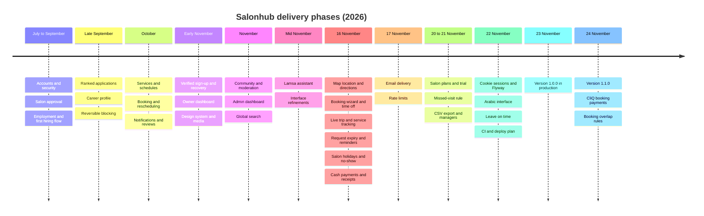

Chapter 31 holds the detailed revision history of this document.

## 8. Roadmap and next phases

The phases below are in priority order. The numbers continue after the delivered phases. A phase is added to chapter 7 after it is delivered and approved.

| Phase | Goal | Main work | State |
| --- | --- | --- | --- |
| 9. Production readiness | Run the product safely for real users | Managed database migrations, durable token revocation, structured logs, metrics, error tracking, backups, backend and admin CI, credential rotation | Partial: migrations, stored sessions, CI, health probes and the deploy plan delivered (2.4.0); in production since 23 November 2026; logs, metrics, alerts, tested backups and a shared scheduler lock remain |
| 10. API documentation | Give integrators one contract | OpenAPI description from the controllers, generated API client shared by both web applications | Planned |
| 11. Scheduling depth | Cover real salon calendars | Partial-day absences, calendar views, recurring appointments, owner-set answer windows, no-show history and deposits | Planned (time off delivered in phase 7; salon holidays, reminders, expiry and no-show in phase 8) |
| 12. Payments | Earn revenue from bookings | Step B: card after the service with a payment link and webhook. Step C: card now with hold, capture, release, refunds and fees. Then invoices and reconciliation | Step A delivered (2.3.0); CliQ transfer delivered (1.1.0); B and C need a provider decision |
| 13. Outbound notifications | Reach users outside the application | Email templates, push delivery, live updates over WebSocket or server-sent events instead of polling | Email delivered (2.4.0); push and live updates planned |
| 14. Reviews and reputation | Richer trust signals | Employee and service ratings | Planned |
| 15. Localization | Serve Arabic-speaking users fully | Arabic interface and right-to-left layout | Delivered (2.4.0). Remaining: receipts and the owner "top services" panel still show English service names |
| 16. Mobile | Native reach | Mobile applications on the same API, background trip sharing | Not yet planned in detail |
| 17. Routing accuracy | Better arrival estimates | Routing provider with live traffic behind the existing `TravelTimeEstimator` interface | Delivered (2.4.0) with the Google Routes API when a key is set |
| 18. Salon plans | Earn revenue from salons | Plans, trial, CliQ requests, admin review, limits | Delivered (2.4.0). Next: card billing for plans when a provider exists |

> **Reserved for later phases.** New phases are added to this table first, then described in a subsection of this chapter with goal, scope, acceptance criteria and dependencies.

## 9. Risks

### Risk register

| ID | Risk | Impact | Likelihood | Treatment |
| --- | --- | --- | --- | --- |
| R-01 | Resolved in version 2.4.0: in-memory logout blacklist | High | Resolved | Sessions are stored in `auth_sessions`; logout and password changes revoke them; refresh tokens rotate |
| R-02 | Resolved in version 2.4.0: automatic schema update | High | Resolved | Flyway applies V1 to V5; Hibernate only validates (`JPA_DDL_AUTO=validate`) |
| R-03 | Earlier credentials remain in Git history | High | Medium | Rotate every exposed value and use deployment secrets |
| R-04 | Authorization coverage is incomplete across the full API surface | High | Medium | Add route and service authorization tests |
| R-05 | Employee capacity and notification idempotency need database-backed contention verification | High | Medium | Add MySQL contention tests around accepted-booking locks and duplicate event keys |
| R-06 | Missing retention and deletion policy creates privacy ambiguity | Medium | High | Approve data-governance policy before launch |
| R-07 | Production logs and monitoring are not yet designed | High | High | Implement observability requirements and runbooks |
| R-08 | Resolved in version 2.2.0: salon-wide holidays | Medium | Resolved | Salon closures remove whole days from availability and assignment |
| R-09 | Card processing and reconciliation are not implemented; cash and receipts are (2.3.0) | High | Certain | Choose a provider with sub-merchant payouts and a hosted card page, then build steps B and C behind the existing `PaymentGateway` interface |
| R-10 | Employee and service ratings are not implemented | Low | High | Approve per-booking rating dimensions and edit policy before extending verified reviews |
| R-11 | Frontend salon-media calls have no matching backend routes | Medium | Certain | Define media ownership, storage, moderation, DTOs, and persistence before enabling the page |
| R-12 | Swagger UI security paths exist without the Springdoc runtime dependency | Low | Certain | Add and configure a compatible Springdoc/OpenAPI dependency before publishing Live API Test |
| R-13 | Resolved: Spring Security 401/403 responses use the application `ApiResponse` envelope | Medium | Resolved | Custom authentication entry point and access-denied handler preserve status codes and clear messages; nine filter-chain integration tests cover rejected and permitted requests |
| R-14 | The owner dashboard still shows booking value, not received money | Medium | High | The Payments page (2.3.0) shows settled payment records; move the dashboard revenue card to the same source |

### Entity exposure

Employment, leave, user-listing, salon-listing, and requested-salon routes return dedicated DTOs. Remaining controllers should be audited for direct JPA entity responses before deployment.

### Secret management

Current source configuration obtains database credentials, SMTP credentials, and the JWT signing key from environment variables. Previously committed credentials remain in Git history and must be rotated before deployment. Production infrastructure should inject the replacement values through its secret manager.

### Token revocation

Resolved in version 2.4.0. Each sign-in creates a row in `auth_sessions`. The access token lasts 15 minutes and names its session; the refresh token lasts 14 days, is stored only as a hash, and changes on each use. Logout, a password reset and a password change revoke the sessions, so a stolen token stops working within 15 minutes at most.

### Data integrity and concurrency

Hiring-post position reservation, post lifecycle changes, linked transfer cancellation, booking decisions, accepted-appointment overlap checks, notification event keys, and one-review-per-booking creation use transactional locks or database constraints. Employee-capacity mutations, notification retries, and review creation should receive database-backed concurrency tests before deployment.

### Error and validation consistency

The approved API contract represents business outcomes through the existing `ApiResponse<T>` envelope and its `success` and `error` factories. `ApiResponse.error` now prevents blank reasons, and the frontend preserves useful response and transport details through one shared normalizer. Future validation work must keep this response structure and must not introduce a new HTTP-status strategy or centralized exception handler. Remaining consistency work should standardize field validation and security-filter responses within this contract.

### Schema lifecycle

Resolved in version 2.4.0. Flyway owns the schema (`src/main/resources/db/migration`). V1 is the baseline of the full schema; an existing database without Flyway history is marked as version 1 on first start (`baseline-on-migrate`) and receives only the newer migrations. Hibernate runs with `ddl-auto=validate`. Tests build an H2 schema from the entities and do not run Flyway.

### Risks added in version 2.0.0

| ID | Risk | Effect | Mitigation |
| --- | --- | --- | --- |
| R-15 | Resolved in version 2.4.0: no migration tool | — | Flyway applies the migrations in order; see "Schema lifecycle" |
| R-16 | Resolved in version 2.4.0: CI only for the web application | — | The backend runs `mvnw verify`, and the admin dashboard runs lint, typecheck and build on every push |
| R-17 | The assistant depends on an external AI service | An outage or a cost increase affects AI replies | Guide mode answers without the service; a rate limit caps use; the model name is configuration |
| R-18 | User-written community content | Harmful content can stay visible until an administrator acts | Reports and admin review exist; automatic filtering is not implemented |
| R-19 | One author wrote the product | Knowledge is concentrated in one person | This document, the tests and the enforced code structure reduce the dependence |

### Risks added in version 2.1.0

| ID | Risk | Effect | Mitigation |
| --- | --- | --- | --- |
| R-20 | The customer's live position is personal data | Misuse or a leak harms the customer | Sharing starts only by customer action, is visible to the assigned staff only, and the server deletes coordinates after the trip. A written retention policy is still needed (chapter 22) |
| R-21 | The arrival estimate uses distance, not real roads or traffic | The employee can see an estimate that is too short or too long | The interface labels it as an estimate; a routing provider can replace it (phase 17) |
| R-22 | Live views poll every 15 seconds | Many open pages create load on the API | Polling stops when the tab is hidden; push delivery is planned (phase 13) |
| R-23 | `LegacyEnumColumnUpgrade` changes three MySQL columns from `ENUM` to `VARCHAR` on start-up | A failed change at deploy time stops new status values from saving | The change keeps all stored values, runs only when the column is still `ENUM`, and logs each conversion. Check the deploy log once. Since version 2.4.0 the Flyway baseline already has these columns as `VARCHAR` |
| R-24 | A pending request that names an employee holds that time | A customer who never gets a decision blocks the employee | The owner sees pending requests first; resolved in version 2.2.0: requests expire 24 hours after creation, or at the appointment start |

### Risks added in version 2.2.0

| ID | Risk | Effect | Mitigation |
| --- | --- | --- | --- |
| R-25 | The life cycle job runs inside each API instance | Two instances do the same checks; a stopped instance delays expiry and reminders | Each change locks the booking and checks its state again, and event keys stop duplicate notices. Accept rejects overdue requests even when the job is late. A shared scheduler lock (for example ShedLock) is planned with phase 9 |
| R-26 | A no-show is the staff's decision and cannot be undone | A wrong mark can upset a customer who came late | It is allowed only 15 minutes after the start and only when the customer is not checked in; the customer is told and is asked to contact the salon |
| R-27 | The answer window is fixed at 24 hours for all salons | A slow salon loses requests; a fast salon could use a shorter window | The value is one constant in `BookingTimePolicy`; an owner setting is planned (phase 11) |
| R-28 | The database connection uses `serverTimezone=UTC` while the server clock uses local time | Raw SQL reads show times 3 hours behind the application | The application converts both ways, so its own reads are correct. Use the API, not raw SQL, to check times; agree one time zone in phase 9 |

### Risks added in version 2.4.0

| ID | Risk | Effect | Mitigation |
| --- | --- | --- | --- |
| R-33 | Free hosting plans can block outgoing SMTP ports | Sign-up codes and alerts do not arrive | The backend logs the SMTP sign-in result at start. If it fails on the host, move to an email API that sends over HTTPS |
| R-34 | Plan payments are checked by hand | A late review delays a salon's plan; a wrong confirmation gives a plan without payment | Requests wait in the dashboard queue with their CliQ reference; every decision stores the reviewer and time; the 7-day grace period covers short delays |
| R-35 | Machine translation can be wrong or can fail | Arabic text can mislead a customer, or stay English | The owner sees and corrects the Arabic; without the Claude key or on an error the English shows; translation runs on one thread so it cannot flood the API |
| R-36 | Google Routes calls cost money and need a key | High use raises cost; a missing key lowers accuracy | The key is optional and stays on the backend; without it the distance estimate is used; calls run only for bookings with alerts turned on |
| R-37 | Cookie sign-in needs the API on the same site as the web page | If Vercel stops forwarding `/api`, or `VITE_API_BASE_URL` points to another domain, sign-in fails | `vercel.json` forwards `/api` to Render; the deploy plan says to remove `VITE_API_BASE_URL` on Vercel |
| R-38 | Rate limits and scheduled jobs live in each API instance | With several instances, limits are per instance and jobs run twice | One instance is enough for version 1; jobs lock rows and use event keys; a shared store and scheduler lock are planned in phase 9 |

### Risks added in version 2.3.0

| ID | Risk | Effect | Mitigation |
| --- | --- | --- | --- |
| R-29 | **Cash received** depends on the staff's word | A wrong or false record shows money that the salon does not have | Only the assigned employee or the owner can record it; the ledger keeps who and when; the customer is told at once and can object; the owner sees every entry |
| R-30 | No card provider is chosen | Steps B and C cannot start; card methods stay locked | The `PaymentGateway` interface, card statuses and ledger types exist; the choice needs a business decision (local acquirer support, sub-merchant payouts, fees) |
| R-31 | Bookings made before 2.3.0 have no payment record | They show no payment line and are not in the unpaid list or the totals | Intended: no back-fill guesses money that was never recorded. The owner can see them in Salon Bookings as before |
| R-32 | The commission rate is server configuration | A wrong value affects every new payment until a restart | The value is validated at start (0 to 10000 basis points); each payment stores its own rate and amount, so a change never rewrites history |

---

---

# Part III. Design

## 10. System architecture

### 10.1 System context

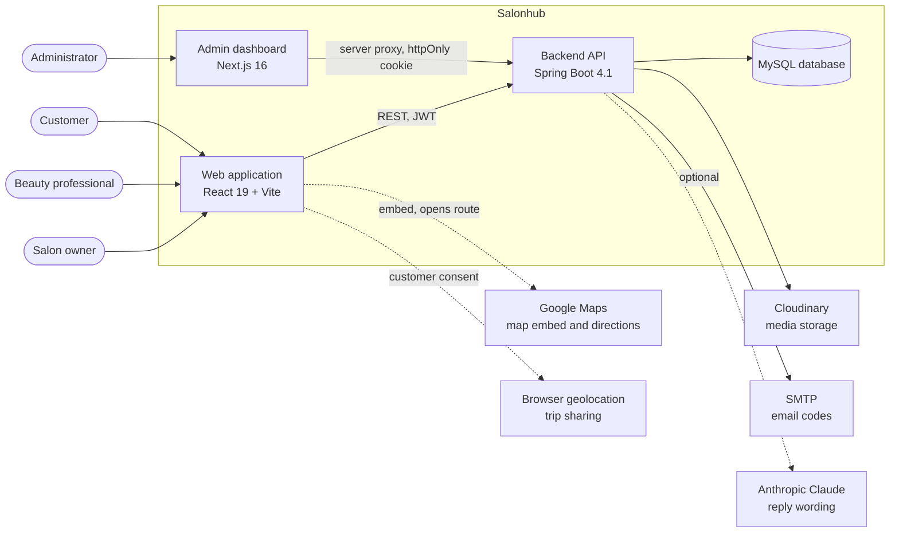

The API is the only business gateway. Both web applications hold no business rules that the API does not enforce again.

### 10.2 Runtime and deployment view

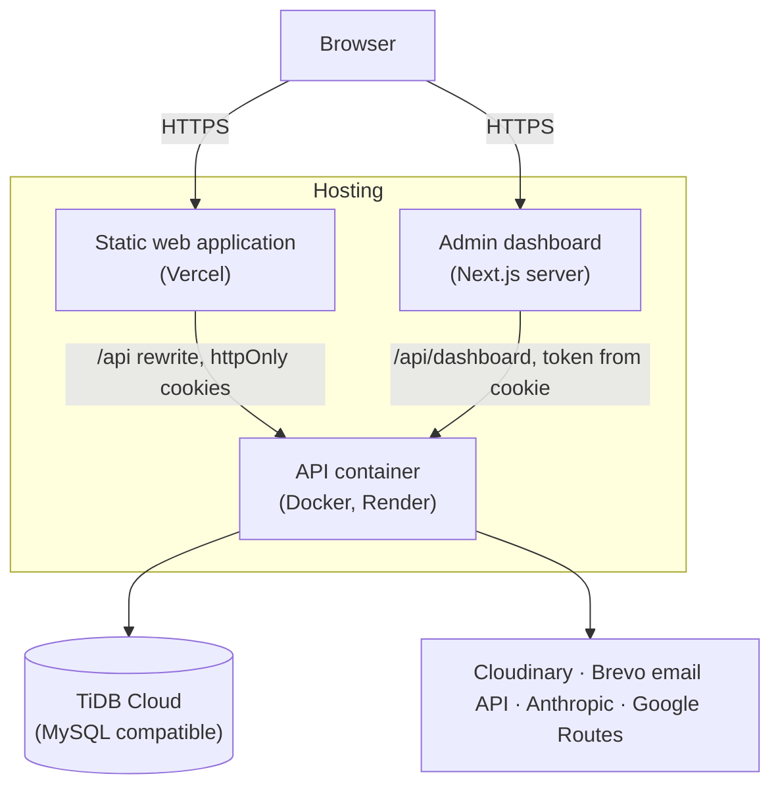

### 10.3 Layers of the backend

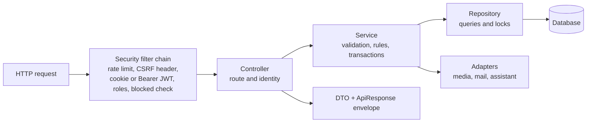

| Layer | Owns | Must not own |
| --- | --- | --- |
| Controller | Route mapping, request binding, authenticated identity | Business decisions or direct repository work |
| DTO | External request and response shape | Persistence behavior |
| Service | Validation, authorization, state transitions, transactions | HTTP rendering |
| Repository | Query intent, locking, persistence access | Product policy |
| Entity | Persisted state and relationships | Client-facing contracts |

### 10.4 Layers of the web application

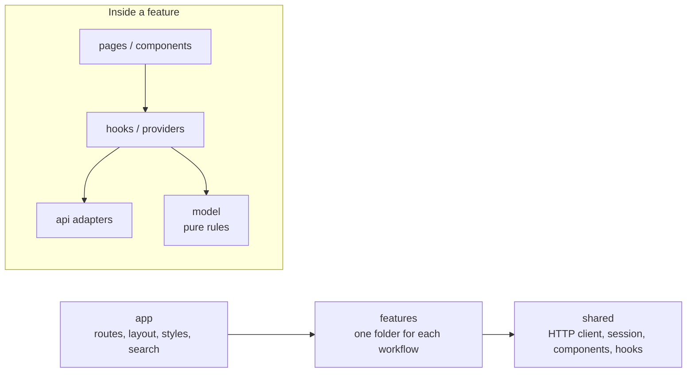

ESLint enforces these rules: `shared` cannot import `features` or `app`; views cannot import API modules; `model` files cannot import React, the router or the HTTP client.

### 10.5 Key architecture decisions

| Decision | Reason |
| --- | --- |
| JWT subject is the immutable user ID | Email and username changes do not break sessions |
| DTOs at each external boundary | Passwords and entity graphs never leave the API |
| One `ApiResponse<T>` envelope (`success`, `message`, `data`) | Both web applications handle success and errors in one way |
| Pessimistic locks and entity versions on sensitive transitions | No double booking, double hiring or double review under load |
| Availability is calculated and re-checked on the server | A stale or modified client cannot book an unavailable time |
| Notification written in the same transaction as the booking change | An event exists only if the change happened |
| Admin dashboard is a separate application with a server-side proxy | The admin token stays in an httpOnly cookie and never reaches browser scripts |
| The assistant loads facts first and lets the model write only the wording | No invented salons, ratings or jobs |
| Media goes through a backend storage abstraction | The Cloudinary secret never reaches the browser, and the provider can be replaced |
| Secrets come from environment variables | No production secret is committed |
| The server builds the map link from the coordinates | No client-supplied URL is stored or shown to visitors |
| The salon pin has its own endpoint | An old profile field that breaks a newer rule cannot block a location change |
| Live tracking is a separate controller and an embedded `BookingTracking` value | The booking life cycle stays simple, and tracking fields are cleared in one place |
| Arrival estimate behind the `TravelTimeEstimator` interface | A routing provider can replace the distance estimate without an API change |
| Enum columns are stored as `VARCHAR` | New status values can be added without a database `ALTER` for each value |
| Polling every 15 seconds only while the tab is visible | Live data without a socket server; low cost while the user is away |

## 11. Application behaviour and flows

### 11.1 Use cases by role

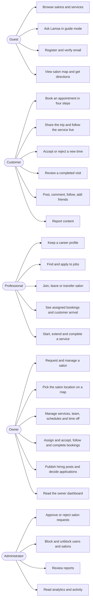

### 11.2 Main journey through the application

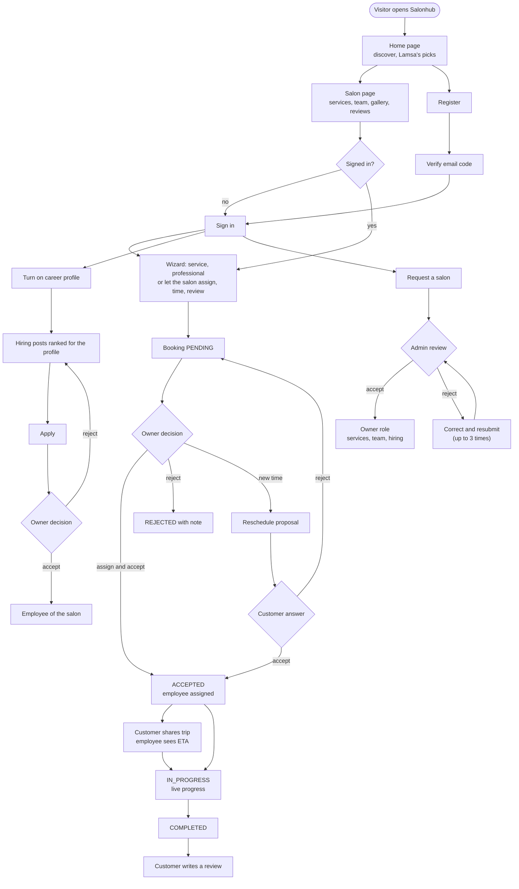

### 11.3 Registration, verification and password recovery

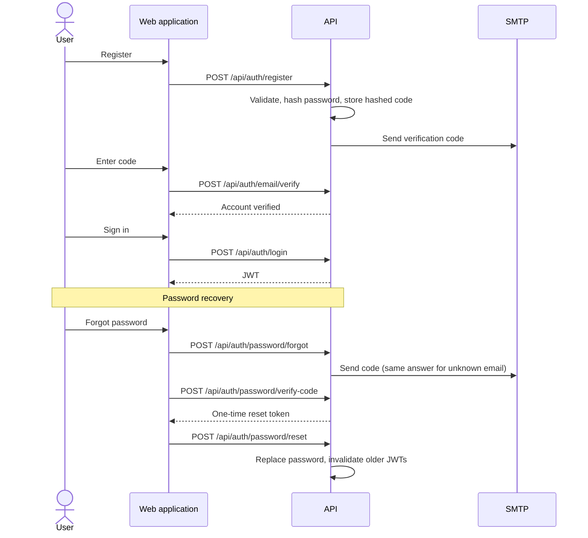

### 11.4 Salon request life cycle

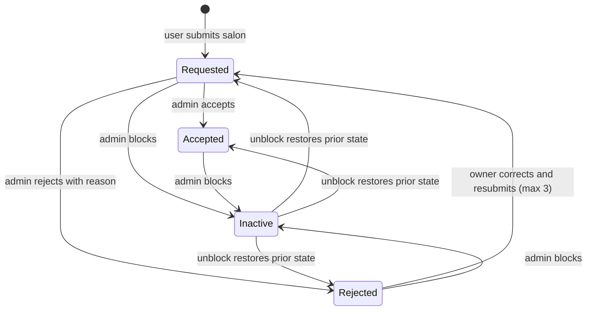

### 11.5 Appointment slot decision

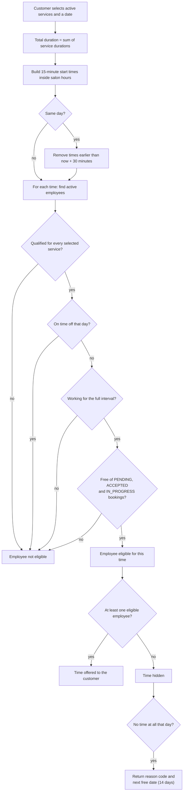

The same checks run again when the customer submits the booking and when the owner accepts it. A running service that is extended holds the employee until its new expected end.

### 11.6 Booking sequence

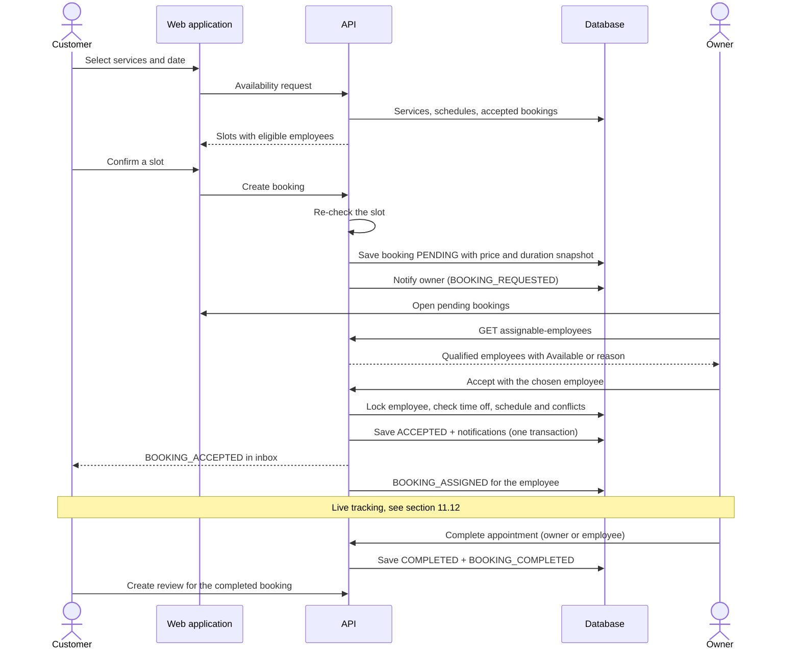

### 11.7 Booking life cycle

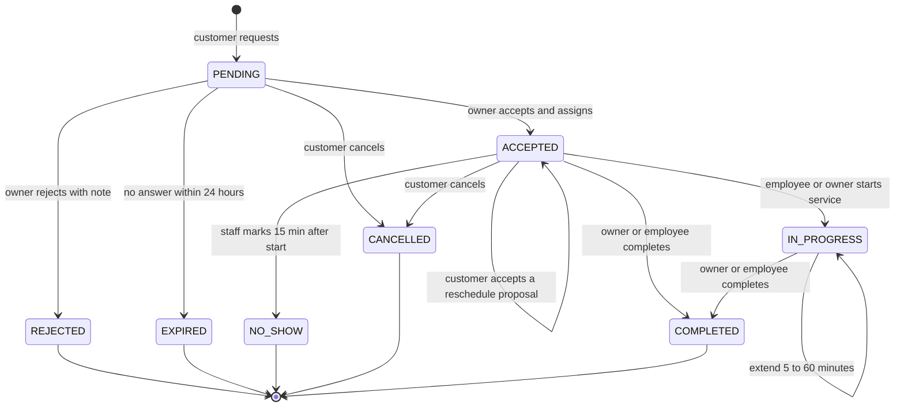

### 11.8 Hiring and employment

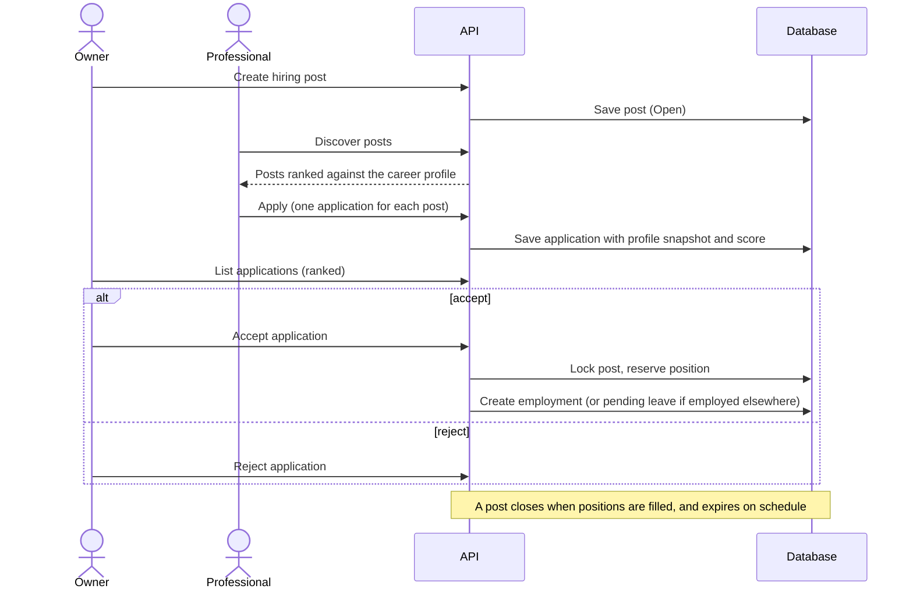

### 11.9 Community and moderation

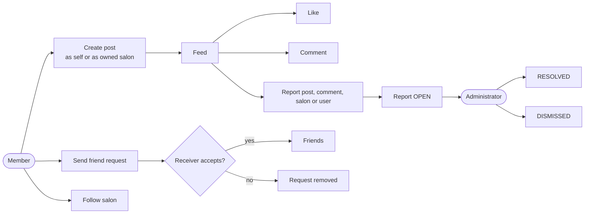

### 11.10 Lamsa reply

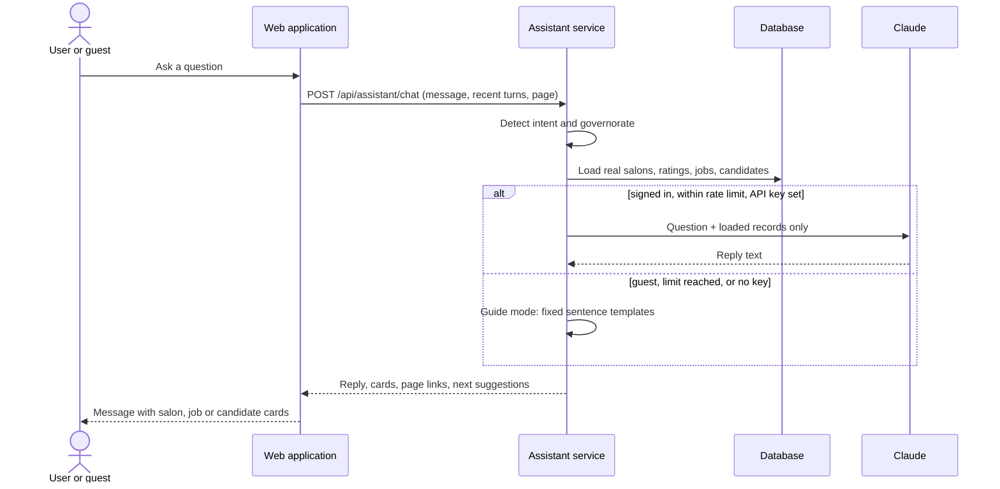

### 11.11 Notification delivery

```mermaid
sequenceDiagram
    participant S as Booking or community service
    participant D as Database
    participant W as Web application
    actor U as Recipient
    S->>D: State change + notification (same transaction)
    loop every 30 seconds and when the tab becomes visible
        W->>D: GET /api/notifications/unread-count
    end
    U->>W: Open inbox
    W->>D: GET /api/notifications
    U->>W: Open a notification
    W->>D: PUT /api/notifications/{id}/read
    W-->>U: Go to the related page
```

A booking notification opens the booking list with `?bookingId=<id>`. The list scrolls to that booking and highlights it.

### 11.12 Live appointment tracking

```mermaid
sequenceDiagram
    actor C as Customer
    participant W as Web application
    participant A as API
    actor E as Employee
    C->>W: Start trip (up to 3 h before)
    W->>A: POST tracking/journey/start (position)
    A->>A: Distance x 1.35 at 28 km/h + 2 min
    A-->>E: BOOKING_CUSTOMER_ON_THE_WAY
    loop about every 12 s while moving
        W->>A: PUT tracking/journey/position
    end
    alt within 80 m or customer selects "I've arrived"
        A->>A: ARRIVED, delete coordinates
        A-->>E: BOOKING_CUSTOMER_ARRIVED
    end
    E->>A: POST tracking/service/start
    A-->>C: BOOKING_SERVICE_STARTED, expected end
    opt the work needs more time
        E->>A: POST tracking/service/extend (5 to 60 min)
    end
    E->>A: POST tracking/service/complete
    A-->>C: BOOKING_COMPLETED, review is open
    loop every 15 s while the page is visible
        W->>A: GET tracking
    end
```

### 11.13 Employee time off

```mermaid
flowchart LR
    o(["Owner"]) --> add["Add time off<br/>start, end, reason"]
    add --> v{"Valid?<br/>1-90 days, not past,<br/>no overlap"}
    v -- no --> err["Error message"]
    v -- yes --> save["Save time off"]
    save --> count["Count pending and confirmed<br/>appointments in the period"]
    count --> warn["Owner reassigns them"]
    save --> avail["Availability skips the employee<br/>reason TIME_OFF"]
```

## 12. Domain model

### 12.1 Entity relationships

```mermaid
erDiagram
    USER ||--o| SALON : owns
    USER }o--o| SALON : "works at"
    SALON ||--o{ SALON_SERVICE : offers
    USER ||--o{ EMPLOYEE_SERVICE : "can perform"
    SALON_SERVICE ||--o{ EMPLOYEE_SERVICE : "performed by"
    USER ||--o{ EMPLOYEE_SCHEDULE : "works on"
    USER ||--o{ EMPLOYEE_TIME_OFF : "is away on"
    SALON ||--o{ EMPLOYEE_TIME_OFF : records
    SALON ||--o{ SALON_CLOSURE : "is closed on"
    USER ||--o{ BOOKING : requests
    SALON ||--o{ BOOKING : receives
    BOOKING ||--|{ BOOKING_SERVICE : snapshots
    BOOKING ||--o{ RESCHEDULE_PROPOSAL : has
    BOOKING ||--o| SALON_REVIEW : "verified by"
    USER ||--o{ USER_NOTIFICATION : receives
    SALON ||--o{ HIRING_POST : publishes
    HIRING_POST ||--o{ HIRING_APPLICATION : receives
    USER ||--o{ HIRING_APPLICATION : submits
    USER ||--o{ EMPLOYMENT_REQUEST : "joins through"
    USER ||--o{ LEAVE_REQUEST : "leaves through"
    USER ||--o{ COMMUNITY_POST : writes
    SALON ||--o{ COMMUNITY_POST : "publishes as"
    COMMUNITY_POST ||--o{ COMMUNITY_COMMENT : has
    COMMUNITY_POST ||--o{ COMMUNITY_POST_LIKE : has
    USER ||--o{ FRIENDSHIP : requests
    USER ||--o{ SALON_FOLLOW : follows
    USER ||--o{ MODERATION_REPORT : files
    SALON ||--o{ WORK_MEDIA : shows
    USER ||--o{ AUTH_SESSION : "signs in with"
    SALON ||--o| SALON_SUBSCRIPTION : "is on a plan"
    SALON_SUBSCRIPTION ||--o{ SUBSCRIPTION_PAYMENT : "paid by"
    BOOKING |o--o| BOOKING_PAYMENT : "paid by"
    BOOKING_PAYMENT ||--o{ PAYMENT_TRANSACTION : records
    USER ||--o{ USER_ACTIVITY_DAILY : "is active on"
```

The diagram shows the main relationships. Sections 12.2 and later describe each entity.

**Schema source (version 2.4.0).** The MySQL schema has 37 tables. Flyway creates and changes them: `V1__baseline_schema.sql` (36 tables), `V2__auth_sessions.sql` (`auth_sessions`) `V3__arabic_content.sql` (Arabic columns), `V4` (notifications without a salon: `user_notification.salon_id` and `salon_name` can be null) and `V5` (CliQ columns on `salon_payment_settings` and `booking_payment`). At start-up, `PaymentCheckConstraintUpgrade` drops old CHECK constraints that list the allowed payment methods, so `CLIQ` can be saved. A new column or table needs a new `V<n>__<name>.sql` file; never edit an applied migration.

### 12.2 Community and moderation entities

| Entity | Main fields | Notes |
| --- | --- | --- |
| Community post | Author, optional salon, content, optional media URL, created and updated time | The salon is set only when the owner publishes as the salon |
| Community comment | Post, author, content, created time | |
| Community post like | Post, member | One for each pair |
| Friendship | Requester, addressee, status (`PENDING`, `ACCEPTED`) | |
| Salon follow | Member, salon | |
| Moderation report | Reporter, target type, target ID, reason, details, status, admin note | Status `OPEN`, `RESOLVED` or `DISMISSED` |

### User

A user stores identity and account information: first name, last name, email, username, BCrypt password hash, phone number, role, status, and an optional salon assignment. The same entity also stores an optional career section containing career-mode status, date of birth, years of experience, skills, preferred work locations, résumé URL, portfolio URL, and professional biography.

The product exposes one unified profile. Registration fields appear automatically in it. Career mode enriches that profile instead of creating a second account or profile. Career skills and preferred locations use collection tables so users may provide multiple values.

`emailVerified` prevents newly registered accounts from signing in before ownership is confirmed. `credentialsUpdatedAt` records the latest password change and invalidates earlier JWTs. Since version 2.4.0 the user also stores a profile picture (`profile_picture_url`, `profile_picture_public_id`), the salon manager flag (`salon_manager`) and the join date at the current salon (`salon_joined_at`). Legacy accounts with a null verification flag remain compatible and are treated as verified.

User status values are `Active`, `Blocked`, and `Deleted`.

### Authentication verification code

The authentication verification record stores the normalized email, purpose, hashed code, expiry, failed-attempt count, consumption time, and optional hashed reset-token authorization. Verification codes expire after 10 minutes, resend is throttled for 60 seconds, five failed attempts consume the code, and reset authorization is one-time and short lived. Raw codes and reset tokens are delivered to the user but are never stored in the database.

### Salon

A salon stores its name, salon phone, owner phone, email, location, description, owner, employees, current and maximum employee counts, creation date, opening and closing times, profile picture URL, approval status, and opening status. Reversible administration also stores the status that existed before a block, independent owner-block and direct admin-block flags, and the owner's role before a direct salon block.

Salon approval status values are `Inactive`, `Requested`, `Accepted`, `Rejected`, and `DELETED`.

Since version 2.4.0 the salon also stores `description_ar`, the Arabic version of the salon story.

### Authentication session

Table `auth_sessions` (version 2.4.0) holds one row for each sign-in: a UUID id, the user, the client (`WEB` or `ADMIN`), the SHA-256 hash of the current refresh token and of the previous one, created, last-used and expiry times, the revoke time and the browser's user agent. Raw refresh tokens are never stored. A session is valid while it is not revoked and not expired.

### Salon subscription and plan payment

Table `salon_subscription` holds one row for each salon: plan (`FREE`, `PRO`, `BUSINESS`), status (`TRIAL`, `ACTIVE`, `GRACE`, `ENDED`), billing cycle, trial end, current period start and end, grace end and the key of the last reminder sent. Table `subscription_payment` holds each plan request: plan, cycle, amount in fils, currency, method, CliQ reference, period, status, the owner who asked, the administrator who reviewed it, the review time and a rejection reason. Prices, limits and features are not stored; they come from the `SubscriptionPlan` enum (section 5.13).

### Salon service

A salon service belongs to one salon and stores a customer-facing name, optional description, their Arabic versions `name_ar` and `description_ar` (version 2.4.0), decimal price in Jordanian dinars, duration in minutes, active state, and creation and update timestamps. The public catalog returns only active services from an accepted, unblocked salon. The owner catalog includes both active and inactive records.

Disabling a service is a soft state change. The row remains available for later reactivation and for the booking history that will reference it. Only the authenticated owner of an accepted, unblocked salon may create, edit, activate, or disable its services.

### Employee service capability

An employee service capability links one active salon employee to one active service in the same salon. The authenticated owner replaces the employee's capability set through one request. The service validates ownership, employee membership, service membership, active states, and duplicate IDs before replacing the persisted links.

Capabilities determine which employees appear as suitable for a customer's selected services and which employees an owner may assign to a booking. One assigned employee must support every service item in that booking. Capability links are removed when an accepted leave or transfer removes the employee from the salon.

### Employee schedule and working period

An employee schedule belongs to one employee and contains zero or more weekly working periods. Each period stores a day of week, start time, and end time. Multiple non-overlapping periods can describe split working shifts. These periods describe scheduled work and do not define or schedule personal breaks.

The owner may configure up to 28 periods per employee. Every period must have a valid day and time range, remain inside the salon's opening hours, and avoid overlap with another period on the same day. Adjacent periods are valid. An employee without a saved schedule inherits the salon opening hours for backward compatibility; an explicitly saved empty schedule makes that employee unavailable for the entire week. Schedule records are removed when an accepted leave or transfer removes the employee from the salon.

### Employee time off

An employee time off record (table `employee_time_off`) stores the employee, the salon, an inclusive start date and end date, an optional reason of up to 255 characters, and the creation time. An index on employee, start date and end date keeps the availability check fast. The weekly schedule says when an employee normally works; time off removes whole dates from it. Rules are in section 5.7.

### Salon closure

A salon closure (table `salon_closure`) stores the salon, an inclusive start date and end date, an optional reason of up to 255 characters, and the creation time. An index on salon, start date and end date keeps the availability check fast. Rules are in section 5.10.

### Booking payment and ledger

A booking payment (table `booking_payment`) belongs to one booking through the booking's unique `payment_id` column. It stores the method, status, amount, refunded amount and commission in whole fils, the currency (`JOD`), the commission rate in basis points, a unique receipt number, the paid time, the person who confirmed it, an optimistic-lock version and audit times. An index on status and paid time serves the owner summary.

Each change adds a payment transaction (table `payment_transaction`): type (`CASH_RECEIVED`, `AUTHORIZE`, `CAPTURE`, `VOID`, `REFUND`, `METHOD_CHANGED`), amount, a unique idempotency key, an optional provider reference, the actor, an optional note and the time. Rows are only added, never changed. Bookings made before version 2.3.0 have no payment.

### Salon payment settings

Salon payment settings (table `salon_payment_settings`, one row per salon) store which methods the salon accepts, the free-cancel hours, the late-cancel and no-show fee percents and, since version 2.4.0, the no-show limit for the missed-visit rule. A salon without a row uses the defaults: cash only, 24 hours, no fees, no limit.

### Booking and service snapshot

A booking links the authenticated customer to one accepted, unblocked salon, an optional assigned employee, one or more service-item snapshots, and its reschedule-proposal history. It stores the current date and time, customer contact and location, customer note, owner note, total price, total duration, status, decision time, completion time, cancellation time, and audit timestamps.

Each booking service item copies the source service ID, name, price, and duration at booking creation. Later salon-service edits therefore do not rewrite historical booking totals or labels. Booking status values are `PENDING`, `ACCEPTED`, `IN_PROGRESS`, `REJECTED`, `CANCELLED`, `COMPLETED`, `EXPIRED` and `NO_SHOW`. The booking also stores the no-show time (`no_show_at`).

An employee cannot hold two overlapping busy bookings on the same date. Busy statuses are `PENDING` (when the request names the employee), `ACCEPTED` and `IN_PROGRESS`. Acceptance and reassignment lock the selected employee, compare the complete appointment interval against the busy appointments, and allow directly adjacent appointments. A running service that is extended uses its new expected end.

A booking also embeds a `BookingTracking` value for the live view: journey status (`NOT_STARTED`, `ON_THE_WAY`, `ARRIVED`), journey start time, customer latitude and longitude, position update time, distance in metres, arrival estimate in minutes, arrival time, service start time and expected end time. The customer coordinates, distance and estimate exist only while the customer is on the way; the server clears them on arrival, stop, completion and cancellation.

Since version 2.4.0 the tracking value also stores the leave-on-time start point (`plan_latitude`, `plan_longitude`, `plan_updated_at`) and the booking stores `customer_confirmed_at`, the time when the customer confirmed that they will come. The start point is cleared when the live trip starts, on arrival, on completion and when the customer turns the alerts off.

### Booking reschedule proposal

A reschedule proposal belongs to one booking and stores the proposing owner, required proposed date and time, optional note, status, creation time, and response time. Status values are `PENDING`, `ACCEPTED`, `REJECTED`, and `CANCELLED`. Only one pending proposal may exist per booking, while all decided proposals remain visible as history.

The current appointment and booking status remain unchanged while a proposal is pending. Accepting the proposal revalidates the complete appointment against current salon hours, employee capability and schedule, accepted-booking conflicts, the 15-minute grid, and the 30-minute same-day notice before changing the booking date and time. Rejecting keeps the original appointment. A terminal booking transition cancels any pending proposal.

### User notification

A user notification belongs to exactly one recipient and one booking. It stores the event type, message, unique event key, salon ID and name snapshots, booking date and time, optional proposed date and time, booking-status snapshot, frontend target path, creation time, and optional read time. Supported booking event types:

| Event type | Receiver | When |
| --- | --- | --- |
| `BOOKING_REQUESTED` | Salon owner | A customer sends a booking request |
| `BOOKING_ACCEPTED` | Customer | The owner accepts the request |
| `BOOKING_ASSIGNED` | Assigned employee | The owner accepts with this employee |
| `BOOKING_REJECTED`, `BOOKING_TIME_SUGGESTED` | Customer | The owner rejects, optionally with a suggested time |
| `BOOKING_RESCHEDULE_PROPOSED` | Customer | The owner proposes a new time |
| `BOOKING_RESCHEDULE_ACCEPTED`, `BOOKING_RESCHEDULE_REJECTED` | Owner, and the employee after acceptance | The customer answers a proposal |
| `BOOKING_EMPLOYEE_REASSIGNED` | Customer | The owner changes the employee |
| `BOOKING_CANCELLED` | Owner and assigned employee | The customer cancels |
| `BOOKING_CUSTOMER_ON_THE_WAY` | Assigned employee | The customer starts trip sharing |
| `BOOKING_CUSTOMER_ARRIVED` | Assigned employee | The customer arrives |
| `BOOKING_SERVICE_STARTED` | Customer | The service starts |
| `BOOKING_COMPLETED` | Customer | The service is complete; the review is open |

The recipient is resolved from trusted booking relationships rather than accepted from the client. Every publisher method requires an active transaction, so the booking transition and its notifications commit or roll back together. Deterministic event keys plus a database uniqueness constraint make retried actions idempotent.

### Salon review

A salon review links exactly one completed booking to its salon and customer. It stores an integer rating from one through five, an optional comment of up to 2000 characters, and its creation time. A database uniqueness constraint on the booking relationship enforces one review per booking in addition to service validation.

Public review lists and aggregate summaries are available only for accepted, unblocked salons and include reviews whose customer is currently active. Blocking a customer hides that customer's reviews without deleting them; unblocking restores their visibility. A customer may list and delete only their own reviews.

### Employment request

An employment request links a salon, sender, receiver, optional hiring post, status, request type, source, creation time, and optional rejection reason.

Request types are `Owner_Invite` and `User_Request`. Sources are `SALON_PROFILE` and `HIRING_POST`.

Employment request statuses are `Requested`, `Accepted_Pending_Leave`, `Accepted`, `Rejected`, and `Cancelled`.

### Leave request

A leave request records the employee, current salon, optional target salon, optional employment request, status, reason, and creation time. It supports both a normal departure and a transfer connected to an accepted employment request.

Leave request statuses are `Requested`, `Accepted`, and `Cancelled`.

### Hiring post

A hiring post belongs to one salon and stores:

- Title and detailed description.
- Required skills in a related collection table.
- Minimum and maximum applicant age.
- Required employee location.
- Minimum years of experience.
- Number of available positions.
- `Open`, `Closed`, or `Expired` status.
- A closure reason that distinguishes manual closure from closure caused by filled positions.
- Creation and expiration timestamps.

The backend obtains salon and owner details from the authenticated owner and database. The client cannot choose another owner or salon while creating a post. A version field and transactional write locks protect concurrent lifecycle and position updates.

### Hiring application

A hiring application links one applicant, hiring post, and employment request. It stores a submission-time snapshot of the applicant's date of birth, preferred work locations, years of experience, skills, optional résumé URL, optional portfolio URL, application note, and creation time.

Known identity fields including name, username, email, phone number, role, and user ID come from the authenticated user and are not accepted from the client. The linked employment request provides the application status and allows acceptance to reuse the existing employment and transfer workflows.

## 13. Domain state model

### Primary state transitions

| Aggregate | From | Trigger | To | Restorable |
| --- | --- | --- | --- | --- |
| User | Active | Administrator blocks a non-admin account | Blocked | Yes, to Active |
| Salon | Requested | Administrator accepts request | Accepted | No automatic rollback |
| Salon | Requested | Administrator rejects with reason | Rejected | Yes, through correction and resubmission |
| Salon | Accepted, Requested, or Rejected | Direct administrator salon block | Inactive | Yes, to exact prior state |
| Salon service | Active | Owner disables service | Inactive | Yes, through owner edit |
| Booking | PENDING | Owner accepts valid request | ACCEPTED | No; customer may cancel |
| Booking | PENDING | Owner rejects with required note | REJECTED | No |
| Booking | PENDING or ACCEPTED | Customer cancels owned booking | CANCELLED | No |
| Booking | ACCEPTED | Assigned employee or owner starts the service | IN_PROGRESS | No |
| Booking | ACCEPTED or IN_PROGRESS | Assigned employee or owner completes the appointment | COMPLETED | No |
| Booking | PENDING | Answer deadline passes (life cycle job) | EXPIRED | No; the customer books again |
| Booking | ACCEPTED | Assigned employee or owner marks a no-show, 15 minutes after the start | NO_SHOW | No |
| Booking payment | UNPAID | Staff record cash while the service runs or after it | PAID | No; refunds come in step C |
| Booking payment | UNPAID | Booking is rejected, cancelled, expired or a no-show | VOIDED | No |
| Booking payment | UNPAID or AUTHORIZED | Provider confirms a hold or a charge (steps B and C) | AUTHORIZED or PAID | Planned |
| Booking payment | PAID | Refund (step C) | PARTIALLY_REFUNDED or REFUNDED | Planned |
| Booking journey | NOT_STARTED | Customer starts trip sharing | ON_THE_WAY | Yes, customer stops sharing |
| Booking journey | ON_THE_WAY | Within 80 m, or customer confirms | ARRIVED | No |
| Hiring post | Open | Positions filled or owner closes post | Closed | Conditional reopen |
| Hiring post | Open | Expiration time passes | Expired | Yes, with future date and valid positions |
| Employment request | Requested | Receiver accepts available applicant | Accepted | Employment ends through leave workflow |
| Employment request | Requested | Receiver accepts applicant employed elsewhere | Accepted_Pending_Leave | Can cancel pending join |
| Leave request | Requested | Current owner accepts | Accepted | No automatic rollback |
| Salon subscription | TRIAL | Administrator confirms a plan payment | ACTIVE | — |
| Salon subscription | TRIAL | Trial end passes (hourly job) | ENDED (Free) | Yes, by a confirmed payment |
| Salon subscription | ACTIVE | Period end passes | GRACE | Yes, by a confirmed payment |
| Salon subscription | GRACE | 7 days pass without payment | ENDED (Free) | Yes, by a confirmed payment |
| Plan payment | PENDING | Administrator confirms or rejects; owner cancels | CONFIRMED, REJECTED or CANCELLED | No |
| Auth session | Active | Logout, password reset or change, expiry, or reuse of an old refresh token | Revoked or expired | No; the user signs in again |

### Invariants

- A user may apply to a specific hiring post only once.
- A hiring application never changes its career-data snapshot after submission.
- A salon must be `Accepted` for active employment and hiring operations.
- A public salon service must be active and belong to an accepted, unblocked salon.
- Only the authenticated salon owner may mutate that salon's service catalog.
- Disabling a salon service preserves its database identity for reactivation and future booking history.
- A booking contains at least one and at most ten unique active services from its salon.
- A requested appointment must be in the future and its complete duration must fit inside salon opening hours.
- An assigned employee must be active in the booking salon, support every selected service, and work for the complete appointment interval.
- An employee cannot be assigned to overlapping busy appointment intervals (`PENDING` with that employee, `ACCEPTED`, `IN_PROGRESS`); directly adjacent appointments remain valid.
- An employee on time off for a date is not available on that date.
- A booking cannot be accepted without an assigned employee.
- An employee serves one client at a time: a second service cannot start while one is `IN_PROGRESS`.
- A service runs at most 120 minutes longer than planned.
- Customer coordinates exist only while the journey is `ON_THE_WAY` and are visible only to the assigned employee and the owner.
- Time off periods of one employee do not overlap.
- Closures of one salon do not overlap, and nobody can book or be assigned on a closed day.
- A pending request cannot be accepted after its answer deadline.
- A customer who is checked in (`ARRIVED`) cannot be marked as a no-show.
- A booking made from version 2.3.0 has exactly one payment, and its amount equals the booking total at creation.
- A payment moves only along its allowed transitions; `VOIDED` and `REFUNDED` are final, and received money is refunded, never voided.
- Cash is recorded only by the assigned employee or the owner, only for an `IN_PROGRESS` or `COMPLETED` booking, and only once.
- A card method cannot be chosen or enabled while no payment provider is configured.
- Replacing an already assigned employee requires a nonblank owner explanation of at most 1000 characters.
- Notification recipients always come from authenticated or booking-owned server data; inbox reads and read-state updates are restricted to that recipient.
- A logical booking event has one unique notification event key, and its persistence shares the booking transaction.
- A missing employee schedule inherits salon hours; a saved empty schedule represents no availability.
- Only a pending booking can be accepted or rejected, only a pending or accepted owned booking can be cancelled, and only an accepted or in-progress booking can be completed.
- Booking service names, prices, and durations are immutable snapshots of the selected services at request time.
- Only the customer who owns a completed booking may create its single salon review.
- Review ratings are integers from one through five; comments are optional and limited to 2000 characters.
- A hiring post must be open, unexpired, and have a remaining position before application or acceptance.
- Employee counts and reserved positions change in the same transaction as the related employment decision.
- A direct salon block and an owner-derived block are independent; both must be removed before restoration.
- Direct salon unblocking restores the saved owner role and exact prior salon status.
- Deleted entities are not restored through block and unblock operations.

## 14. Experience and visual design

### 14.1 Brand

| Element | Definition |
| --- | --- |
| Name | Salonhub. The word mark sets "Salon" in upright type and "hub" in italic. |
| Mark | A comb arc with teeth around a gold hub |
| Primary color | Plum `#76546f` (dark theme `#c58eba`) |
| Accent color | Gold `#d7a86e` (dark theme `#e1b978`) |
| Background | Warm cream `#faf7f4` (dark theme `#141216`) |
| Typefaces | Fraunces Variable for headings, Inter Variable for interface text |
| Assistant | Lamsa: a speech bubble that holds the comb arc, with a gold spark for the "touch" |

### 14.2 Design tokens

All feature styles use shared tokens in `src/app/styles/tokens.css`.

| Scale | Values |
| --- | --- |
| Type | 11, 12, 13, 14, 16, 18, 20, 24, 32, 40, 48 and 64 px |
| Weights | 400, 500, 600, 700 |
| Spacing | 4 px grid: 4, 8, 12, 16, 20, 24, 32, 40, 48, 64 px |
| Radius | 6, 10, 16, 24 px and full; buttons use 4 px as part of the editorial style |
| Elevation | Four shadow levels, with separate dark-theme values |
| Motion | 120 ms (fast), 200 ms (base), 320 ms (slow), one standard ease-out curve |
| Breakpoints | 640 px, 900 px, 1200 px |

### 14.3 Interaction rules

- **Buttons:** four variants (primary, secondary, danger, success) and two sizes. Hover lifts the button on pointer devices only. A press settles it. A disabled button stays flat.
- **Focus:** each interactive element shows a visible focus ring for keyboard users. Form fields show a brand border and a soft ring.
- **Cards:** only cards that the user can open or act on lift on hover. Forms and layout panels do not move.
- **Scroll reveal:** home page sections fade and rise in about 1.2 to 1.4 seconds. Content that is on screen at first paint appears with no animation.
- **Background:** each page sits on a soft plum light, a low gold glow and a paper grain. It is CSS only and stays behind the content.
- **Lamsa launcher:** one short gesture every 6 seconds (spark, then comb teeth), then a rest. A greeting appears once in a session.
- **Reduced motion:** when the user asks for reduced motion, animations stop and content shows immediately.
- **Themes:** light and dark themes use the same tokens; colors come from theme variables.

### Visual design system

The application uses an editorial salon identity built around deep plum, warm gold, soft rose surfaces, and high-contrast neutral text. The same semantic color roles drive the navigation, cards, forms, dashboard, feedback components, and documentation. Components consume theme variables instead of feature-specific hard-coded colors so light and dark modes remain visually consistent.

| Token | Light value | Dark value | Use |
| --- | --- | --- | --- |
| Primary | `#76546F` | `#C58EBA` | Brand actions, active navigation, focus and diagram emphasis |
| Primary strong | `#5E4058` | `#D7A8CE` | Hover emphasis, headings, high-priority controls |
| Primary soft | `#F1E8EF` | Derived dark plum surface | Selected states, subtle panels, loader aura |
| Accent gold | `#D7A86E` | `#E1B978` | Highlights, status accents, premium visual details |
| Page background | `#FAF7F4` | `#141216` | Main application canvas |
| Card surface | `#FFFFFF` | `#211D23` | Cards, dialogs, forms, dashboard panels |
| Main text | `#292329` | `#F8F3F6` | Readable foreground content |
| Muted text | `#746B72` | `#B9AFB6` | Secondary labels and supporting copy |
| Border | `#E8DEDF` | `#423942` | Dividers, input outlines, non-destructive hover feedback |
| On primary | `#FFFFFF` | `#1D161C` | Text on filled primary and success buttons (WCAG AA in both themes) |
| Focus outline | `#76546F` | `#D7A8CE` | Solid 2px keyboard focus outline, at least 3:1 against surfaces |

Typography uses two self-hosted variable typefaces: Fraunces (`--font-display`) for editorial headings and Inter (`--font-body`) for interface text. Theme-independent scales live in `src/app/styles/tokens.css`: twelve type sizes (`--text-2xs` 11px to `--text-6xl` 64px), four weights (400, 500, 600, 700), spacing on a 4px grid, radius, elevation, layering, and motion durations. Feature stylesheets consume these tokens instead of literal values. Buttons are defined once in `buttons.css` and rendered through the shared `Button` component. Salons without a cover image show branded cover art (initials, scissors mark, plum gradient) rather than an empty block.

Hover states preserve the card's dark surface instead of replacing it with a light fill. They communicate interaction through a stronger border, restrained background modulation, shadow, and motion so text remains readable. Normal pages show the Salonhub wordmark once in the header; repeated full-brand blocks were removed from authentication content and the footer. Startup and route-transition states may show the brand because normal page chrome is not yet available.

### Loading and transition experience

Two coordinated loading patterns clarify what the application is doing:

- **Signature Snip action loader:** used for API operations such as signing in, registering, searching, booking, deciding a request, applying to a post, changing staff or services, and updating notifications. Animated scissors open and close with a small gold sparkle over a softened page backdrop. The message describes the current action instead of displaying a generic spinner.
- **Salonhub navigation loader:** used for initial application startup, lazy route loading, redirects, link navigation, programmatic navigation, and browser back or forward movement. It uses the primary brand mark and a destination-aware message without duplicating the header wordmark.

The shared loader store counts overlapping operations so one completed request cannot hide another request that is still running. Action overlays appear after 180 ms to avoid flicker and remain visible for at least 320 ms once shown. Route transitions remain visible for about 320 ms so navigation feels intentional without delaying the next page. The startup splash appears for 600 ms on the first load of a browser session only. Scroll reveals are short (360–420 ms), blur-free, and skipped for content already on screen at first paint. Background availability refresh and notification polling do not take over the screen. Both loaders respect light/dark tokens and reduced-motion preferences.

### Error presentation

The backend `ApiResponse.error(...)` factory trims supplied messages and guarantees a clear fallback when a caller provides a blank or null reason. On the client, one normalizer prioritizes the backend `message`, validation `errors`, or legacy `error` field and then maps timeouts, network failures, and HTTP status failures to understandable text. Axios interceptors preserve those details; feature hooks render them through the common toast or page-error components. A generic failure is used only when neither the server nor transport provides a useful reason.

---

# Part IV. Development

## 15. Technology stack

| Layer | Technology |
| --- | --- |
| Web application | React 19, React Router 7, Vite 8 |
| Web HTTP and feedback | Axios, React Toastify |
| Web styling and icons | Project CSS with design tokens, Tailwind CSS 4 foundation, Lucide React |
| Web tests and quality | Vitest, Testing Library, ESLint with architecture rules, Prettier |
| Admin dashboard | Next.js 16 (App Router), React 19, TypeScript 5, Tailwind CSS 4, Lucide icons |
| Backend language and framework | Java 17, Spring Boot 4.1, Spring Web MVC |
| Security | Spring Security, JWT, BCrypt |
| Persistence | Spring Data JPA, Hibernate |
| Database | MySQL in production; H2 in MySQL mode for local work and tests |
| Validation | Spring Validation plus service-level rules |
| Email | Spring Mail over SMTP |
| Media | Cloudinary through a backend storage abstraction |
| AI assistant | Anthropic Java SDK |
| Build and packaging | Maven, multi-stage Docker image |

## 16. Repositories and code structure

| Repository | Content | Main branch |
| --- | --- | --- |
| `salon-community-frontend` | Web application | `main` |
| `Salon-hub-backend` (`SalonBookingv2/backend`) | API, database scripts, this document | `master` |
| `SalonBookingv2/admin-dashboard` | Admin dashboard | separate repository |

### 16.1 Backend packages (`com.salon.backend`)

| Package | Content |
| --- | --- |
| `Config` | Security configuration, password hashing, JWT filter, CORS |
| `Controllers` | `Auth`, `Users`, `Salons` (salon, services, employees, bookings, reviews, employment, hiring, media), `Community`, `Moderation`, `Notifications`, `Owner`, `Dashboard` (admin), `Assistant` |
| `DTOs` | Request and response contracts for each area, and `ApiResponse` |
| `Entities` | `auth`, `users`, `salons`, `community`, `moderation`, `notifications`, `media` |
| `Repositories` | Spring Data repositories for each area |
| `Services` | Interfaces and implementations for each area, including `Activity` (admin activity) and `Assistant` |

### 16.2 Web application structure

```text
src/
  app/        routes, layout, navigation, global search, ordered styles
  features/   applications, assistant, auth, bookings, community, dashboard,
              employees, employment, hiring, home, media, moderation,
              notifications, profile, prototype, reviews, salons, services
  shared/     api, auth, components, config, hooks, notifications, theme, utils
  test/       test setup and architecture checks
```

Each feature holds only the layers that it needs: `pages`, `components`, `hooks`, `providers`, `api` and `model`.

### 16.3 Web routes

| Area | Routes |
| --- | --- |
| Public | `/`, `/salons/:salonId`, `/assistant`, `/prototype`, `/hiring-posts`, `/settings` |
| Authentication | `/login`, `/register`, `/verify-email`, `/forgot-password`, `/verify-reset-code`, `/reset-password` |
| Customer | `/salons/:salonId/book`, `/my-bookings`, `/notifications`, `/account/security` |
| Career | `/profile/career`, `/hiring-posts/:postId/apply`, `/my-applications`, `/employment` |
| Community | `/community`, `/community/discover`, `/community/requests`, `/community/following`, `/community/new`, `/community/people/:userId` |
| Owner | `/owner/dashboard`, `/owner/create-salon`, `/owner/my-salon`, `/owner/my-salon/edit`, `/owner/services`, `/owner/create-service`, `/owner/services/:serviceId/edit`, `/owner/employees`, `/owner/employees/:employeeId/setup`, `/owner/employment`, `/owner/bookings`, `/owner/payments`, `/owner/plan`, `/owner/create-hiring-post`, `/owner/applications` |
| Employee | `/employee/bookings` |

Route guards give navigation behavior only. The API enforces authorization for each operation. Unknown routes, missing records, blocked access and crashes all show the shared `ErrorPage` (version 2.4.0), and each route shows a page-shaped loading skeleton while its code and data load.

### 16.4 Admin dashboard structure

| Path | Purpose |
| --- | --- |
| `/login` | Administrator sign-in |
| `/` | Overview |
| `/analytics`, `/activity` | Platform numbers and user activity |
| `/reports` | Moderation queue |
| `/salons`, `/salons/[id]` | Salon requests, list and detail |
| `/users`, `/people/[id]` | User directory and detail |
| `/profile` | Administrator profile |
| `/api/admin/login`, `/api/admin/logout`, `/api/admin/[...path]` | Server routes that keep the token in an httpOnly cookie and forward calls to `/api/dashboard/*` |

### 16.5 Web and API connection

The browser uses `VITE_API_BASE_URL`, defaulting to `/api`. During local development, Vite proxies `/api` to `VITE_API_PROXY_TARGET`. In production the web application must call `/api` on its own domain: `vercel.json` forwards `/api/*` to the Render API, so the sign-in cookies are first-party. Since version 2.4.0 a different API origin breaks sign-in.

| Concern | Frontend behavior | Backend behavior |
| --- | --- | --- |
| Authentication | Holds no token. Sends cookies (`withCredentials`) and the `X-Requested-With: XMLHttpRequest` header, reads only the `salonhub_auth=1` hint, and on a 401 calls `/api/auth/refresh` once, then repeats the request or shows the session-expired page | Verifies account email before login, sets the session cookies, validates the access JWT and its stored session, resolves the immutable user ID, checks active state and credential-change time, and applies roles |
| Request lifecycle | Uses a 15-second timeout and abort signals for stale page requests | Binds DTOs, derives caller identity from the security principal |
| Success handling | Reads `ApiResponse.data`; feature hooks update UI and show success feedback | Returns `ApiResponse.success(message, data)` |
| Business failure | Shared normalization preserves `message`, validation `errors`, and legacy `error`; hooks show the result in a toast or page state | Returns `ApiResponse.error(message)` with `data: null`; blank reasons receive a safe fallback |
| Slow foreground action | Begins a contextual Signature Snip loading operation and keeps concurrent work visible | Completes or fails the requested transaction and returns the standard envelope |
| Route transition | Shows the branded navigation overlay for links, redirects, programmatic navigation, and history changes | Protected resources still enforce authentication and role authorization |
| Unauthorized session | Clears matching current credentials on HTTP 401; HTTP 403 does not sign the user out | Security may reject unauthenticated or unauthorized calls before the controller |
| Booking decisions | Polls customer bookings every 30 seconds only while the page is visible and reports accepted or rejected transitions | Persists booking state and owner note; returns scoped booking DTOs |
| Live tracking | Polls `GET /api/bookings/{id}/tracking` every 15 seconds while visible; sends the customer position through browser geolocation only after the customer starts the trip | Returns a viewer-shaped tracking DTO; hides the customer position from the customer view and other clients' details from everyone |
| Notification inbox | Connected inbox, bell, polling, unread count, and read controls | Persists recipient-scoped booking events and exposes paginated inbox, unread-count, and read-state APIs |
| Mapping differences | Salon and hiring adapters normalize backend field names for views | Keeps stable DTO names and pagination metadata |

### Runtime links and environment

- [Live API Test](http://localhost:8080/swagger-ui/index.html) - local Swagger UI address. It becomes usable when the backend is running and the Springdoc/OpenAPI dependency is enabled. The route is allowed by security, but the current Maven dependencies do not yet provide Swagger UI.
- Frontend local URL: `http://localhost:5173` when started with Vite's default development server.
- Backend local base URL: `http://localhost:8080/api`.

| Variable | Default | Use |
| --- | --- | --- |
| `VITE_API_BASE_URL` | `/api` | Browser API prefix; safe public configuration, never a secret |
| `VITE_API_PROXY_TARGET` | `http://localhost:8080` | Local Vite proxy target |
| Backend environment variables | Defined in backend `.env.example` | Database, JWT, SMTP, and runtime configuration |

### Integration coverage and gaps

| Capability | Frontend | Backend | Connection state |
| --- | --- | --- | --- |
| Auth and unified career profile | Registration, verification, login, recovery, and profile pages implemented | Verification codes, reset authorization, JWT invalidation, and unified profile implemented | Connected end to end |
| Public salons and service catalogs | Implemented | Implemented | Connected |
| Salon request and owner management | Implemented | Implemented | Connected |
| Hiring discovery, application, and decisions | Implemented | Implemented | Connected for current UI actions; edit, reopen, and cancel-join APIs have no current page control |
| Employee directory, capabilities, and schedules | Implemented | Implemented | Connected |
| Booking creation and customer, owner, employee views | Implemented (four-step wizard) | Implemented | Connected |
| Salon map location and directions | Location picker dialog, public map card and directions | Location-only endpoint, server-built link | Connected |
| Employee time off | Time off panel on the employee setup page | Time off API and availability filter | Connected |
| Owner assign-and-accept | Accept dialog with available employees and reasons | Assignable-employees endpoint, required employee on accept | Connected |
| Live appointment tracking | Customer, employee and owner live cards, trip sharing | Tracking API, distance estimator, six notification events | Connected |
| Booking assignment explanation | Implemented | Implemented | Connected; explanation is required when replacing an assigned employee |
| Persistent notification inbox | Implemented | Implemented | Connected with signed-in polling and refresh when the application becomes active |
| Server-calculated booking availability | Implemented | Implemented | Connected; the booking page renders qualified employees and selectable 15-minute slots |
| Customer-approved booking rescheduling | Implemented | Implemented | Connected; owners propose server-available slots and customers accept or keep the original appointment |
| Verified salon reviews | Implemented | Implemented | Connected |
| Direct employment, leave, transfer | No dedicated current pages | Implemented | Backend ready; frontend journey pending |
| Administration dashboard | No dedicated current pages | Implemented | Backend ready; frontend journey pending |
| Salon media | Device/Drive picker, previews, owner cover editor, public gallery, employee publisher | Cloudinary storage abstraction, signed server uploads, asset metadata and deletion | Connected; requires Cloudinary environment credentials |
| Swagger interactive testing | Link and allowed security path | Dependency absent | Enable Springdoc/OpenAPI before using Live API Test |

## 17. Business workflows

### Registration and login

Registration validates names, username format, supported email domains, Jordanian phone formats, password strength, and uniqueness of username, email, and phone number. New accounts receive the `USER` role and `Active` status, are marked unverified, and receive a six-digit email code. Passwords are stored as BCrypt hashes. The registration response tells the frontend that verification is required, that the code lasts 10 minutes, and that resend becomes available after 60 seconds.

Email verification compares a secret-backed hash, limits failed attempts, consumes the code after success, and marks the account verified. Login rejects unverified accounts and verifies account status and password. Since version 2.4.0 it then creates an `auth_sessions` row and sets three cookies: `salonhub_access` (access JWT, 15 minutes, httpOnly, path `/api`), `salonhub_refresh` (refresh token, 14 days, httpOnly, path `/api/auth`) and `salonhub_auth=1` (a readable hint with no secret). The response body has no token. `POST /api/auth/refresh` rotates the refresh token and issues a new access token. Logout revokes the session and clears the cookies.

Forgot-password requests return the same success response whether or not an account exists, preventing account enumeration. A valid six-digit recovery code produces a one-time reset token. Reset requires matching new and confirmation passwords, applies the shared password policy, replaces the BCrypt hash, consumes the authorization, and records `credentialsUpdatedAt` so older JWTs stop working immediately.

### End-to-end user journey

1. A visitor registers with first name, last name, username, email, phone number, and password.
2. Registration validates identity fields, uniqueness, supported formats, and password strength, then creates an active but email-unverified `USER` account and sends a short-lived verification code.
3. The user verifies the registered email, then logs in and receives a JWT whose subject is the immutable database user ID. The authenticated principal also exposes email and role without accepting identity from the client.
4. `GET /api/profile` returns one unified profile populated with the identity information already collected during registration.
5. The user may keep the normal profile or select the client action represented by "Make your profile career."
6. `PUT /api/profile/career` validates and stores the career section, then enables career mode on the same profile.
7. The hiring feed loads open, unexpired posts from accepted salons with available positions. Career users receive personalized labels and ordering; normal-profile users receive the standard filtered feed plus a prompt to enable career mode.
8. A career user applies with only an optional application note. The backend obtains identity and career data from the database and stores an application snapshot.
9. The salon owner reviews every application ordered by match level and score, then accepts or rejects it.
10. Acceptance reuses employment rules: an available applicant joins immediately, while an existing employee enters the transfer and leave workflow.

### Owner dashboard journey

An authenticated owner opens `/owner/dashboard`. The route guard requires an active session and the `OWNER` role before rendering the page; backend authorization remains authoritative for every requested resource. The dashboard resolves the owner's salon from authenticated identity and composes scoped salon data, employees and their service capabilities, customers with completed bookings, booking revenue values, verified salon ratings, and operational totals. Employee performance combines completed booking count, services delivered, and received ratings so the owner can identify strong performance without exposing another salon's data. Non-owners are redirected away from the workspace and cannot obtain its protected data through direct API calls.

### Shared interaction-feedback journey

When a user starts a foreground operation, the relevant feature hook supplies an action-specific message to the shared loading service. The Signature Snip overlay appears only when the operation lasts beyond the short delay, keeps the underlying page visually present but de-emphasized, and remains active until all overlapping operations finish. On success, the page updates and a success message may be shown. On failure, the client displays the exact useful backend reason from `ApiResponse`; transport-only failures receive a clear network, timeout, authentication, authorization, not-found, or server message. Navigation uses the separate Salonhub brand loader and covers declarative links, redirects, programmatic navigation, and browser history movement.

### End-to-end appointment journey

1. A customer opens an accepted salon and receives its active services and active employees with their service capabilities.
2. In the wizard the customer selects one to ten unique services, then an employee qualified for every selected service or **Let the salon assign**, then a free date and time.
3. The backend calculates immutable price and duration totals, checks salon hours, time off, and the selected employee's complete working interval.
4. The booking is stored as `PENDING`, the owner receives `BOOKING_REQUESTED`, and the customer sees it in personal booking history.
5. The salon owner opens the request, selects a qualified available employee, and accepts, or rejects the request.
6. Acceptance repeats capability, time off and schedule validation and requires an employee. The customer receives `BOOKING_ACCEPTED`, the employee `BOOKING_ASSIGNED`. Rejection stores a required owner note and may include a suggested time.
7. The assigned employee sees the booking in the employee-scoped list. The customer may cancel while it remains pending or accepted.
8. On the appointment day the customer may share the trip. The employee sees the distance and arrival estimate, and is told when the customer arrives.
9. The employee or owner starts the service (`IN_PROGRESS`), may extend it, and completes it (`COMPLETED`). The customer follows the progress and the expected end.
10. The customer may create one verified salon review linked to that completed booking.
11. Public salon pages may display visible reviews and the aggregate average while preserving administrative block and restore behavior.

### Unified profile and career mode

Every authenticated user has one profile. Basic identity fields come from registration and are never re-entered to activate career mode. Career activation requires date of birth, nonnegative years of experience, at least one skill, and at least one preferred work location. Skills and locations are trimmed and deduplicated case-insensitively.

Résumé, portfolio, and professional biography are optional. When supplied, a résumé must be an absolute HTTP or HTTPS URL whose path ends in `.pdf`, while a portfolio must be an absolute HTTP or HTTPS URL with a valid host. The service stores links only and does not fetch remote content. Profile completion assigns 80 percent to the four required career sections and the remaining 20 percent to résumé, portfolio, and biography.

The same career endpoint activates a normal profile and updates an existing career profile. Career mode becomes active only after all required career information passes validation.

### Salon onboarding

1. An authenticated user submits salon information.
2. The service validates the salon name, Jordanian city, description, email, phone number, opening hours, and employee capacity.
3. The salon is created with `Requested` status.
4. An administrator reviews the request.
5. Acceptance changes the salon to `Accepted` and promotes its user to `OWNER`.
6. Rejection requires a reason, stores it on the salon, and changes the salon to `Rejected`.
7. The owner can view the reason, correct the rejected salon details, and explicitly resubmit the same request.
8. Each resubmission clears the previous reason and returns the salon to `Requested`. A salon may be resubmitted at most three times.

Only the salon owner can update or resubmit the owned salon through the service ownership check. Editing alone does not resubmit a rejected salon. A rejected owner cannot create a second salon request to bypass the resubmission limit. Acceptance, rejection, and resubmission use transactional write locks.

### Reversible user and salon blocking

Dashboard administrators can block or unblock non-admin users and salons. Administrators cannot block an account whose role is `ADMIN`; approval by the future application owner is planned before administrator-to-administrator blocking is introduced. Deleted users and salons are outside this workflow.

Blocking a normal user or employee changes the account status from `Active` to `Blocked`. The JWT filter reloads account state for every authenticated request, so both new login attempts and already-issued tokens stop granting access while the account remains blocked. Unblocking returns the account to `Active` without deleting profile, application, or employment history.

Blocking a salon directly is different from blocking its owner. The owner account remains active, but the owner's current role is saved and temporarily changed to `USER`. The salon's current approval status is saved and changed to `Inactive`. Hiring posts, applications, employment links, and other related records remain persisted but become unavailable through the accepted-salon business checks. Unblocking restores the exact previous salon status and owner role, making records that were valid before the block usable again.

Blocking a salon owner blocks the owner account and makes the owned salon inactive while preserving the owner's role. Direct salon blocks and owner-derived blocks are tracked independently. If both restrictions apply, removing only one keeps the salon inactive; the salon is restored only after both restrictions are removed. Transactional pessimistic locks protect these state transitions.

### Salon service catalog

An authenticated owner whose salon is accepted and unblocked can create a service with a required name, positive price, and positive duration. Description is optional. Names are trimmed to 100 characters, descriptions to 1000 characters, and prices use at most two decimal places within the persisted precision.

The owner management endpoint returns active and inactive services so disabled entries remain editable and may be reactivated. Update requests can change the name, description, price, duration, and active state. The delete route performs a soft disable and returns the updated DTO rather than deleting the row.

Public clients can list the active services of a salon without authentication. The service layer first verifies that the salon is accepted and unaffected by either administrator or owner-derived blocking, then queries only active services ordered by name. Response DTOs expose the service contract without serializing the salon entity graph.

### Employee directory and capabilities

Authenticated clients can list active employees for an accepted, unblocked salon. The salon owner can list the same scoped team through an owner route. Employee responses include identity details appropriate for discovery plus the service IDs and names the employee can perform.

The salon owner replaces an employee's service capabilities using service IDs. All selected services must be active and belong to the owner's salon. These capabilities are enforced again by booking creation, acceptance, and assignment, so a manipulated client cannot select or assign an unqualified employee.

### Weekly employee schedules and ad hoc absences

The owner can read or replace a current employee's weekly schedule. A schedule accepts multiple working periods per day. Gaps between periods are outside scheduled working hours; they are not configured break times. An employee may also become unavailable unexpectedly, for example to eat, smoke, or leave. The owner can assign the affected appointment to another qualified employee and add an update for the customer. Validation rejects missing values, reversed ranges, periods outside salon opening hours, overlaps, and more than 28 periods.

When no employee schedule has ever been configured, booking validation treats the salon's opening and closing times as the employee's working period. Once an empty schedule is explicitly saved, the employee is unavailable all week. This distinction preserves existing employee behavior while allowing owners to disable appointment availability intentionally.

### Appointment availability, request, and decision

An authenticated customer first requests availability using a salon ID, one to ten unique service IDs, a date, and an optional employee ID. The backend calculates the total duration, finds employees who support every selected service, removes employees on time off, loads their weekly schedules and busy bookings (`PENDING` with that employee, `ACCEPTED`, `IN_PROGRESS`) in batches, and returns selectable times at 15-minute intervals. A same-day slot must start at least 30 minutes after the current server time. When no time is free, the response adds `unavailableReason` and `nextAvailableDate` (searched up to 14 days ahead).

When no employee is selected, a slot is returned when at least one fully qualified employee is free, and the response lists every eligible employee for that time. When an employee is selected, only that employee's availability is considered. An employee without a configured schedule inherits the salon hours; an explicitly empty schedule means unavailable all week.

The customer creates the booking using one returned time plus the salon, services, location, optional phone override, optional note, and optional employee ID. The backend loads the customer and salon, verifies every service is active and belongs to that salon, defaults the phone number from the profile when omitted, calculates price and duration, and saves service snapshots. It revalidates the exact slot before persistence so elapsed time, a newly accepted appointment, or a manipulated request cannot create an unavailable booking.

If the customer selects an employee, that employee must be active in the salon, support every selected service, not be on time off, and work for the complete appointment interval. The complete interval must also fit within salon opening hours. The owner may accept a pending request with an employee (the API rejects acceptance without one), reject it with a required note, or assign a qualified available employee to a pending or accepted booking. `GET /api/bookings/{bookingId}/assignable-employees` lists the qualified employees for the exact booking time with `available` and a `reason` (`TIME_OFF`, `NOT_WORKING` or `BUSY`). Replacing an employee who is already assigned requires an owner explanation, which is stored as the customer-visible owner note. Acceptance and assignment repeat capability and schedule validation because availability may have changed since creation.

Customers receive their own booking history and can cancel an owned pending or accepted booking. Salon owners receive all owned-salon bookings or a pending-only queue. Employees receive only bookings assigned to them. The owner completes an accepted or in-progress booking after the visit. Business outcomes continue through the shared `ApiResponse` envelope.

### Employee time off workflow

1. The owner opens the employee setup page and the **Time off** panel.
2. The owner enters a start date, an end date and an optional reason.
3. The API checks that the salon is accepted and owned, that the employee works there, and the rules of section 5.7.
4. The API saves the record and returns it with `affectedBookings`, the number of pending and confirmed appointments of this employee inside the period.
5. The panel lists upcoming time off. The owner can remove a record; availability returns at once.

### Salon holiday workflow

1. The owner opens the salon edit page and the panel **Days the salon is closed**.
2. The owner enters a start date, an end date and an optional note for guests.
3. The API checks that the caller owns this accepted, unblocked salon, and the rules of section 5.10.
4. The API saves the closure and returns it with `affectedBookings`. When it is more than zero, the panel links to **Salon Bookings** so the owner can move or cancel those appointments.
5. The public salon page and the booking wizard use the closure at once. The owner can remove it; the days open again.

### Request expiry and reminder workflow

1. Every minute, the life cycle job finds `PENDING` requests whose answer deadline has passed.
2. For each one, it locks the booking, checks the state and the deadline again, sets `EXPIRED`, cancels open reschedule proposals and notifies the customer and the owner.
3. Then it loads the confirmed appointments of today and tomorrow and sends the reminder that is due (`DAY` or `SOON`). The event key `booking:{id}:reminder:{type}:{receiver}` makes each reminder unique.

### No-show workflow

1. From 15 minutes after the start, the live card of a confirmed appointment shows **Customer did not come** to the assigned employee and the owner. Before that, it shows the time from which it is possible.
2. The person confirms in a dialog. The API sets `NO_SHOW`, clears any shared position and notifies the customer.
3. For a past appointment that is not live, the owner finds the same action next to **Mark Completed** in **Salon Bookings**.
4. The payment of the booking closes as `VOIDED`, with the staff member as the actor.

### Payment workflow

1. In step 4 of the wizard the customer sees the payment cards and chooses one. The request carries `paymentMethod`; the API checks it against the salon settings and the provider state, then creates the booking and an `UNPAID` payment in one transaction.
2. When the service starts or ends, the booking card of the assigned employee and the owner shows **Cash received**. The person confirms the amount in a dialog.
3. The API locks the booking, checks the person and the state, sets `PAID`, stores the time, the person and the receipt number, adds a `CASH_RECEIVED` ledger row with the key `booking:{id}:cash`, and notifies the customer (`PAYMENT_RECEIVED`).
4. The customer, the employee and the owner can open the receipt. The owner also sees the ledger.
5. A finished appointment that is still unpaid stays in the owner's **Finished but not paid** list until someone records the money.

### Salon location workflow

1. The owner opens **Select location on map** on the salon edit page.
2. The owner searches, drops the pin, or uses the device position. The dialog shows the address and the detected city.
3. The web application sends `PUT /api/salons/{salonId}/location` with latitude, longitude and the optional city.
4. The API checks ownership and the Jordan bounds, rounds the coordinates, builds the Google Maps link, and saves the three values.
5. The public salon page shows the map card, the larger map dialog and the **Directions** link.

### Live tracking workflow

1. The customer opens **My bookings**. From 3 hours before a confirmed appointment, the card offers **I'm on my way**.
2. The browser asks for location permission. The customer's position goes to `journey/start` and then to `journey/position`.
3. The API calculates distance and arrival estimate and notifies the employee once (`BOOKING_CUSTOMER_ON_THE_WAY`).
4. Within 80 m of the salon, or when the customer selects **I've arrived**, the journey becomes `ARRIVED`, the coordinates are deleted and the employee is notified.
5. The employee (or owner) selects **Start service**. The customer receives `BOOKING_SERVICE_STARTED` and sees a progress bar and the expected end.
6. The employee may add 5 to 60 minutes when the work needs more time. The customer sees the new end.
7. The employee selects **Complete service**. The customer receives `BOOKING_COMPLETED` and can write a review.

The customer can stop sharing at any time (`journey/stop`). The server then deletes the stored position.

### Customer-approved booking rescheduling

The salon owner can propose a new date and time for a future `PENDING` or `ACCEPTED` booking. Reschedule availability derives the salon, service snapshots, assigned employee, duration, and booking to exclude from trusted persisted data; the client submits only the date for availability and the selected date, time, and optional note for the proposal.

The proposal does not reserve the new time, and the original booking remains unchanged. The customer may accept or reject only a proposal attached to the customer's booking. Acceptance locks both proposal and booking, revalidates availability while excluding the booking's current accepted interval, updates the date and time, preserves the booking status, and notifies the salon owner plus an assigned employee for an accepted booking. Rejection preserves the original appointment and notifies the owner. Retried identical decisions return the existing outcome without duplicate notifications.

### Verified salon reviews

After a booking reaches `COMPLETED`, its customer may submit one salon rating from one through five and an optional comment. The service locks and reloads the booking, verifies active customer identity, booking ownership, completed status, active salon state, and absence of an existing review before saving it.

Anyone may read the review list and aggregate average for an active salon. Authenticated customers may list their own reviews and delete only a review they own. Public queries filter by the review customer's current active status, so administration blocking temporarily removes that content and unblocking restores it without data loss.

### Direct employment request

A `USER` may request to join an accepted salon with available capacity. The system prevents duplicate pending requests for the same user and salon. The salon owner becomes the receiver of the request.

When the owner accepts and the user has no current salon, the user is assigned to the salon, the role becomes `Employee`, the salon employee count increases, and the request becomes `Accepted`.

### Owner invitation

The owner of an accepted salon may invite another user when the salon has capacity. The system prevents self-invitations and duplicate pending invitations or requests. The invited user may accept or reject the invitation, and the owner may cancel an invitation that the owner sent.

### Leave and transfer

An employee can create a leave request for the current salon. The current salon owner accepts the request. For a normal leave, the employee is removed from the salon, the role returns to `USER`, and the salon employee count decreases.

If a user who already works at a salon accepts another employment opportunity, the employment request becomes `Accepted_Pending_Leave` and a linked leave request is created. Approval by the current salon owner removes the employee from the current salon and adds the employee to the target salon in one transaction.

### Hiring-post creation

Only an authenticated `OWNER` can create a hiring post. The owner must have an associated salon with `Accepted` status. The service validates all owner-entered requirements, removes blank and duplicate skills, assigns the current time, sets the status to `Open`, and stores the post for the owner's salon.

The response automatically includes the salon ID, salon name, salon location, owner ID, and owner name from persisted data.

### Hiring-post discovery and personalization

Authenticated users browse open posts through a paginated endpoint. The query may filter by keyword, required employee location, required skill, and maximum required experience. Page size is limited to 50. Supported secondary orders are newest, expiring soon, and required experience ascending.

The feed excludes closed or expired posts, posts without remaining positions, and posts belonging to salons that are not accepted. For a user with career mode enabled, the backend calculates a transparent match for every eligible candidate before pagination and orders results by match level, score, and the requested secondary order:

1. `SUGGESTED` means every requirement matches and the user has both more experience than required and at least one additional skill.
2. `MATCHED` means every required skill, experience, age, and location condition matches.
3. `MISSING_REQUIREMENTS` remains visible and describes every missing skill or unmet condition.

Required skills contribute up to 50 points, experience 25, age 10, preferred-location compatibility 10, additional skills up to 5, and an optional résumé 5, capped at 100. A location matches when the post's required employee location equals any saved preferred work location, case-insensitively.

### Hiring application and ranking

Any authenticated `USER` or `Employee` with a complete career profile can apply to an open, unexpired hiring post unless already employed by that salon or already registered as an applicant for that post. Applications are never rejected because the applicant does not match the post requirements.

The client submits only the application-specific note. Date of birth, years of experience, skills, preferred work locations, résumé URL, portfolio URL, and identity fields are loaded from the authenticated user's saved profile. The application stores a snapshot so later profile edits do not rewrite historical submissions.

The owner receives every application ordered by match level and score:

1. `SUGGESTED` applications meet every requirement, exceed the experience requirement, and provide additional skills.
2. `MATCHED` applications meet every required skill, experience, age, and location condition.
3. `MISSING_REQUIREMENTS` applications remain visible and include exact missing skills and unmet conditions.

The match score is transparent and reproducible. Required skills contribute up to 50 points, experience up to 25, age 10, location 10, additional skills up to 5, and an optional résumé adds a 5-point bonus. The final score is capped at 100. The résumé is encouraged but may be omitted or stored as `null` without preventing submission.

### Hiring application decision

Only the owner of the salon connected to a hiring post can accept or reject its applications. Rejection requires a reason and reuses the existing employment-request rejection workflow.

Acceptance reuses the employment-request acceptance workflow. An applicant without a current salon joins immediately. An applicant already employed elsewhere enters `Accepted_Pending_Leave`, and the existing transfer leave request is created. Acceptance reserves one advertised position. A post closes when no positions remain. If a pending transfer is cancelled, the reserved position is restored and an unexpired post reopens when appropriate.

### Hiring-post lifecycle management

The salon owner can list all owned hiring posts, inspect one post with application counts, edit allowed fields, close a post manually, and reopen it. Requirements remain editable until the first application exists. After an application exists, the owner may change only the title, description, expiration date, and number of positions so the requirements used for ranking historical applicants remain stable.

Reopening requires a future expiration date. A closed or expired post can reopen with its restored positions; when no position is available, the owner must add at least one. Manual closure remains closed when a position is later restored. A post closed because all positions were filled automatically reopens after a pending hiring transfer is cancelled when it is still unexpired.

A scheduled service marks open posts as expired when their expiration time passes. Request-time checks also expire stale posts before an operation continues, so correctness does not depend only on the scheduler.

Applicants can view their permanent application history. An application itself cannot be deleted or cancelled and a rejected or cancelled applicant cannot apply again to the same post. When an accepted application is waiting for the applicant to leave a current salon, the applicant may cancel the linked join request. This cancels the employment transfer and restores the reserved position. Fully accepted employment uses the normal leave workflow instead.

### Authenticated employment identity

Employment and leave endpoints never accept a current-user ID from request parameters. The JWT subject stores the immutable user ID, the authentication filter loads that user by primary key, and controllers receive a typed authenticated principal. Service authorization compares the authenticated ID with the request sender, receiver, employee, or salon owner as required.

Employment and leave endpoints return dedicated response DTOs instead of exposing JPA entities. The DTOs contain the request, salon, participant, hiring-post, status, reason, and timestamp fields needed by clients without exposing entity graphs or account secrets.

### Community workflow

1. A signed-in member opens the feed. The API returns one page of posts with author, salon, like and comment counts.
2. The member creates a post as their own account, or as the owned salon if the member is its owner.
3. Other members like and comment. The author can edit or delete the post; the API checks ownership.
4. A member sends a friend request. The receiver accepts or declines it. A friend event creates a notification.
5. A member follows or unfollows an active salon.

### Moderation workflow

1. A member reports a post, comment, salon or user with a reason.
2. The API rejects the report if the item no longer exists or if the member already has an open report for it.
3. An administrator opens the reports page in the admin dashboard and filters the queue.
4. The administrator sets the report to `RESOLVED` or `DISMISSED` and can add a note. Blocking a user or salon is a separate administrative action.

### Assistant workflow

1. The web application sends the message, the recent turns and the current page to `POST /api/assistant/chat`.
2. The service detects one intent: greeting, top salons, find salons, jobs, hiring, application help or unknown. It also detects one of the 12 governorates of Jordan from English or Arabic names.
3. The service loads the matching records and page links.
4. A reply writer produces the text: the AI writer for signed-in members inside the rate limit, the guide writer in all other cases.
5. The response holds the reply, the intent, the mode, cards (salons, jobs, candidates, rankings), links and next suggestions. The service removes a suggestion that repeats the question.
6. `GET /api/assistant/insights` supplies the home page rankings and the opportunity card.

### Session workflow (version 2.4.0)

1. `POST /api/auth/login` checks the password and creates an `auth_sessions` row. The response sets the access, refresh and hint cookies.
2. Each API call sends the cookies. A call that changes data must also send `X-Requested-With: XMLHttpRequest` (`CsrfHeaderFilter`); the cookies are `SameSite=Strict`.
3. When the access token expires, the API answers 401. The web client calls `POST /api/auth/refresh` once. The server checks the refresh hash, stores the old hash as the previous one, issues new tokens and repeats the first call.
4. If an old refresh token is used again, the server treats it as stolen and revokes the whole session.
5. Logout revokes the session. A password reset or change revokes all sessions of the user.

### Plan workflow (version 2.4.0)

1. When an administrator approves a salon, a 30-day Pro trial starts (`salon_subscription`, status `TRIAL`).
2. The owner opens `/owner/plan`, chooses a plan and a cycle, pays by CliQ and sends the reference (`POST /api/owner/subscription/requests`). The request is `PENDING`.
3. An administrator confirms or rejects it on the dashboard Plans page. Confirming sets `ACTIVE` and the new period.
4. The hourly job moves ended periods to `GRACE`, then to `ENDED` (Free) after 7 days, and sends each reminder once.
5. Every limit check reads the effective plan through `PlanLimits`.

### Translation workflow (version 2.4.0)

1. An owner saves a service or the salon story. `ArabicText.resolve` decides whether the saved Arabic stays or must be translated again.
2. After the transaction commits, `ContentTranslationService` sends the English text to Claude on the `translationExecutor` thread and saves the Arabic with a guarded update.
3. At start-up, rows without Arabic are translated in the background.

### Leave-on-time workflow (version 2.4.0)

1. The customer turns on alerts for an accepted booking and shares a start point (`PUT /api/bookings/{id}/departure-plan/origin`).
2. `DepartureAlertScheduler` finds today's confirmed bookings with a start point, forecasts the expected start, asks for the travel time and sends each alert once.
3. Starting the live trip, arrival, completion or `DELETE .../origin` removes the start point.

## 18. Workflow data contracts

### Hiring-post creation contract

#### Owner-provided fields

| Field | Rule |
| --- | --- |
| title | Required, at least 3 characters |
| description | Required, at least 10 characters |
| requiredSkills | At least one nonblank skill; duplicate values are removed |
| minimumAge | Required and at least 18 |
| maximumAge | Required and not lower than minimum age |
| employeeLocation | Required |
| minimumYearsOfExperience | Required and zero or greater |
| numOfPositions | Required and greater than zero |
| expiresAt | Required and later than the current time |

#### Automatically generated fields

| Field | Source |
| --- | --- |
| salon | Loaded using the authenticated owner's email |
| owner identity | Loaded from the authenticated account and salon relationship |
| status | Set to `Open` |
| createdAt | Set by the backend at creation time |

### Hiring application contract

#### Applicant-provided field

| Field | Rule |
| --- | --- |
| applicationNote | Optional, maximum 2000 characters |

#### Profile-provided application snapshot

| Field | Rule |
| --- | --- |
| dateOfBirth | Loaded from the career profile; user must be at least 18 |
| preferredWorkLocations | Loaded from the career profile; at least one is required |
| yearsOfExperience | Loaded from the career profile; zero or greater |
| skills | Loaded from the career profile; at least one is required |
| resumeUrl | Optional HTTP/HTTPS PDF URL; adds a ranking bonus |
| portfolioUrl | Optional valid HTTP/HTTPS URL |

#### Ranking output

| Field | Purpose |
| --- | --- |
| matchLevel | Classifies the application as `SUGGESTED`, `MATCHED`, or `MISSING_REQUIREMENTS` |
| matchScore | Orders applications within each level from highest to lowest |
| matchedSkills | Required skills supplied by the applicant |
| additionalSkills | Applicant skills beyond the post requirements |
| missingSkills | Required skills absent from the application |
| missingRequirements | Human-readable explanation of every unmet condition |
| resumeUploaded | Shows whether the optional résumé bonus applies |

### Employee availability contract

#### Service capability update

| Field | Rule |
| --- | --- |
| employeeId | Path value; employee must be active and assigned to the authenticated owner's salon |
| serviceIds | Required collection of unique IDs; an empty list clears capabilities |
| each service | Must be active and belong to the same salon as the employee |

#### Weekly schedule update

| Field | Rule |
| --- | --- |
| workingPeriods | Required collection; empty means unavailable all week; maximum 28 periods |
| dayOfWeek | Required Java day-of-week value |
| startTime | Required and earlier than end time |
| endTime | Required and no later than salon closing time |
| same-day periods | Must not overlap; adjacent periods are accepted; gaps are outside scheduled working periods |

### Booking contract

#### Customer-provided booking fields

| Field | Rule |
| --- | --- |
| salonId | Required; salon must be accepted and unblocked |
| serviceIds | One to ten unique active services belonging to the selected salon |
| assignedEmployeeId | Optional; employee must support every selected service and be available for the full interval |
| bookingDate and bookingTime | Required server-offered appointment start; 15-minute grid, full duration inside salon hours, and at least 30 minutes of notice on the same day |
| customerPhoneNumber | Optional override; otherwise loaded from the authenticated profile; maximum 30 characters |
| customerLocation | Required; maximum 255 characters |
| note | Optional; maximum 1000 characters |

#### Backend-generated booking fields

| Field | Source |
| --- | --- |
| customer | Authenticated user ID from the JWT principal |
| service snapshots | Active service records loaded from the selected salon |
| totalPrice | Sum of selected service prices |
| totalDurationMinutes | Sum of selected service durations |
| status | Set to `PENDING` at creation |
| timestamps | Set during creation and every accepted state transition |

#### Availability request and response

| Field | Rule |
| --- | --- |
| salonId | Required; salon must be accepted, open, and unblocked |
| serviceIds | One to ten unique active services from the selected salon |
| bookingDate | Required and not before the current server date |
| employeeId | Optional; when supplied, the employee must be active in the salon and capable of every selected service |
| totalDurationMinutes | Calculated from current service durations |
| slotIntervalMinutes | Server-owned interval; currently 15 minutes |
| minimumLeadMinutes | Server-owned same-day notice; currently 30 minutes |
| slots[].time | A start time whose complete duration fits salon and employee availability |
| slots[].eligibleEmployees | Qualified active employees without a busy overlap or time off at that time |
| unavailableReason | Set only when no slot exists: `TIME_OFF`, `NOT_WORKING`, `FULLY_BOOKED`, `NO_TIME_LEFT_TODAY` or `NO_QUALIFIED_EMPLOYEE` |
| nextAvailableDate | Set only when no slot exists: the first date within 14 days that has a free time, or null |

#### Owner booking action fields

| Field | Rule |
| --- | --- |
| assignedEmployeeId | Required during acceptance when the booking has no employee yet, and a required path value during explicit assignment; employee must pass salon, capability, time off and schedule checks |
| ownerNote | Optional for first assignment and acceptance; required when replacing an already assigned employee; maximum 1000 characters |

#### Reschedule proposal contract

| Field | Rule |
| --- | --- |
| bookingDate | Availability request date; required and not in the past |
| proposedDate | Required and must produce a future server-available slot |
| proposedTime | Required 15-minute slot returned by the reschedule availability endpoint |
| note | Optional customer message; maximum 1000 characters |
| current appointment | Remains unchanged while the proposal is pending or after rejection |
| acceptance | Revalidates capacity and updates the appointment while preserving booking status |
| history | Every proposal remains in the booking response with status and timestamps |

### Employee time off contract

| Field | Rule |
| --- | --- |
| startDate | Required date; inclusive |
| endDate | Required date; inclusive; not before `startDate` and not before today |
| length | 1 to 90 days |
| planning window | `startDate` no later than one year from today |
| reason | Optional; trimmed; up to 255 characters |
| overlap | Rejected when it overlaps another time off of the same employee |
| affectedBookings (response) | Count of `PENDING` and `ACCEPTED` appointments of the employee inside the period |

### Salon closure contract

| Field | Rule |
| --- | --- |
| startDate | Required date; inclusive |
| endDate | Required date; inclusive; not before `startDate` and not before today |
| length | 1 to 60 days |
| planning window | `startDate` no later than one year from today |
| reason | Optional; trimmed; up to 255 characters; public |
| overlap | Rejected when it overlaps another closure of the same salon |
| affectedBookings (response) | Count of `PENDING` and `ACCEPTED` appointments of the salon inside the period; `null` in the public list |

### Salon location contract

| Field | Rule |
| --- | --- |
| latitude, longitude | Both set, or both null to remove the pin; inside Jordan (29.0 to 33.5, 34.8 to 39.4); rounded to 7 decimals |
| city | Optional; replaces the profile city only when it is a supported Jordan city |
| googleMapsUrl (response) | Built by the server from the coordinates; never accepted from the client on this route |

### Live tracking contract

| Field | Rule |
| --- | --- |
| position latitude, longitude | Both set or both null; valid world coordinates. Null means the customer declined to share |
| extend minutes | Integer 5 to 60; total overrun at most 120 minutes |
| viewerRole (response) | `CUSTOMER`, `EMPLOYEE` or `OWNER`, from the authenticated user |
| journeyStatus | `NOT_STARTED`, `ON_THE_WAY`, `ARRIVED` |
| distanceMeters, etaMinutes, expectedArrivalAt | Set only while `ON_THE_WAY` |
| customerLatitude, customerLongitude | Only for `EMPLOYEE` and `OWNER`, only while `ON_THE_WAY` |
| etaSource | `DISTANCE_ESTIMATE` |
| employeeState | `AWAITING_EMPLOYEE`, `AVAILABLE`, `BUSY_WITH_ANOTHER_CLIENT`, `SERVING_YOU`, `FINISHED`; another client's details are never sent |
| employeeBusyUntil | Expected end of the employee's current other service, when busy |
| serviceStartedAt, expectedEndAt, remainingMinutes, progressPercent | Set while and after `IN_PROGRESS` |
| canShareJourney, canStartService, canCompleteService, canMarkNoShow | Server decision for the viewer; the interface shows actions only when true |
| noShowAllowedFrom | Start time plus 15 minutes; only for staff and only while `ACCEPTED` |
| serverTime | Server clock, so the client calculates countdowns without clock drift |

### Salon review contract

| Field | Rule |
| --- | --- |
| bookingId | Required; booking must belong to the authenticated customer and be `COMPLETED` |
| rating | Required integer from 1 through 5 |
| comment | Optional trimmed text; maximum 2000 characters |
| uniqueness | One salon review per booking, protected by service validation and a database constraint |
| visibility | Public only while the salon is active and the reviewing customer is active |

## 19. API catalog

All routes except explicitly public routes require a signed-in user. The web application signs in with httpOnly cookies; the admin dashboard server sends a Bearer token. Both carry the same access JWT.

### Response convention

Every service response uses the existing envelope:

```text
{
  "success": true or false,
  "message": "Human-readable outcome",
  "data": object, array, scalar, or null
}
```

The current product decision is to represent business outcomes through `ApiResponse.success(...)` and `ApiResponse.error(...)`. New work must preserve this contract and must not introduce a competing centralized exception handler or independent HTTP-status strategy without a separately approved migration.

### Access matrix

| API group | Public | Authenticated user | OWNER | Employee | ADMIN |
| --- | --- | --- | --- | --- | --- |
| Registration and login | Yes | Yes | Yes | Yes | Dashboard login only |
| Unified profile | No | Own profile | Own profile | Own profile | Own profile |
| Active salon and service discovery | Yes | Yes | Yes | Yes | Yes |
| Salon ownership actions | No | Request only | Owned salon | No | Approval and moderation |
| Salon service management | No | No | Accepted owned salon | No | No special access |
| Employee discovery | No | Active salon team | Owned salon team | Active salon team | Active salon team |
| Employee capabilities and schedules | No | No | Owned salon employees | No | No special access |
| Booking | No | Own bookings and actions | Owned salon decisions | Assigned bookings | No special access |
| Employee time off | No | No | Owned salon employees | No | No special access |
| Live tracking | No | Own booking: trip sharing and view | View, start, extend, complete | Assigned booking: view, start, extend, complete | No special access |
| Notification inbox | No | Own notifications only | Own notifications only | Own notifications only | Own notifications only |
| Salon reviews | Public salon list and summary | Own creation, list, and deletion | Public read | Public read | Public read |
| Employment and leave | No | Applicable requests | Owned salon decisions | Applicable requests | No special access |
| Hiring discovery and application | No | Yes | Owner cannot apply as owner | Yes | No special access |
| Hiring-post management | No | No | Owned salon only | No | No special access |
| User directory and dashboard moderation | No | No | No | No | Yes |

### Authentication

| Method | Route | Purpose |
| --- | --- | --- |
| POST | `/api/auth/register` | Create a user account |
| POST | `/api/auth/rigester` | Backward-compatible alias for the original registration route |
| POST | `/api/auth/login` | Authenticate; the session is set in httpOnly cookies |
| POST | `/api/auth/refresh` | Rotate the refresh token and issue a new access token (cookie `salonhub_refresh`) |
| POST | `/api/auth/password/change` | Change the password while signed in; ends the other sessions |
| POST | `/api/auth/email/verify` | Verify a registered email with its current six-digit code |
| POST | `/api/auth/email/resend` | Invalidate the previous code and send a replacement after the cooldown |
| POST | `/api/auth/password/forgot` | Request a password-recovery code without exposing account existence |
| POST | `/api/auth/password/verify-code` | Exchange a valid recovery code for a short-lived one-time reset token |
| POST | `/api/auth/password/reset` | Replace the password with a valid reset token and invalidate older JWTs |
| POST | `/api/auth/logout` | Revoke the current session and clear the cookies |

### Unified user profile

| Method | Route | Purpose |
| --- | --- | --- |
| GET | `/api/profile` | Return registration identity and the optional career section for the authenticated user |
| PUT | `/api/profile/career` | Enable career mode or update career information on the same profile |

### Salon management

| Method | Route | Purpose |
| --- | --- | --- |
| GET | `/api/salons` | Return all salons to an administrator |
| GET | `/api/salons/active` | Return accepted salons |
| GET | `/api/salons/{salonId}` | Return one salon profile |
| GET | `/api/salons/mine` | Return the authenticated owner's salon, rejection reason, and resubmission counters |
| POST | `/api/salons/create` | Request creation of a salon |
| PUT | `/api/salons/{salonId}/edit` | Update an owned salon |
| PUT | `/api/salons/{salonId}/location` | Set or remove only the map pin of an owned salon |
| GET | `/api/salons/{salonId}/closures` | List upcoming closures of an active salon (public) |
| POST | `/api/salons/{salonId}/closures` | Add a closure to the owned salon; returns `affectedBookings` |
| DELETE | `/api/salons/{salonId}/closures/{closureId}` | Remove a closure of the owned salon |
| POST | `/api/salons/{salonId}/resubmit` | Resubmit a rejected owned salon, up to three times |
| DELETE | `/api/salons/{salonId}` | Soft-delete the authenticated owner's salon |

### Salon services

| Method | Route | Purpose | Access |
| --- | --- | --- | --- |
| POST | `/api/salon-services` | Create an active service for the authenticated owner's salon | Accepted salon owner |
| GET | `/api/salon-services/salon/{salonId}` | List active services for an accepted, unblocked salon | Public |
| GET | `/api/salon-services/my-salon` | List active and inactive services for management | Accepted salon owner |
| PUT | `/api/salon-services/{serviceId}` | Update and optionally reactivate an owned service | Accepted salon owner |
| DELETE | `/api/salon-services/{serviceId}` | Disable an owned service without deleting history | Accepted salon owner |

### Salon employees, capabilities, and schedules

| Method | Route | Purpose | Access |
| --- | --- | --- | --- |
| GET | `/api/salon-employees/salon/{salonId}` | List privacy-safe active employee profiles and service capabilities for an accepted, unblocked salon | Public |
| GET | `/api/salon-employees/my-salon` | List the authenticated owner's active employees | Accepted salon owner |
| GET | `/api/salon-employees/{employeeId}/services` | Read one owned employee's current service capabilities | Accepted salon owner |
| PUT | `/api/salon-employees/{employeeId}/services` | Replace one owned employee's validated service-capability set | Accepted salon owner |
| GET | `/api/salon-employees/{employeeId}/schedule` | Read configured weekly periods or inherited salon hours | Accepted salon owner |
| PUT | `/api/salon-employees/{employeeId}/schedule` | Replace one owned employee's weekly working periods | Accepted salon owner |
| GET | `/api/salon-employees/{employeeId}/time-off` | List the employee's current and future time off | Accepted salon owner |
| POST | `/api/salon-employees/{employeeId}/time-off` | Add whole-day time off and return affected appointments | Accepted salon owner |
| DELETE | `/api/salon-employees/time-off/{timeOffId}` | Remove a time off record | Accepted salon owner |

### Appointment bookings

| Method | Route | Purpose | Access |
| --- | --- | --- | --- |
| POST | `/api/bookings/availability` | Calculate available 15-minute appointment starts and eligible employees for selected services and date | Authenticated user |
| POST | `/api/bookings` | Create a validated future appointment request with service snapshots | Authenticated customer |
| GET | `/api/bookings/my` | Return the authenticated customer's booking history | Booking customer |
| GET | `/api/bookings/my-salon` | Return all bookings for the authenticated owner's salon | Accepted salon owner |
| GET | `/api/bookings/my-salon/pending` | Return the owner's pending queue ordered by appointment time | Accepted salon owner |
| GET | `/api/bookings/employee/my` | Return bookings assigned to the authenticated employee | Active employee |
| GET | `/api/bookings/{bookingId}/assignable-employees` | List qualified employees for the booking time with availability and reason | Booking salon owner |
| PUT | `/api/bookings/{bookingId}/accept` | Accept a pending booking with an employee after current capability, time off and availability checks | Booking salon owner |
| PUT | `/api/bookings/{bookingId}/reject` | Reject a pending booking with a required owner note | Booking salon owner |
| PUT | `/api/bookings/{bookingId}/cancel` | Cancel an owned pending or accepted booking | Booking customer |
| PUT | `/api/bookings/{bookingId}/complete` | Complete an accepted appointment | Booking salon owner |
| PUT | `/api/bookings/{bookingId}/assign-employee/{employeeId}` | Assign a qualified available employee; reassignment requires an explanatory `ownerNote` body | Booking salon owner |
| POST | `/api/bookings/{bookingId}/reschedule-availability` | Calculate trusted availability for moving this booking while excluding its current interval | Booking salon owner |
| POST | `/api/bookings/{bookingId}/reschedule-proposals` | Create one pending date-and-time proposal | Booking salon owner |
| PUT | `/api/bookings/{bookingId}/reschedule-proposals/{proposalId}/accept` | Accept an owned proposal after current availability revalidation | Booking customer |
| PUT | `/api/bookings/{bookingId}/reschedule-proposals/{proposalId}/reject` | Reject an owned proposal and preserve the original appointment | Booking customer |

### Live appointment tracking

| Method | Route | Purpose | Access |
| --- | --- | --- | --- |
| GET | `/api/bookings/{bookingId}/tracking` | Live view shaped for the viewer | Booking customer, assigned employee, salon owner |
| POST | `/api/bookings/{bookingId}/tracking/journey/start` | Start trip sharing, optionally with the first position | Booking customer |
| PUT | `/api/bookings/{bookingId}/tracking/journey/position` | Send the current position | Booking customer |
| POST | `/api/bookings/{bookingId}/tracking/journey/arrived` | Mark arrival | Booking customer |
| POST | `/api/bookings/{bookingId}/tracking/journey/stop` | Stop sharing and delete the position | Booking customer |
| POST | `/api/bookings/{bookingId}/tracking/service/start` | Start the service | Assigned employee or salon owner |
| POST | `/api/bookings/{bookingId}/tracking/service/extend` | Add 5 to 60 minutes | Assigned employee or salon owner |
| POST | `/api/bookings/{bookingId}/tracking/service/complete` | Complete the appointment | Assigned employee or salon owner |
| POST | `/api/bookings/{bookingId}/tracking/no-show` | Mark a confirmed appointment as missed, 15 minutes after the start | Assigned employee or salon owner |

### Payments

| Method | Route | Purpose | Access |
| --- | --- | --- | --- |
| GET | `/api/salons/{salonId}/payment-options` | Methods a customer can choose now, the default method, currency and free-cancel hours | Public |
| GET | `/api/bookings/{bookingId}/payment` | Receipt and payment state; the owner also gets commission, net and the ledger | Booking customer, assigned employee, salon owner |
| POST | `/api/bookings/{bookingId}/payment/cash` | Record cash received; repeating it returns the same receipt | Assigned employee or salon owner |
| PUT | `/api/bookings/{bookingId}/payment/method` | Switch an unpaid pending or accepted booking between `CASH` and `CLIQ` | Booking customer |
| POST | `/api/bookings/{bookingId}/payment/cliq` | Mark an accepted CliQ booking as paid, with an optional bank reference | Salon owner |
| GET | `/api/salons/{salonId}/payment-settings` | Read accepted methods, free-cancel hours, fees, provider state and commission rate | Owner of that salon |
| PUT | `/api/salons/{salonId}/payment-settings` | Save the settings; card methods need a provider | Owner of that salon |
| GET | `/api/owner/payments/summary?from&to` | Collected, cash, card, refunded, commission and net for a period (default: this month, at most one year), plus all unpaid finished work | `OWNER` role, active salon |
| GET | `/api/owner/payments/outstanding?page&size` | Finished appointments with an unpaid payment, newest first (size 1 to 100) | `OWNER` role, active salon |

`POST /api/bookings` takes an optional `paymentMethod` (`CASH`, `CLIQ`, `CARD_POSTPAID`, `CARD_PREPAID`). Each booking response has a `payment` object (method, status, `amountFils`, currency, paid time, receipt number, `collectable`), or `null` for bookings made before version 2.3.0.

### Notification inbox

| Method | Route | Purpose | Access |
| --- | --- | --- | --- |
| GET | `/api/notifications` | List the authenticated user's notifications newest first with pagination | Authenticated recipient |
| GET | `/api/notifications/unread-count` | Return the authenticated user's unread notification count | Authenticated recipient |
| PUT | `/api/notifications/{notificationId}/read` | Mark one owned notification as read idempotently | Notification recipient |
| PUT | `/api/notifications/read-all` | Mark all unread notifications owned by the authenticated user as read | Authenticated recipient |

### Verified salon reviews

| Method | Route | Purpose | Access |
| --- | --- | --- | --- |
| POST | `/api/reviews` | Create one salon review for an owned completed booking | Booking customer |
| GET | `/api/reviews/salon/{salonId}` | List visible reviews newest first for an active salon | Public |
| GET | `/api/reviews/salon/{salonId}/summary` | Return average rating and total visible reviews | Public |
| GET | `/api/reviews/my` | Return the authenticated customer's reviews | Review owner |
| DELETE | `/api/reviews/{reviewId}` | Delete a review owned by the authenticated customer | Review owner |

### Employment and leave

| Method | Route | Purpose |
| --- | --- | --- |
| POST | `/api/employment/join` | Request employment at a salon |
| POST | `/api/employment/invite/{salonId}` | Invite a user to a salon |
| POST | `/api/employment/accept` | Accept an employment request or invitation |
| POST | `/api/employment/reject` | Reject a request or invitation |
| POST | `/api/employment/cancel` | Cancel a sent employment request |
| POST | `/api/employment/leave/request` | Request departure from the current salon |
| POST | `/api/employment/leave/accept/{requestId}` | Accept a leave request |
| POST | `/api/employment/leave/cancel/{requestId}` | Cancel a leave request |
| POST | `/api/employment/invitation/accept-and-leave` | Accept an invitation and start a transfer |

The authenticated user for every route above comes from the JWT principal. No route accepts `currentUserId` from the client.

### Hiring

| Method | Route | Purpose | Status |
| --- | --- | --- | --- |
| POST | `/api/hiring-posts` | Create a hiring post for the authenticated owner's salon | Implemented |
| GET | `/api/hiring-posts` | Browse and filter open posts, with personalized ranking for career profiles | Implemented |
| POST | `/api/hiring-posts/{id}/applications` | Apply to a hiring post | Implemented |
| GET | `/api/hiring-posts/{id}/applications` | Owner reviews ranked post applications | Implemented |
| POST | `/api/hiring-posts/applications/{id}/accept` | Accept an applicant and execute employment rules | Implemented |
| POST | `/api/hiring-posts/applications/{id}/reject` | Reject an applicant with a reason | Implemented |
| GET | `/api/hiring-posts/owner` | List the authenticated owner's posts, optionally filtered by status | Implemented |
| GET | `/api/hiring-posts/owner/{id}` | Inspect an owned post and its application counts | Implemented |
| PUT | `/api/hiring-posts/owner/{id}` | Edit an owned post under lifecycle locking rules | Implemented |
| POST | `/api/hiring-posts/owner/{id}/close` | Close an owned post manually | Implemented |
| POST | `/api/hiring-posts/owner/{id}/reopen` | Reopen a closed or expired post with a future expiration | Implemented |
| GET | `/api/hiring-posts/applications/me` | Return the authenticated applicant's permanent history | Implemented |
| POST | `/api/hiring-posts/applications/{id}/cancel-join` | Cancel a linked pending transfer and restore its reserved position | Implemented |

### Administration and users

| Method | Route | Purpose |
| --- | --- | --- |
| POST | `/api/dashboard/login` | Authenticate an administrator |
| GET | `/api/dashboard/salons/requested` | Review requested salons |
| POST | `/api/dashboard/salons/requested/accept` | Accept a salon request by salon ID |
| POST | `/api/dashboard/salons/requested/reject` | Reject a salon request with a required persisted reason |
| POST | `/api/dashboard/users/{userId}/block` | Block a non-admin user and inactivate an owned salon |
| POST | `/api/dashboard/users/{userId}/unblock` | Restore a blocked user and remove the owner-derived salon block |
| POST | `/api/dashboard/salons/{salonId}/block` | Inactivate a salon and temporarily return its active owner role to `USER` |
| POST | `/api/dashboard/salons/{salonId}/unblock` | Remove the direct salon block and restore its prior status and owner role |
| GET | `/api/users` | Return users to an administrator |
| GET | `/api/users/active` | Return active users to an administrator |
| GET | `/api/users/blocked` | Return blocked users to an administrator |

### Community

All community routes need a signed-in user.

| Method | Endpoint | Purpose |
| --- | --- | --- |
| GET | `/api/community/feed` | One page of feed posts |
| GET | `/api/community/posts/{postId}` | One post |
| POST | `/api/community/posts` | Create a post (as self or as owned salon) |
| PUT | `/api/community/posts/{postId}` | Edit an owned post |
| DELETE | `/api/community/posts/{postId}` | Delete an owned post |
| PUT / DELETE | `/api/community/posts/{postId}/like` | Like or remove the like |
| GET | `/api/community/posts/{postId}/likes` | Members who liked the post |
| GET / POST | `/api/community/posts/{postId}/comments` | List or add comments |
| DELETE | `/api/community/posts/{postId}/comments/{commentId}` | Delete a comment that the caller may delete |
| GET | `/api/community/people` | Search members |
| GET | `/api/community/people/{userId}` | Community profile of a member |
| GET | `/api/community/people/{userId}/posts` | Posts of a member |
| POST | `/api/community/friends/requests/{userId}` | Send a friend request |
| PUT | `/api/community/friends/requests/{friendshipId}/accept` | Accept an incoming request |
| DELETE | `/api/community/friends/requests/{friendshipId}` | Decline or cancel a request |
| DELETE | `/api/community/friends/{friendshipId}` | Remove a friendship |
| GET | `/api/community/friends` | List friends |
| GET | `/api/community/friends/requests` | List incoming requests |
| PUT / DELETE | `/api/community/salons/{salonId}/follow` | Follow or unfollow a salon |
| GET | `/api/community/salons/following` | List followed salons |

### Moderation

| Method | Endpoint | Access | Purpose |
| --- | --- | --- | --- |
| POST | `/api/reports` | Signed-in user | Report a post, comment, salon or user |
| GET | `/api/dashboard/reports` | `ADMIN` | List reports |
| PUT | `/api/dashboard/reports/{reportId}` | `ADMIN` | Resolve or dismiss a report |

### Owner dashboard

| Method | Endpoint | Access | Purpose |
| --- | --- | --- | --- |
| GET | `/api/owner/dashboard` | `OWNER` | Salon, bookings, employees, services and reviews of the owned salon in one response |
| GET | `/api/owner/dashboard/summary` | `OWNER` | Period summary built with SQL; the period is limited by the plan's analytics days |
| GET | `/api/owner/dashboard/export` | `OWNER`, Business plan | Bookings of a period as a CSV file |

### Salon plans

| Method | Endpoint | Access | Purpose |
| --- | --- | --- | --- |
| GET | `/api/subscription-plans` | Public | Plan catalog: prices, limits and features |
| GET | `/api/owner/subscription` | `OWNER` | Current plan, status, dates, usage and open request |
| POST | `/api/owner/subscription/requests` | `OWNER` | Ask for a plan after a CliQ transfer (plan, cycle, reference) |
| DELETE | `/api/owner/subscription/requests/{requestId}` | `OWNER` | Cancel an open request |
| GET | `/api/dashboard/subscriptions/requests`, `/requests/history` | `ADMIN` | Open and decided plan requests |
| POST | `/api/dashboard/subscriptions/requests/{requestId}/confirm`, `/reject` | `ADMIN` | Decide a plan request |
| GET | `/api/dashboard/subscriptions/salons` | `ADMIN` | Plans of all salons |
| POST | `/api/dashboard/subscriptions/salons/{salonId}/grant`, `/plan` | `ADMIN` | Grant time or change a salon's plan |

### Leave on time and attendance

| Method | Endpoint | Access | Purpose |
| --- | --- | --- | --- |
| GET | `/api/bookings/{bookingId}/departure-plan` | Booking customer | Alert state, leave time, travel time and expected start |
| PUT | `/api/bookings/{bookingId}/departure-plan/origin` | Booking customer | Turn on alerts with a start point |
| DELETE | `/api/bookings/{bookingId}/departure-plan/origin` | Booking customer | Turn off alerts and delete the start point |
| PUT | `/api/bookings/{bookingId}/confirm-attendance` | Booking customer | Confirm that the customer will come |
| PUT | `/api/salon-employees/{employeeId}/manager` | `OWNER`, Business plan | Mark or unmark an employee as salon manager |

### Admin dashboard

All routes need the `ADMIN` role, except sign-in.

| Method | Endpoint | Purpose |
| --- | --- | --- |
| POST | `/api/dashboard/login` | Administrator sign-in (public) |
| GET | `/api/dashboard/session`, `/api/dashboard/profile` | Current administrator |
| GET | `/api/dashboard/analytics` | Platform totals and monthly trend |
| GET | `/api/dashboard/activity` | User activity |
| GET | `/api/dashboard/salons/requested`, `/all`, `/active`, `/{salonId}`, `/{salonId}/team` | Salon queues and detail |
| POST | `/api/dashboard/salons/requested/accept`, `/reject` | Decide a salon request |
| POST | `/api/dashboard/salons/{salonId}/block`, `/unblock` | Block or restore a salon |
| GET | `/api/dashboard/users/all`, `/active`, `/blocked`, `/{userId}` | User directories and detail |
| POST | `/api/dashboard/users/{userId}/block`, `/unblock` | Block or restore a user |

### Assistant

| Method | Endpoint | Access | Purpose |
| --- | --- | --- | --- |
| POST | `/api/assistant/chat` | Public | One reply with cards, links and suggestions |
| GET | `/api/assistant/insights` | Public | Governorate rankings and one opportunity for the home page |

## 20. API contract reference

This reference lists every implemented controller route. `Body` names JSON fields, `path` and `query` identify URL inputs, and `none` means the caller sends no application data beyond authentication. Every success value below is placed in `ApiResponse.data`.

For controller and business validation failures, the API uses `{ "success": false, "message": "...", "data": null }`. The frontend reads this envelope with `requireData` and displays the server `message` in an error toast or page error. Success uses `{ "success": true, "message": "...", "data": ... }`. Spring Security failures before the controller use the same error envelope and `application/json`: unauthenticated protected requests return HTTP 401 with `Your session is missing or expired. Please sign in and try again.`, and authenticated requests lacking the required role return HTTP 403 with `Your account does not have permission to perform this action.` The registered `ApiAuthenticationEntryPoint` and `ApiAccessDeniedHandler` serialize `ApiResponse.error(...)` using the application's Jackson mapper. Endpoint permissions and roles remain unchanged. Axios displays the server message. Since version 2.4.0 a 401 first triggers one `POST /api/auth/refresh`; only a failed refresh clears the sign-in state and shows the session-expired page, while a 403 preserves it.

### Authentication and profile contracts

| Endpoint | Access | Request data | Success data | Main errors shown in `message` |
| --- | --- | --- | --- | --- |
| `POST /api/auth/register` | Public | Body: `firstName`, `lastName`, `userName`, `email`, `phoneNumber`, `password` | Registered user identity plus `emailVerificationRequired`, `verificationCodeExpiresInSeconds`, and `resendAvailableInSeconds` | Required or duplicate identity data, invalid values |
| `POST /api/auth/rigester` | Public legacy alias | Same registration body | Same registration response | Same registration errors |
| `POST /api/auth/login` | Public | Body: `email`, `password` | `id`, `username`, `userRole`, `email`; the session is in `Set-Cookie` headers, never in the body | Invalid credentials, unverified email, blocked account, or rate limit (10 calls in 5 minutes for each IP; `salon.auth.rate-limit.login-max` changes it, 1.1.0) |
| `POST /api/auth/refresh` | Holder of a refresh cookie | Cookie `salonhub_refresh`; header `X-Requested-With` | New cookies | Missing, expired, revoked or reused refresh token (cookies are cleared) |
| `POST /api/auth/email/verify` | Public | Body: `email`, six-digit `code` | Verification confirmation | Missing/invalid input, expired or consumed code, attempt limit reached |
| `POST /api/auth/email/resend` | Public | Body: `email` | Generic delivery confirmation | Missing email or active 60-second cooldown |
| `POST /api/auth/password/forgot` | Public | Body: `email` | Generic response regardless of account existence | Missing/invalid email or active cooldown for an existing account |
| `POST /api/auth/password/verify-code` | Public | Body: `email`, six-digit `code` | `resetToken`, `expiresInSeconds` | Invalid, expired, consumed, or attempt-limited code |
| `POST /api/auth/password/reset` | Public | Body: `resetToken`, `newPassword`, `confirmPassword` | Password-reset confirmation | Invalid/expired/used token, mismatched passwords, or password-policy failure |
| `POST /api/auth/logout` | Authenticated | Session cookies; body is ignored | `null` with logout message; cookies cleared | Invalid/expired session is still treated as logout |
| `GET /api/profile` | Authenticated user | None | Unified identity plus career-mode profile DTO | User/profile not found or blocked session |
| `PUT /api/profile/career` | Authenticated user | Body: `dateOfBirth`, `yearsOfExperience`, `skills[]`, `preferredWorkLocations[]`, optional PDF `resumeUrl`, optional HTTP(S) `portfolioUrl`, `professionalBio` | Updated unified profile DTO with career mode enabled | Invalid age, experience, URLs, resume type, or profile data |

### Salon and administration contracts

| Endpoint | Access | Request data | Success data | Main errors shown in `message` |
| --- | --- | --- | --- | --- |
| `GET /api/salons` | ADMIN | None | List of all salon DTOs | Administrator authorization failure |
| `GET /api/salons/active` | Public | None | Accepted and active salon DTO list | Empty list is valid |
| `GET /api/salons/{salonId}` | Public | Path: `salonId` | Salon DTO | Salon missing or unavailable |
| `GET /api/salons/mine` | Authenticated owner | None | Owned salon, status, rejection reason, resubmission count | No owned salon |
| `POST /api/salons/create` | Authenticated user | Body: salon name, description, phone, email, city, employee limit, opening/closing time, profile picture URL; legacy `ownerId` is ignored and the JWT principal is authoritative | Requested salon DTO | Existing ownership/request, invalid hours or fields |
| `PUT /api/salons/{salonId}/edit` | Salon owner | Path: `salonId`; body: editable salon fields | Updated salon DTO | Not owner, salon missing, invalid changed fields, closing time not after opening time. An unchanged old value is accepted even when it breaks a newer rule |
| `PUT /api/salons/{salonId}/location` | Salon owner | Path: `salonId`; body: `latitude`, `longitude`, optional `city` | Salon DTO with `latitude`, `longitude`, server-built `googleMapsUrl`, `city` | Not owner, only one coordinate, outside Jordan |
| `POST /api/salons/{salonId}/resubmit` | Rejected salon owner | Path: `salonId` | Requested salon DTO with updated counters | Not rejected, not owner, or three-resubmission limit reached |
| `DELETE /api/salons/{salonId}` | Salon owner | Path: `salonId` | Confirmation string/null | Not owner or salon missing |
| `POST /api/dashboard/login` | Public admin login | Body: `adminEmail`, `adminPassword` | JWT token | Invalid credentials, non-admin, or blocked admin |
| `GET /api/dashboard/salons/requested` | ADMIN | None | Requested salon DTO list | Administrator authorization failure |
| `POST /api/dashboard/salons/requested/accept` | ADMIN | Body: `salonId` | Accepted salon DTO | Missing salon or invalid current status |
| `POST /api/dashboard/salons/requested/reject` | ADMIN | Body: `salonId`, `rejectionReason` | Rejected salon DTO | Missing reason, salon, or invalid status |
| `POST /api/dashboard/users/{userId}/block` | ADMIN | Path: `userId` | Confirmation string | User missing, already blocked, or target is an admin |
| `POST /api/dashboard/users/{userId}/unblock` | ADMIN | Path: `userId` | Confirmation string | User missing or not blocked |
| `POST /api/dashboard/salons/{salonId}/block` | ADMIN | Path: `salonId` | Confirmation string | Salon missing or already blocked |
| `POST /api/dashboard/salons/{salonId}/unblock` | ADMIN | Path: `salonId` | Confirmation string | Salon missing or no direct block to restore |
| `GET /api/users` | ADMIN | None | All user DTOs | Administrator authorization failure |
| `GET /api/users/active` | ADMIN | None | Active user DTOs | Administrator authorization failure |
| `GET /api/users/blocked` | ADMIN | None | Blocked user DTOs | Administrator authorization failure |

### Service and employee contracts

| Endpoint | Access | Request data | Success data | Main errors shown in `message` |
| --- | --- | --- | --- | --- |
| `POST /api/salon-services` | Accepted salon owner | Body: `name`, optional `description`, `price`, `durationMinutes` | Service DTO with ID and active state | No accepted salon, duplicate/invalid fields |
| `GET /api/salon-services/salon/{salonId}` | Public | Path: `salonId` | Active service DTO list | Salon missing, blocked, or not accepted |
| `GET /api/salon-services/my-salon` | Accepted salon owner | None | Owned service DTO list including inactive items | No accepted owned salon |
| `PUT /api/salon-services/{serviceId}` | Accepted salon owner | Path: `serviceId`; body: name, description, price, duration, optional `isActive` | Updated service DTO | Not owner, missing service, invalid values |
| `DELETE /api/salon-services/{serviceId}` | Accepted salon owner | Path: `serviceId` | Disabled service DTO/message | Not owner, missing service, already inactive |
| `GET /api/salon-employees/salon/{salonId}` | Public | Path: `salonId` | Privacy-safe employee DTO list with career and service details | Salon unavailable |
| `GET /api/salon-employees/my-salon` | Accepted salon owner | None | Owned active employee DTO list | No accepted owned salon |
| `GET /api/salon-employees/{employeeId}/services` | Accepted salon owner | Path: `employeeId` | Employee capability DTO | Employee not in owned salon |
| `PUT /api/salon-employees/{employeeId}/services` | Accepted salon owner | Path: `employeeId`; body: `serviceIds[]` | Replaced capability DTO | Employee/service mismatch, inactive service, duplicates |
| `GET /api/salon-employees/{employeeId}/schedule` | Accepted salon owner | Path: `employeeId` | Weekly periods plus inherited-hours indicator | Employee not in owned salon |
| `PUT /api/salon-employees/{employeeId}/schedule` | Accepted salon owner | Path: `employeeId`; body: `periods[{dayOfWeek,startTime,endTime}]`; multiple periods can describe split working shifts | Validated weekly schedule DTO | More than 28 periods, overlap, invalid interval, outside salon hours |
| `GET /api/salon-employees/{employeeId}/time-off` | Accepted salon owner | Path: `employeeId` | Time off list: `id`, `employeeId`, `startDate`, `endDate`, `reason`, `affectedBookings` | Employee not in owned salon |
| `POST /api/salon-employees/{employeeId}/time-off` | Accepted salon owner | Path: `employeeId`; body: `startDate`, `endDate`, optional `reason` | Saved time off with `affectedBookings` | Missing dates, end before start, past period, longer than 90 days, more than one year ahead, overlap, reason too long |
| `DELETE /api/salon-employees/time-off/{timeOffId}` | Accepted salon owner | Path: `timeOffId` | `null` with "Time off removed" | Time off not in owned salon |

### Booking, notification, and review contracts

| Endpoint | Access | Request data | Success data | Main errors shown in `message` |
| --- | --- | --- | --- | --- |
| `POST /api/bookings/availability` | Authenticated user | Body: `salonId`, `serviceIds[]`, `bookingDate`, optional `employeeId` | Total duration, 15-minute interval, 30-minute lead, ordered slots with eligible employee summaries, and `unavailableReason` plus `nextAvailableDate` when the day is full | Inactive salon/service, duplicate or excessive services, past date, selected employee not fully qualified |
| `POST /api/bookings` | Authenticated customer | Body: `salonId`, `serviceIds[]`, optional `assignedEmployeeId`, `customerPhoneNumber`, `customerLocation`, `bookingDate`, `bookingTime`, optional `note` | Pending booking DTO with service price/duration snapshots | Past or off-grid time, stale/unavailable slot, unavailable salon/employee, unsupported service, schedule conflict |
| `GET /api/bookings/my` | Booking customer | None | Customer booking DTO list; each booking DTO also has `responseDeadline` (only while `PENDING`) and `noShowAt` | Authentication failure; empty list is valid |
| `GET /api/bookings/my-salon` | Accepted salon owner | None | All owned-salon booking DTOs | No accepted owned salon |
| `GET /api/bookings/my-salon/pending` | Accepted salon owner | None | Pending booking DTOs ordered by appointment | No accepted owned salon |
| `GET /api/bookings/employee/my` | Active employee | None | Assigned booking DTO list | Caller is not an active employee |
| `GET /api/bookings/{bookingId}/assignable-employees` | Booking salon owner | Path: `bookingId` | List of `id`, `fullName`, `specialty`, `available`, `reason` | Not owner or booking missing |
| `PUT /api/bookings/{bookingId}/accept` | Booking salon owner | Path: `bookingId`; body: `assignedEmployeeId` (required when none is set), optional `ownerNote` | Accepted booking DTO; customer and employee notifications committed atomically | Not owner, wrong state, no employee chosen, pending reschedule decision, expired time, answer deadline passed, employee on time off or no longer eligible, overlapping busy appointment |
| `PUT /api/bookings/{bookingId}/reject` | Booking salon owner | Path: `bookingId`; body: required `ownerNote` | Rejected booking DTO | Blank/long note, not owner, wrong state |
| `PUT /api/bookings/{bookingId}/cancel` | Booking customer | Path: `bookingId` | Cancelled booking DTO | Not customer or state cannot be cancelled |
| `PUT /api/bookings/{bookingId}/complete` | Booking salon owner | Path: `bookingId` | Completed booking DTO | Not owner, not accepted or in progress, or appointment not eligible for completion |
| `GET /api/bookings/{bookingId}/tracking` | Customer, assigned employee or owner of the booking | Path: `bookingId` | Tracking DTO (see the live tracking contract in chapter 18) | Booking missing or caller not a participant |
| `POST .../tracking/journey/start` | Booking customer | Optional body: `latitude`, `longitude` | Tracking DTO with `ON_THE_WAY` | Not confirmed, outside the 3-hour window, already arrived, invalid position |
| `PUT .../tracking/journey/position` | Booking customer | Body: `latitude`, `longitude` | Tracking DTO with new distance and estimate | Sharing not active, invalid position |
| `POST .../tracking/journey/arrived` | Booking customer | None | Tracking DTO with `ARRIVED` | Outside the window |
| `POST .../tracking/journey/stop` | Booking customer | None | Tracking DTO; position deleted | Booking not owned |
| `POST .../tracking/service/start` | Assigned employee or owner | None | Tracking DTO with `IN_PROGRESS` and `expectedEndAt` | Not confirmed, no employee, wrong day, more than 60 minutes early, employee busy with another client |
| `POST .../tracking/service/extend` | Assigned employee or owner | Body: `minutes` 5 to 60 | Tracking DTO with new `expectedEndAt` | Not running, minutes out of range, more than 120 minutes over plan |
| `POST .../tracking/service/complete` | Assigned employee or owner | None | Tracking DTO with `COMPLETED` | Not confirmed or running |
| `POST .../tracking/no-show` | Assigned employee or owner | None | Tracking DTO with `NO_SHOW` | Not confirmed, customer checked in, less than 15 minutes after the start |
| `GET /api/salons/{salonId}/closures` | Public | Path: `salonId` | Upcoming closures: `id`, `salonId`, `startDate`, `endDate`, `reason` | Salon not active |
| `POST /api/salons/{salonId}/closures` | Salon owner | Body: `startDate`, `endDate`, optional `reason` | Closure with `affectedBookings` | Not the owner, past or reversed dates, longer than 60 days, more than a year ahead, overlap |
| `DELETE /api/salons/{salonId}/closures/{closureId}` | Salon owner | Paths: salon and closure IDs | None | Not the owner, closure of another salon |
| `PUT /api/bookings/{bookingId}/assign-employee/{employeeId}` | Booking salon owner | Paths: booking and employee IDs; optional body `ownerNote`, required when replacing an assignment, max 1000 chars | Booking DTO with assigned employee and explanation | Not owner, employee unqualified/unavailable, conflict, missing reassignment explanation |
| `POST /api/bookings/{bookingId}/reschedule-availability` | Booking salon owner | Path: `bookingId`; body: required `bookingDate` | Duration, slot interval, lead time, and available slots derived from the booking | Not owner, terminal/past booking, invalid date, employee no longer qualified |
| `POST /api/bookings/{bookingId}/reschedule-proposals` | Booking salon owner | Path: `bookingId`; body: `proposedDate`, `proposedTime`, optional `note` | Pending proposal DTO; customer notification committed atomically | Not owner, duplicate pending proposal, unchanged or unavailable time, terminal/past booking |
| `PUT /api/bookings/{bookingId}/reschedule-proposals/{proposalId}/accept` | Booking customer | Booking and proposal path IDs | Accepted proposal DTO and updated booking appointment; owner/employee notifications | Not customer, wrong proposal state, booking no longer eligible, proposed slot no longer available |
| `PUT /api/bookings/{bookingId}/reschedule-proposals/{proposalId}/reject` | Booking customer | Booking and proposal path IDs | Rejected proposal DTO; original appointment unchanged | Not customer or proposal no longer pending |
| `GET /api/notifications` | Authenticated recipient | Query: optional zero-based `page` (default 0), `size` (default 20, maximum 100) | `content[]`, page, size, total elements/pages, first/last; each item contains IDs, event type, message, booking/salon snapshot, target path, timestamps, and `read` | Negative page, size outside 1-100, authentication failure |
| `GET /api/notifications/unread-count` | Authenticated recipient | None | `unreadCount` for the current user | Authentication failure |
| `PUT /api/notifications/{notificationId}/read` | Notification recipient | Path: `notificationId` | Updated notification DTO with `readAt` and `read=true` | Notification missing or owned by another user; the same non-revealing error is returned |
| `PUT /api/notifications/read-all` | Authenticated recipient | None | `unreadCount: 0` after the scoped bulk update | Authentication failure |
| `POST /api/reviews` | Completed-booking customer | Body: `bookingId`, integer `rating` 1-5, optional `comment` up to 2000 chars | Verified salon review DTO | Booking not owned/completed, duplicate review, invalid rating/comment |
| `GET /api/reviews/salon/{salonId}` | Public | Path: `salonId` | Visible reviews newest first | Salon unavailable; empty list is valid |
| `GET /api/reviews/salon/{salonId}/summary` | Public | Path: `salonId` | `averageRating`, `totalReviews` | Salon unavailable |
| `GET /api/reviews/my` | Authenticated customer | None | Customer's review DTO list | Authentication failure |
| `DELETE /api/reviews/{reviewId}` | Review owner | Path: `reviewId` | Confirmation string/null | Review missing or caller is not its owner |

### Employment and hiring contracts

| Endpoint | Access | Request data | Success data | Main errors shown in `message` |
| --- | --- | --- | --- | --- |
| `POST /api/employment/join` | Authenticated user | Body: `salonId` | Employment request DTO | Already employed/pending, salon unavailable/capacity reached |
| `POST /api/employment/invite/{salonId}` | Salon owner | Path: `salonId`; body: `userId` | Invitation DTO | Not owner, user unavailable, duplicate request, capacity issue |
| `POST /api/employment/accept` | Applicable receiver | Body: `requestId` | Accepted employment DTO | Wrong receiver/state, existing employment, capacity issue |
| `POST /api/employment/reject` | Applicable receiver | Body: request ID and rejection reason | Rejected employment DTO | Wrong receiver/state or blank reason |
| `POST /api/employment/cancel` | Request sender | Body: `requestId` | Cancelled employment DTO | Not sender or request no longer cancellable |
| `POST /api/employment/leave/request` | Active employee | Body: optional reason | Leave request DTO | No active employment or existing leave request |
| `POST /api/employment/leave/accept/{requestId}` | Salon owner | Path: `requestId` | Accepted leave DTO and ended employment | Not owner, missing request, wrong state |
| `POST /api/employment/leave/cancel/{requestId}` | Leave requester | Path: `requestId` | Cancelled leave DTO | Not requester or wrong state |
| `POST /api/employment/invitation/accept-and-leave` | Employed invitee | Body: `requestId`; optional query `reason` | Pending transfer employment DTO | Wrong invitee/state or missing current employment |
| `GET /api/hiring-posts` | Authenticated | Query: keyword, location, skill, maximum required experience, paging/sorting | Page containing post, match score/level, pagination, personalization message | Invalid paging/filter values |
| `POST /api/hiring-posts` | Accepted salon owner | Body: title, description, skills, age range, employee location, minimum experience, positions, future expiry | Hiring-post DTO | Not eligible owner, invalid range/date/positions/fields |
| `GET /api/hiring-posts/owner` | Accepted salon owner | Optional query: `status` | Owner post DTO list with application counts | No owned salon or invalid status |
| `GET /api/hiring-posts/owner/{hiringPostId}` | Post owner | Path: `hiringPostId` | Owned post plus application counts | Post missing or not owner |
| `PUT /api/hiring-posts/owner/{hiringPostId}` | Post owner | Path; body: title, description, expiry, `additionalPositions` | Updated hiring-post DTO | Locked field/state, invalid future date/positions, not owner |
| `POST /api/hiring-posts/owner/{hiringPostId}/close` | Post owner | Path: `hiringPostId` | Closed hiring-post DTO | Already closed or not owner |
| `POST /api/hiring-posts/owner/{hiringPostId}/reopen` | Post owner | Path; body: future `expiresAt` | Reopened hiring-post DTO | Not reopenable, no free position, invalid date |
| `POST /api/hiring-posts/{hiringPostId}/applications` | Authenticated career user | Path; body: optional `applicationNote` | Application snapshot with match analysis | Career mode incomplete, duplicate application, own post, closed/expired/full post |
| `GET /api/hiring-posts/{hiringPostId}/applications` | Post owner | Path: `hiringPostId` | All applications ranked suggested/matched/missing | Not owner or post missing |
| `POST /api/hiring-posts/applications/{applicationId}/accept` | Post owner | Path: `applicationId` | Accepted or pending-transfer application DTO | Wrong state, capacity/position issue, employment conflict |
| `POST /api/hiring-posts/applications/{applicationId}/reject` | Post owner | Path; body: `rejectionReason` | Rejected application DTO | Blank reason, wrong state, not owner |
| `GET /api/hiring-posts/applications/me` | Applicant | None | Permanent application-history DTO list | Authentication failure |
| `POST /api/hiring-posts/applications/{applicationId}/cancel-join` | Applicant | Path: `applicationId` | Cancelled linked join/transfer DTO and restored position | Not applicant, no cancellable linked request, wrong state |

### API usage example

```text
POST /api/reviews
Cookie: salonhub_access=<jwt>
X-Requested-With: XMLHttpRequest
Content-Type: application/json

{
  "bookingId": 42,
  "rating": 5,
  "comment": "Excellent service."
}
```

Successful response body:

```text
{
  "success": true,
  "message": "Review created successfully",
  "data": {
    "id": 9,
    "bookingId": 42,
    "salonId": 3,
    "rating": 5,
    "comment": "Excellent service."
  }
}
```

Business-error response body:

```text
{
  "success": false,
  "message": "Only completed bookings can be reviewed",
  "data": null
}
```

The frontend presents the error `message` to the user through the shared notification component. It must not replace useful server validation text with a generic failure unless no message exists.

## 21. Security model

Spring Security runs without HTTP sessions, but since version 2.4.0 every sign-in is a stored row in `auth_sessions` (client `WEB` or `ADMIN`). A JWT uses the immutable database user ID as its subject, carries email as a claim and names its session. The web application sends it in the httpOnly `salonhub_access` cookie; the admin dashboard server sends it as a Bearer header. The filter validates the token signature and expiration, checks that its session is not revoked, loads the user by primary key, verifies that the account is still active, rejects tokens issued before `credentialsUpdatedAt`, and places a typed `AuthenticatedUser` principal and its role in the security context. `getName()` remains the account email for existing controllers, while security-sensitive employment endpoints use the principal ID directly. Passwords use BCrypt.

The authentication filter does not log authorization headers or bearer-token values. Employment and leave controllers derive caller identity from `@AuthenticationPrincipal` and return response DTOs.

Public routes include login, registration, email verification and resend, the three password-recovery operations, dashboard login, API documentation routes, and selected search routes. The frontend never attaches a stored JWT to public authentication requests. Dashboard salon and user routes and every user-directory route require the `ADMIN` role. Blocked administrators cannot obtain a dashboard token. Other routes require authentication unless explicitly allowed.

Verification codes are six digits, stored only as a secret-backed hash, expire after 10 minutes, allow at most five failures, and are replaced on resend. Reset tokens are high-entropy, stored only as a hash, short lived, and consumed in the same transaction as the password change. Forgot-password responses are deliberately non-enumerating. SMTP sender identity uses `MAIL_FROM`; verification hashing uses the separately configurable `AUTH_CODE_SECRET`.

Database, SMTP, and JWT secrets are supplied through environment variables and are absent from the current source configuration. The repository includes a safe `.env.example` contract, while real `.env` variants are ignored by Git. Credentials that existed in earlier repository history must still be rotated before deployment.

The JWT signing secret must be Base64 encoded and contain at least 32 random bytes before encoding. Since version 2.4.0 `JWT_EXPIRATION_MS` is removed. The lifetimes are `AUTH_ACCESS_TTL` (default `PT15M`), `AUTH_REFRESH_TTL` (`P14D`) and `AUTH_ADMIN_TTL` (`PT8H`). Cookies are `Secure` outside local development (`AUTH_COOKIE_SECURE`) and `SameSite=Strict` (`AUTH_COOKIE_SAME_SITE`).

Local development loads an ignored `.env` file and uses a local MySQL database (the `local` profile), with `salon.auth.cookie.secure=false` because it runs on plain HTTP. Deployment environment variables override local values and may point the same application to MySQL. Automated tests use a separate H2 in-memory database with test-only mail and JWT values, so tests do not require developer MySQL or SMTP credentials and do not write to local or production data.

### Additions in version 2.0.0

- Community, report and notification routes need a signed-in user. The API takes the acting user from the token, never from the request body.
- Admin routes under `/api/dashboard/**` need the `ADMIN` role. The admin dashboard keeps the token in an httpOnly cookie and calls the API from its server routes.
- The two assistant routes are public. Guests receive guide mode only, and AI replies have a rate limit for each member.
- The Anthropic API key and the Cloudinary secret exist only in the backend environment.
- Text that a user sends to the assistant is treated as data. The model receives only the loaded records and has no tools and no write access.

### Additions in version 2.1.0

- Every tracking route finds the viewer's role from the token and the booking (customer, assigned employee, salon owner). Any other user receives "Booking was not found", so the API does not show that the booking exists.
- Only the customer can send a position. Only the assigned employee and the owner receive it, and only while the customer is on the way. A busy employee's other client is shown to a customer only as "busy with another client".
- Booking, tracking and acceptance changes use pessimistic locks (`findByIdForUpdate`), so parallel requests cannot start two services or double-assign an employee.
- Position updates closer than 8 seconds are ignored, which limits write load from one browser.
- The salon map link is built on the server, so a stored link cannot point to another site.
- Time off and location routes check that the caller owns an accepted, unblocked salon and that the employee works in it.

### Additions in version 2.2.0

- Reading salon closures is public, because guests must see them before they book. Adding and removing closures needs the owner of that accepted, unblocked salon; the salon in the path must be the caller's salon.
- No-show uses the same viewer rules as the other tracking actions: only the assigned employee or the owner. Any other user receives "Booking was not found".
- The life cycle job runs without a user. It changes only bookings whose state and deadline it checks again under a row lock.

### Additions in version 2.4.0

- Sessions are stored and revocable (`auth_sessions`). Tokens are in httpOnly, `Secure`, `SameSite=Strict` cookies; page scripts can read only the `salonhub_auth=1` hint. Refresh tokens rotate, and reuse of an old one revokes the session.
- Requests that change data and carry the sign-in cookie must send `X-Requested-With` (`CsrfHeaderFilter`). The admin dashboard keeps its token on its own server and sends it as a Bearer header; the login route no longer returns the token to the browser.
- `AuthRateLimitFilter` limits each IP: sign-in 10 tries in 5 minutes, email-sending routes 5 in 15 minutes, code checks 15 in 15 minutes. It answers HTTP 429.
- Remote media links are accepted only from `drive.google.com`, `docs.google.com` and `lh3` to `lh6.googleusercontent.com` over HTTPS on port 443; a Drive link is rebuilt from its file id alone.
- Errors never include stack traces or exception messages (`server.error.include-*=never`). SQL and bind values are not logged in production.
- `/actuator/health` and its probes are public and show no details. No other Actuator endpoint is exposed.
- The Google Maps key and the Claude key stay on the backend.

### Additions in version 2.3.0

- No card data reaches Salonhub. Card steps will use the provider's hosted page; the server keeps only the provider reference.
- The server sets every amount from the booking total. The client sends only the method.
- **Cash received** locks the booking row and checks the person (assigned employee or owner) and the state again. A unique idempotency key on each ledger row stops a double record.
- Payment rows have an optimistic-lock version, so two parallel changes cannot both win.
- The customer never sees the commission, the net or the ledger. Any other user receives "Booking was not found".
- Owner payment routes need the `OWNER` role and an accepted, unblocked salon; the salon in the path must be the caller's salon.
- In step B the provider webhook is the source of truth for card results; the browser redirect never marks a payment as paid.

## 22. Data protection and governance

### Data classification

| Classification | Examples | Required handling |
| --- | --- | --- |
| Authentication secret | Password hashes, JWT signing secret, SMTP password | Never returned by APIs or logged; inject secrets at runtime |
| Personal information | Name, email, username, phone, date of birth | Return only through approved DTOs and authorized routes |
| Career information | Skills, experience, résumé URL, portfolio URL, biography | User-controlled profile data; snapshot only when applying |
| Business information | Salon profile, location, hours, hiring posts | Publish only for accepted and active salons |
| Live location | Customer latitude and longitude during a trip | Collect only after the customer starts sharing; show only to the assigned employee and owner; delete on arrival, stop, completion or cancellation |
| Staff absence | Employee time off dates and reason | Owner only; never shown to customers (they see only that no time is free) |
| Sign-in sessions | Refresh-token hashes, user agent, session times | Never return to clients; revoke on logout and password change |
| Departure start point | Latitude and longitude where the customer will leave from | Only after the customer turns on alerts; used only by the server; deleted when the trip starts, on arrival, completion or turn-off |
| Payment records | Amounts, method, receipt number, ledger with actors | Customer sees own receipt; staff see the receipt of their bookings; the owner sees ledger, commission and net. Never store card numbers |
| Workflow history | Applications, employment requests, leave decisions, rejection reasons | Preserve for product history and future audit requirements |

The current implementation does not yet define retention periods, user data export, consent records, or permanent erasure rules. Those policies must be agreed before production because they affect database relationships, audit history, and regulatory obligations.

### Logging rules

- Never log passwords, JWTs, authorization headers, signing secrets, SMTP credentials, or full résumé content.
- Avoid logging complete personal profiles; use immutable IDs and workflow IDs for correlation.
- Production logs should be structured and include request correlation IDs, severity, event name, and safe entity identifiers.
- Security and moderation events should become durable audit records before launch.

## 23. Environments and configuration

| Environment | Purpose | Database | Schema strategy |
| --- | --- | --- | --- |
| Local development | Implementation and manual tests | Local MySQL (`local` profile) | Flyway, then Hibernate `validate` |
| Automated test | Repeatable tests | In-memory H2 in MySQL mode | Create and drop |
| Staging | Release acceptance | Isolated managed MySQL | Flyway (no staging host yet) |
| Production | Real users | TiDB Cloud Starter (MySQL compatible) with its automatic backups; Hibernate uses `TiDBCompatibleDialect` because TiDB rejects `FOR UPDATE OF <alias>` | Flyway; `JPA_DDL_AUTO=validate` |

### Backend variables

| Variable | Purpose | Required |
| --- | --- | --- |
| `DB_URL`, `DB_USERNAME`, `DB_PASSWORD` | Database connection | Password required; others have local defaults |
| `JWT_SECRET` | Token signing | Required |
| `AUTH_ACCESS_TTL`, `AUTH_REFRESH_TTL`, `AUTH_ADMIN_TTL` | Access (15 min), refresh (14 days) and admin (8 h) lifetimes | Optional |
| `AUTH_COOKIE_SECURE`, `AUTH_COOKIE_SAME_SITE` | Cookie flags (`true`, `Strict`) | Optional; keep the defaults in production |
| `JPA_DDL_AUTO` | Hibernate schema mode, default `validate` | Optional; `update` only for a one-time repair |
| `FRONTEND_URL` | Links in emails | Required in deployed environments |
| `AUTH_CODE_SECRET` | Hashing of email and reset codes | Required in deployed environments |
| `MAIL_DELIVERY` | `smtp` sends real emails; `log` (local default) writes them to the log | Required in production (`smtp`) |
| `MAIL_HOST`, `MAIL_PORT`, `MAIL_SSL_ENABLED`, `MAIL_STARTTLS`, `MAIL_USERNAME`, `MAIL_PASSWORD`, `MAIL_FROM`, `MAIL_FROM_NAME`, `MAIL_LOGIN_ALERTS` | SMTP. Gmail uses `smtp.gmail.com`, port 465, SSL on, STARTTLS off, and an App Password | Username and password required |
| `CLOUDINARY_CLOUD_NAME`, `CLOUDINARY_API_KEY`, `CLOUDINARY_API_SECRET` | Media storage | Required for uploads |
| `CORS_ALLOWED_ORIGINS` | Allowed web origins | Required in deployed environments |
| `ANTHROPIC_API_KEY`, `ASSISTANT_MODEL` | Lamsa AI replies and Arabic translation (model `claude-opus-5-5`) | Optional; without a key Lamsa uses guide mode and nothing is translated |
| `GOOGLE_MAPS_API_KEY` | Google Routes travel times | Optional; without it the distance estimate is used |
| `BILLING_CLIQ_ALIAS`, `BILLING_CLIQ_NAME`, `BILLING_SUPPORT_PHONE` | Where owners send plan payments | Required to sell plans |
| `SERVER_PORT` | API port (8081 in the local profile) | Optional |
| `salon.booking.lifecycle-delay-ms`, `salon.booking.lifecycle-initial-delay-ms` | Pause between life cycle runs (default 60000) and the first delay after start-up (default 30000) | Optional |
| `PAYMENT_COMMISSION_BPS` | Salonhub commission on new payments in basis points (100 = 1%); 0 to 10000, default 0 | Optional |

### Web variables

| Variable | Application | Purpose |
| --- | --- | --- |
| `VITE_API_PROXY_TARGET` | Web application | Local API address for the Vite proxy |
| `VITE_API_BASE_URL` | Web application | Must be `/api` (the default in `.env.production`). Do not set it on Vercel: cookie sign-in needs the same-site `/api` rewrite |
| `BACKEND_API_URL` | Admin dashboard (server only) | API address that the dashboard server calls |

All `VITE_*` and `NEXT_PUBLIC_*` values are public. They must not hold secrets.

## 24. Deployment

| Part | Current arrangement |
| --- | --- |
| Web application | Static build (`dist/`) on Vercel. All routes rewrite to `index.html`. |
| Backend API | Multi-stage Docker image (Java 17), built for Render, which supplies the port |
| Database | MySQL |
| Admin dashboard | Next.js application on Vercel |
| Database changes | Flyway migrations in `src/main/resources/db/migration`, applied when the API starts (version 2.4.0). The older hand-run scripts and `LegacyEnumColumnUpgrade` stay only for databases that were created before the baseline |
| CI | GitHub Actions in all three repositories: backend `mvnw verify`; web format check, lint, tests and build; dashboard lint, typecheck and build |
| Step-by-step plan | `documentation/production-environment.md` (every value for Render, Vercel and the dashboard host) and `documentation/first-production-deploy.md` (backup, schema check, deploy order, log checks, rollback) |

### Deploy notes for version 2.1.0

- Hibernate `update` creates the `employee_time_off` table and the new tracking columns on `salon_booking`.
- On the first start, `LegacyEnumColumnUpgrade` converts `salon_booking.status`, `user_notification.event_type` and `user_notification.booking_status` from MySQL `ENUM` to `VARCHAR`. Stored values stay the same. Without this, the new values `IN_PROGRESS` and the six new event types cannot be saved. The runner does nothing when the columns are already `VARCHAR`, and logs each conversion.
- Deploy the API before the web application, or at the same time, because the new web pages call the new routes.
- After the deploy, check the log for the conversion lines and run one booking from request to review.

### Deploy notes for version 2.2.0

- Hibernate `update` creates the `salon_closure` table and the `salon_booking.no_show_at` column.
- `EXPIRED`, `NO_SHOW` and the three new event types fit the `VARCHAR` columns that version 2.1.0 created. No column change is needed.
- On the first run after the deploy, the job expires every old pending request at once and notifies its customer and owner. Tell salon owners before the release.
- Deploy the API before the web application, or at the same time.

### Deploy notes for version 2.3.0

- Hibernate `update` creates the tables `booking_payment`, `payment_transaction` and `salon_payment_settings`, and the column `salon_booking.payment_id`.
- `PAYMENT_RECEIVED` fits the `VARCHAR` event column. No column change is needed.
- Old bookings keep `payment_id` empty and show no payment line. Nothing is back-filled.
- Leave `PAYMENT_COMMISSION_BPS` unset (0) until the business decides a commission.
- Deploy the API before the web application, because the wizard sends `paymentMethod` and reads `payment`.

### Deploy notes for version 2.4.0

- Back up the production database first.
- On the first start, Flyway marks an existing database as version 1 (`baseline-on-migrate`) and applies V2 (`auth_sessions`) and V3 (Arabic columns). All changes add columns or tables; nothing is deleted, so the code can roll back without a restore.
- If production is older than the V1 baseline, set `JPA_DDL_AUTO=update` for one deploy, then set it back to `validate`.
- Set the new values before the push: new `JWT_SECRET` and `AUTH_CODE_SECRET`, the `MAIL_*` values, `FRONTEND_URL`, `CORS_ALLOWED_ORIGINS`, `ANTHROPIC_API_KEY`, `GOOGLE_MAPS_API_KEY`, `BILLING_CLIQ_*`. Delete `VITE_API_BASE_URL` on Vercel and set `BACKEND_API_URL` on the dashboard host.
- Deploy the backend, then the web application, then the dashboard, close together: old and new parts sign in differently. Every user is signed out once.
- In the log, check `Successfully applied`, `Email: signed in to smtp.gmail.com:465` and `Translating N services`.

### Release procedure (target)

1. Build and test each application.
2. Back up the database and check the migration.
3. Apply database migrations through a controlled job.
4. Deploy to staging and run the critical journeys.
5. Deploy to production with health checks and a rollback rule.
6. Check logs, email delivery, database health and the core journeys.

Since version 2.4.0, steps 1, 3 and 5 are automated (CI, Flyway at start-up, health probes). Steps 2 and 4 are manual, and there is no staging host yet.

## 25. Testing and quality

| Application | Evidence (22 November 2026) | Tooling |
| --- | --- | --- |
| Backend | 317 tests pass; `mvnw verify` passes | JUnit, Spring test context, H2 |
| Web application | 220 tests pass; format check, lint and production build pass | Vitest, Testing Library, ESLint, Prettier |
| Admin dashboard | Lint, typecheck and production build pass | ESLint, TypeScript, Next.js |

Version 2.4.0 updated the tests for cookie sign-in (no readable token, new session key on each sign-in, one refresh on 401), the Arabic content fields, and the new constructors. The first deploy checklist in `first-production-deploy.md` lists the manual checks on the live site.

Version 2.1.0 added tests for the map location rules, time off rules, availability reasons and next free date, assign-and-accept, the distance estimator, tracking rules (window, arrival radius, early start, extension limits, one client at a time), the safe salon update, the booking wizard model and trip sharing.

Version 2.2.0 added tests for the time policy (deadline, reminders, no-show time), the life cycle service (expire, keep, skip, `DAY` and `SOON` reminders), salon closure rules and ownership, `SALON_CLOSED` with the next open date, the no-show rules (too early, checked in, wrong person), the late-accept guard, the new notifications, and the web model (labels, deadline, urgency, no-show time, date ranges).

Version 2.3.0 added tests for money in fils and rounding, the commission rule, receipt numbers, payment transitions, payment settings (defaults, card lock, validation, ownership), cash received (success, repeat, method change, too early, card in advance, closed, wrong person), the receipt view per role, the owner summary and paging, payment closing on expiry and no-show, the card refusal at booking, and the web payment model, method picker and payment line. A manual check against the running API confirmed the public payment options (cash only, 24 hours) and that owner and booking payment routes reject anonymous calls; the signed-in screens were not checked in the browser.

A second manual run on 16 November 2026 against the local API and MySQL covered: the job expired a request that was more than 24 hours old and notified the customer and the owner; it sent a one-day reminder for a confirmed appointment of the next day; a salon closure showed on the public salon page.

A manual end-to-end run on 16 November 2026 covered: owner adds time off → wizard shows `TIME_OFF` and the next free date → customer books with **Let the salon assign** → owner assigns and accepts → customer and employee notifications → trip sharing with a 5.9 km, 20-minute estimate → automatic arrival → start, extend by 10 minutes, complete → review.

| Layer | Purpose | State |
| --- | --- | --- |
| Unit tests | Business rules: ranking, availability, intent detection, reply writing | Present |
| Service and security tests | Authorization, ownership, 401 and 403 responses | Present |
| Web component and route tests | Routes, guards, forms, stale-request handling | Present |
| Architecture checks | Import boundaries in the web application | Enforced by ESLint |
| Continuous integration | Format, lint, tests and build on each push | All three repositories (2.4.0) |
| End-to-end tests against a running API | Full journeys with real accounts | Not present |
| Load, contention and accessibility audits | Production confidence | Not present |

### Quality and review policy

Every feature should move through a small reviewable slice:

1. Confirm business rules with the product owner.
2. Add or update entities only when persistence changes are required.
3. Create request and response DTOs.
4. Add repository methods with clear names.
5. Define the service interface and implement business validation.
6. Add a thin controller that uses authenticated identity.
7. Compile and run relevant tests.
8. Review the code and API behavior before moving to the next feature.
9. Update this document after the change is approved.

## 26. Operations and observability

| Signal | State |
| --- | --- |
| Application logs | Standard Spring logs; structured logging is planned |
| Health endpoint | `/actuator/health`, `/liveness` and `/readiness`, public with no details (2.4.0) |
| Start-up checks | Flyway result, SMTP sign-in result and translation backfill are written to the log (2.4.0) |
| Shutdown | Graceful, up to 20 seconds for running requests (2.4.0) |
| Metrics, alerts, error tracking | Planned |
| Backups and recovery test | Manual `mysqldump` procedure written (2.4.0); a restore test is planned |
| Admin activity view | Implemented in the admin dashboard |

### Incident response outline (planned)

1. Detect through alerts or user reports.
2. Limit the effect: block the account or salon, or disable the feature.
3. Restore service: roll back the release or the migration.
4. Record the cause and the correction in this document's risk chapter.

---

# Part V. Handover

## 27. Asset inventory for a new owner

| Asset | Description |
| --- | --- |
| Source code | Three repositories: web application, backend API, admin dashboard |
| Database | MySQL schema of 37 tables, created and changed by Flyway migrations V1 to V5 |
| Brand | Salonhub name, comb-arc mark, Lamsa name and mark, plum and gold design system |
| Tests | 317 backend tests and 220 web tests (22 November 2026) |
| History | 187 backend, 238 web and 29 admin dashboard commits (23 November 2026) |
| Documentation | This document, repository README files, `THIRD_PARTY_NOTICES.md` in the web application |
| Build and hosting | Dockerfile for the API, Vercel configuration for the web application (with the `/api` rewrite), GitHub Actions workflows for all three repositories |

### External services that the product uses

| Service | Use | Needed to run? |
| --- | --- | --- |
| MySQL host | Data | Yes |
| SMTP provider (Gmail, `salonhub.jo`) | Account codes and event emails | Yes |
| Google Routes API | Traffic-aware travel times for leave-on-time alerts | No; distance estimate without a key |
| CliQ (bank transfer) | Owners pay for plans; an administrator checks the transfer | For paid plans |
| Cloudinary | Salon covers and work galleries | For uploads |
| Anthropic API | Lamsa AI replies and Arabic translation of salon text | No; guide mode works and English shows without it |
| Google Maps | Map embed, location links and directions (no API key) | No |
| Browser geolocation | Trip sharing and "use my position" in the location picker | No; the product works without it |
| Vercel and Render | Current hosting | Replaceable |

A new owner needs their own accounts and keys for each service. No secret is stored in the repositories; the risk register records that earlier credentials in the repository history must be rotated.

### What a buyer should check

- Third-party licenses: see `THIRD_PARTY_NOTICES.md` and the dependency files (`pom.xml`, `package.json`).
- The legal basis for personal data (accounts, bookings, reviews, community content) in the target market.
- The cost of the external services at the expected number of users. This document does not hold cost figures.

## 28. Known gaps before production

| Gap | Effect | Roadmap phase |
| --- | --- | --- |
| No monitoring, metrics or error tracking | Problems are found late | 9 |
| No tested backup restore | Recovery time is unknown | 9 |
| Receipts and the owner "top services" panel show English service names | Mixed language for Arabic users | 15 |
| Long workflow methods in `EmploymentServiceImpl` and `HiringPostServiceImpl` | Harder to change safely | Refactor after more tests |
| The `user.role` column stores the enum position | Reordering the enum would change roles | Needs a data migration |
| Credentials from the repository history are not rotated | Security exposure | 9 |
| No generated API description (OpenAPI) | Integrators read this document only | 10 |
| No card payments (cash and receipts work) | Guests cannot pay online; no fees for late cancel or no-show | 12 (steps B and C) |
| The owner dashboard revenue card uses booking value | It can differ from the Payments page | 12 |
| Email delivery uses SMTP with no delivery reports | Bounces and spam placement are not visible | 13 |
| The life cycle job runs on every API instance | With more than one instance, each one runs the job; row locks and event keys stop duplicates, but the work repeats | 9 |
| Live views use polling, not push | Up to 15 seconds delay and extra API load | 13 |
| Trip sharing stops when the browser tab is closed or the phone locks | The employee can lose the arrival estimate | 16 |
| Live trip arrival estimate uses distance unless a Google key is set | The estimate can differ from real travel time | 17 |
| No written retention rule for live location | Privacy review is open, although positions are deleted after each trip | 9 |
| No automated end-to-end or load tests | Unknown behavior under real traffic | 9 |
| The PDF edition needs a manual build step | A reader can get an older PDF if a release forgets to rebuild it | Build it with `documentation/pdf-edition` in each documentation release (chapter 30) |

## 29. Glossary

| Term | Meaning |
| --- | --- |
| Career profile | The optional professional section of the single user profile |
| Direct salon block | An administrator restriction placed on the salon itself; owner stays active as `USER` |
| Owner-derived salon block | Salon inactivity caused by blocking the salon owner account |
| Hiring application snapshot | Applicant career data copied at submission time for historical consistency |
| Suggested | A complete match that exceeds experience requirements and contains additional skills |
| Matched | An application or post where every required condition is satisfied |
| Missing requirements | A visible candidate with one or more unmet post conditions |
| Pending leave | A transfer stage in which a new opportunity is accepted but the current salon must release the employee |
| Reserved position | A hiring-post position consumed while an accepted transfer is waiting for leave completion |
| Salon service | A priced and timed offering owned by one salon and shown publicly only while active |
| Employee capability | A persisted relationship showing that one salon employee can perform one active salon service |
| Working period | A weekly day and time interval during which an employee can receive a complete appointment |
| Inherited schedule | Availability derived from salon hours when no employee schedule has been configured |
| Availability slot | A server-calculated appointment start where at least one fully qualified employee can cover the complete selected-service duration |
| Reschedule proposal | An owner-created date-and-time offer that changes the appointment only after the booking customer accepts it |
| Booking service snapshot | The service name, price, duration, and source ID copied when a booking is created |
| Notification event key | A deterministic unique value that prevents the same logical booking event from producing duplicate inbox records |
| Notification snapshot | Salon and booking display data copied into an inbox item so the frontend can render a useful durable message |
| Verified salon review | A one-to-one review created by the customer from an owned completed booking |
| Soft disable | A reversible state change that hides a service without deleting its identity or future booking references |
| DTO | A request or response object that defines an external API contract without exposing persistence entities |
| Community | The area where members post, comment, like, add friends and follow salons |
| Moderation report | A member's report of a post, comment, salon or user, decided by an administrator |
| Lamsa | The Salonhub AI assistant |
| Guide mode | Lamsa replies that fixed templates write, without the AI service |
| Governorate | One of the 12 administrative regions of Jordan |
| Time off | Whole days on which an employee does not work, added by the owner |
| Busy booking | A booking that holds employee time: `PENDING` with that employee, `ACCEPTED` or `IN_PROGRESS` |
| Let the salon assign | The wizard option where the customer leaves the employee choice to the owner |
| Assign and accept | The owner action that chooses the employee and confirms the booking in one step |
| Next free date | The first date within 14 days that has a free time for the selected services and employee |
| Trip sharing | The customer's choice to send the live position to the salon on the way to an appointment |
| Arrival estimate (ETA) | Minutes to the salon from the distance estimate; labelled as an estimate |
| Journey status | `NOT_STARTED`, `ON_THE_WAY` or `ARRIVED` for the customer's trip |
| Service extension | Extra minutes that the employee adds to a running service |
| Answer deadline | The latest time for the salon to accept or reject a request: 24 hours after it, but not after the start |
| Expired request | A request that passed its answer deadline without a decision (`EXPIRED`) |
| Reminder | An inbox notice one day (`DAY`) and two hours (`SOON`) before a confirmed appointment |
| Salon closure | Whole days on which the full salon is closed, added by the owner and shown to guests |
| No-show | A confirmed appointment that the customer missed, recorded by staff (`NO_SHOW`) |
| Life cycle job | The background task that expires requests and sends reminders every minute |
| Fils | One thousandth of a Jordanian dinar; all money is stored in whole fils |
| Payment ledger | The append-only list of payment changes, each with a type, amount, actor and idempotency key |
| Receipt number | The readable payment number `SH-{salon}-{payment}` shown on the receipt |
| Basis point (bps) | One hundredth of a percent; the commission rate unit (100 bps = 1%) |
| Payment provider | The card company (gateway) that Salonhub will connect in steps B and C |

## 30. Documentation maintenance

- The source is `backend/documentation/Salon-Hup-Project-Documentation.md`. It stays with the backend repository because the API is the shared contract.
- Each approved change in any of the three applications updates this document in the same work item.
- An update changes: the version and date in the document control table, chapter 5 (status), the affected workflow, API and domain chapters, chapter 8 (roadmap) and chapter 31 (history).
- A delivered roadmap phase moves from chapter 8 to chapter 7.
- Diagrams are Mermaid text in this file. Change the diagram in the same commit as the behavior.
- Behavior that is not approved stays marked as planned.
- The PDF edition (`output/pdf/Salon-Hup-Project-Documentation.pdf`) is built from this file by the scripts in `documentation/pdf-edition`. It has A4 pages, a cover, a contents list with page numbers, and "Page N of M" in each footer. Rebuild it in the same change as the text. Version 2.5.0 has 124 pages.

Versions use `major.minor.patch`: patch for a correction, minor for a feature or a large section, major for a new structure.

## 31. Revision history

| Version | Date | Summary |
| --- | --- | --- |
| 2.5.0 | 24 November 2026 | Recorded the production releases 1.0.0 (23 November 2026: Render, TiDB Cloud, Vercel, Brevo email API, TiDB-safe dialect) and 1.1.0 (24 November 2026). Added CliQ transfer as a booking payment method (sections 5.12 and the payment API), the overlap and own-salon booking rules (5.6), migrations V4 and V5, the TiDB production database and Brevo in the deployment view. Removed the resolved SMTP gap |
| 2.4.0 | 23 November 2026 | Recorded the work of 17 to 22 November 2026 for the version 1 release candidate: email delivery, sign-in rate limits, profile pictures, salon plans with trial, CliQ requests, admin review, limits, badge and search boost (section 5.13), attendance confirmation, missed-visit rule, SQL owner summary, CSV export, salon manager role, Arabic interface and Arabic salon content (5.14), leave-on-time alerts with Google Routes (5.15), httpOnly cookie sessions with rotating refresh tokens, Flyway migrations V1 to V3, CI in all repositories, health probes and graceful shutdown, loading skeletons, one error page and a settings page. Added FR-33 to FR-40, delivery phases 13 and 18, four workflows, the session, subscription and plan-payment entities, new state transitions, API tables for plans, departure and attendance, security additions, new variables, deploy notes, risks R-33 to R-38 and new test evidence (317 backend, 220 web). Resolved R-01, R-02, R-15 and R-16. Linked the shareable product guide |
| 2.3.0 | 16 November 2026 | Delivered step A of phase 12 "Payments": method choice in the wizard (card methods locked until a provider exists), payment record in fils with an append-only ledger, **Cash received** for the assigned employee and the owner, receipts for customer, employee and owner, payment closing on reject, cancel, expiry and no-show, owner Payments page with period summary, unpaid list and settings, commission stored and kept at 0, and the `PAYMENT_RECEIVED` notice. Added section 5.12, FR-30 to FR-32, the payment workflow, three entities, payment transitions and invariants, seven API routes, security and data rules, risks R-29 to R-32, deploy notes and test evidence (311 backend, 218 web). Updated R-09 and R-14 |
| 2.2.0 | 16 November 2026 | Added phase 8 "Appointment life cycle": automatic expiry of unanswered requests after 24 hours, answer deadline in the interface, day and two-hour reminders, salon holidays with a public notice and the `SALON_CLOSED` reason, no-show marking, statuses `EXPIRED` and `NO_SHOW`, and three notification events. Added section 5.10 (administration is now 5.11), FR-26 to FR-29, three workflows, the salon closure contract, four API routes, risks R-25 to R-28, deploy notes and test evidence (284 backend, 206 web). Resolved R-08 and R-24. Renumbered roadmap phases to 9 to 17 |
| 2.1.0 | 16 November 2026 | Added phase 7 "Live appointments": map location picker with its own endpoint and server-built link, public map and directions, four-step booking wizard with "Let the salon assign", unavailable reasons and next free date, employee time off, owner assign-and-accept, `IN_PROGRESS` status, live trip and service tracking, six notification events, safe update of unchanged old salon fields, and the enum-to-`VARCHAR` column upgrade. Added sections 5.6 to 5.9, 11.12, 11.13, three contracts, thirteen API routes, risks R-20 to R-24, deploy notes, and new test evidence (256 backend, 200 web). Renumbered roadmap phases to 8 to 16. New A4 PDF edition with cover, numbered contents and page numbers, built by `documentation/pdf-edition` |
| 2.0.1 | 15 November 2026 | Marked the Lamsa assistant as implemented after its release to the main branches, and removed the "release pending" convention |
| 2.0.0 | 14 November 2026 | New structure in five parts (product, planning, design, development, handover). Added community, moderation, admin dashboard, owner dashboard API, global search and the Lamsa assistant. Added delivery history, phased roadmap, buyer handover chapters and 17 Mermaid diagrams. Updated status, tests, configuration and deployment to the current state. Product name written as Salonhub. |
| 1.4.2 | 1 November 2026 | Recorded salon location and media delivery, and frontend design tokens, typography and motion timings |
| 1.4.1 | 31 October 2026 | Standardized security-filter 401/403 responses through `ApiResponse.error`, preserved endpoint permissions and frontend session behavior, resolved R-13, and added nine filter-chain integration tests plus current verification evidence |
| 1.4.0 | 27 October 2026 | Added verified registration, email-code lifecycle and resend cooldown, non-enumerating password recovery, one-time reset authorization, credential-change JWT invalidation, four connected React auth pages, action and navigation loading integration, public-auth token policy, complete API contracts, security model, auth sequence diagram, and final backend/frontend verification evidence |
| 1.3.0 | 26 October 2026 | Rethemed the full publication to the Salonhub plum-and-gold design system; documented the owner dashboard, interactive prototype, light/dark behavior, accessible hover treatment, single-header branding, Signature Snip action loading, branded route-transition loading, concurrent loader lifecycle, centralized frontend error display, backend error-message fallback, and new frontend feedback diagram and verification evidence |
| 1.2.4 | 18 October 2026 | Added customer-approved booking rescheduling, trusted reschedule availability, proposal history and decisions, acceptance-time revalidation, concurrency locks, durable proposal notifications, connected owner and customer interfaces, a reschedule sequence diagram, four API contracts, and 98-test verification evidence |
| 1.2.3 | 18 October 2026 | Added server-calculated 15-minute booking availability, qualified-employee slot details, 30-minute same-day notice, accepted-conflict filtering, booking-creation revalidation, connected frontend slot selection, updated booking diagrams and API contracts, and 89-test verification evidence |
| 1.2.2 | 13 October 2026 | Added persistent recipient-scoped booking notifications, authenticated paginated inbox and read APIs, atomic and idempotent event creation, frontend polling contract, accepted-booking overlap prevention, notification sequence diagram, API tables, authorization rules, and 83-test verification evidence |
| 1.2.1 | 13 October 2026 | Added a portrait application-flow chart for completed customer, owner, career, and employee journeys; clarified that employee breaks are ad hoc and unavailable appointments are handled by qualified reassignment with a customer update |
| 1.2.0 | 12 October 2026 | Expanded the specification to the complete React and Spring product: frontend architecture, routes and journeys, shared HTTP/error behavior, environment and deployment connection, integration coverage and gaps, Live API Test link, frontend-to-backend diagram, and complete request/response/error tables for every implemented backend endpoint |
| 1.1.1 | 12 October 2026 | Added employee directories, service capabilities, weekly schedules and split working periods, schedule-aware appointment booking, qualified assignment and reassignment explanation, booking state transitions and views, verified salon reviews, five public and customer review routes, updated test evidence, risks, roadmap, availability decision, booking lifecycle, booking sequence, and review sequence diagrams |
| 1.1.0 | 10 October 2026 | Added the salon-service domain and API contract, local persistent development database model, current test evidence, and professional system context, use case, component, sequence, and stakeholder-benefit diagrams |
| 1.0.0 | 29 September 2026 | Rebuilt the complete document as a production product and engineering specification with document control, linked contents, product scope and principles, functional requirements, domain transitions, API conventions, governance, non-functional requirements, environment and deployment models, testing strategy, operations, release gates, risk register, and glossary |
| 0.7.0 | 29 September 2026 | Added reversible non-admin user and salon blocking, independent overlapping block state, exact salon-status and owner-role restoration, administrator-only user directories, and immediate blocked-token enforcement |
| 0.6.0 | 29 September 2026 | Added safe user and salon listing DTOs, administrator-only full salon listing, persisted salon rejection reasons, owner correction, and a three-resubmission limit |
| 0.5.0 | 29 September 2026 | Externalized database, SMTP, and JWT secrets; added a safe environment contract, configurable JWT lifetime, and isolated H2 test configuration |
| 0.4.0 | 29 September 2026 | Added owner hiring-post lifecycle management, scheduled expiration, applicant history, protected position restoration, employment and leave DTOs, and immutable user-ID JWT principals |
| 0.3.0 | 26 September 2026 | Added the unified normal/career profile, multiple preferred locations, personalized hiring discovery, profile-based application snapshots, URL validation, and ranking tests |
| 0.2.0 | 26 September 2026 | Added ranked hiring applications, optional résumé scoring, owner decisions, position reservation, and transfer integration |
| 0.1.0 | 26 September 2026 | Initial professional project specification covering the existing backend and hiring-post creation workflow |
